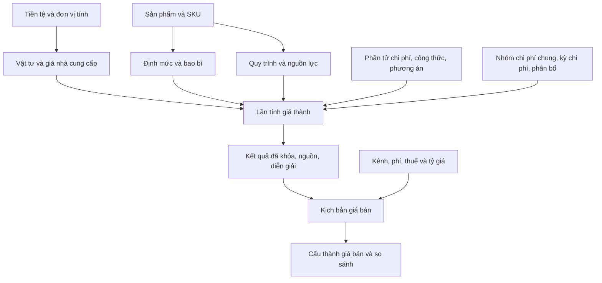

# 01. Tổng quan hệ thống

## 1. Phần mềm giúp quyết định điều gì?

**[HỆ THỐNG HIỆN TẠI]** Phần mềm trả lời hai câu hỏi: sản xuất một lượng hàng xác định tốn bao nhiêu, và phải bán một đơn vị hàng với giá bao nhiêu để đạt mục tiêu lợi nhuận sau các khoản phí và thuế đã cấu hình. Nó còn giữ lại nguồn và cách tính để người dùng giải thích con số về sau.

Ví dụ: mua cà phê theo kg, định mức dùng gam, đóng gói theo hộp, máy và nhân công tính theo giờ. Phần mềm nối các thông tin đó trong một **Lần tính giá thành**. Sau đó **Kịch bản giá bán** lấy giá thành đơn vị đã lưu để tính theo kênh bán cụ thể.

Không dùng kết quả này thay sổ kế toán, chứng từ mua hàng, quản lý tồn kho thực tế hoặc nghĩa vụ thuế. Hệ thống hiện quản lý cấu hình và tính theo dữ liệu được cung cấp; không tự thu thập tiêu hao thực tế từ nhà máy hoặc đối soát sàn thương mại.

## 2. Bức tranh nghiệp vụ

Sơ đồ là luồng nghiệp vụ, không khẳng định mỗi mũi tên là một khóa liên kết database. Quan hệ bắt buộc và quan hệ chỉ phát sinh khi tính được phân biệt tại [ma trận phụ thuộc](13_DEPENDENCY_MATRIX.md).

## 3. Phân biệt những khái niệm dễ nhầm

| Khái niệm | Hiểu đơn giản | Ví dụ |
|---|---|---|
| Vật tư / Hàng hóa (Item) | Thứ mua hoặc tiêu hao; có thể là nguyên liệu, bao bì, bán thành phẩm, thành phẩm hoặc dịch vụ | Cà phê hòa tan, đường, túi, hộp giấy |
| Sản phẩm (Product) | Sản phẩm nghiệp vụ gốc | Cappuccino |
| SKU | Mã sản phẩm cụ thể/quy cách bán | Cappuccino hộp 20 gói |
| BOM / Công thức sản xuất | Thành phần và lượng đầu vào cho sản lượng chuẩn | 200 g cà phê + 300 g đường cho 1 hộp trong mẫu |
| Cấu hình bao bì | Thành phần đóng gói, gán SKU bằng liên kết riêng | 20 túi + 1 hộp |
| Quy trình sản xuất | Thứ tự công đoạn, nơi làm và nguồn lực chính | Phối trộn → đóng gói |
| Phần tử chi phí | Tên biến nghiệp vụ có kiểu giá trị | Chi phí nguyên liệu, tổng giá thành |
| Công thức tính | Quan hệ giữa các biến | Nguyên liệu + bao bì + nguồn lực |
| Nhóm chi phí chung | Nhóm chi phí gián tiếp có số liệu theo kỳ | Chi phí chung nhà máy |
| Phương án tính giá thành | Bản cấu hình các dòng và nguồn/công thức cần chạy | Phương án giá thành Cappuccino |
| Lần tính giá thành | Một lần thực thi với ngày, lượng, đơn vị và phương án cụ thể | 10 hộp ngày 07/10/2026 |
| Kịch bản giá bán | Một phép định giá từ giá thành đã lưu và chính sách kênh | Bán trực tiếp, margin 20% |

**Product không phải Item.** Source không có thao tác tự biến Product thành Item. BOM và Routing gắn Product; bao bì gắn Product và được liên kết với SKU. Không có BOM riêng theo SKU bằng cách chỉ đổi bộ lọc SKU.

## 4. Trình tự làm việc hàng ngày

1. Kiểm tra ngày cần tính và nguồn giá/rate/phiên bản tương ứng.
2. Xác định đúng Product/SKU và lượng đầu ra; chọn đúng đơn vị, không mặc định mọi lượng đều là kg.
3. Vào **TỔNG QUAN → Lần tính giá thành**, tạo và chạy.
4. Đọc tổng, giá thành đơn vị và từng dòng; mở diễn giải nếu con số bất thường.
5. Vào **GIÁ BÁN → Kịch bản giá bán**, chọn đúng nguồn đã khóa.
6. Nhập một mục tiêu định giá, kênh, ngày và chính sách thuế/tỷ giá; lưu Nháp rồi **Tính giá bán**.
7. Xem **Cấu thành giá bán**, lưu ý giá khách trả, phí, thuế, giá vốn và lợi nhuận.
8. Khi cần quyết định giữa nhiều cách bán, dùng **So sánh kịch bản**.

Kết quả hợp lệ phải có trạng thái hoàn tất, nguồn rõ, đơn vị rõ và số liệu đối chiếu được. Chỉ thấy bản ghi trong danh sách chưa có nghĩa đã có kết quả.

## 5. Cách sử dụng giao diện chung

- **Tìm kiếm** lọc phía máy chủ. Danh mục hỗ trợ những cột tìm kiếm riêng, không phải tìm mọi nội dung mọi trang.
- **Bộ lọc**, **Sắp xếp**, số dòng **25/50/100** và chuyển trang giữ trạng thái trong URL. Có thể đánh dấu trang trình duyệt để quay lại bộ lọc.
- Sau khoảng 400 ms dừng gõ, danh sách có thể tự cập nhật. Khi tải, chờ chỉ báo hoàn tất trước khi thao tác tiếp.
- **Đặt lại** bỏ điều kiện đang chọn. Danh sách rỗng có thể do bộ lọc, không nhất thiết database không có dữ liệu.
- **Thêm mới**, **Chỉnh sửa**, **Xem chi tiết** có nhãn cụ thể theo màn hình; hướng dẫn từng module ghi đúng tên nút.
- Khi lưu sai, dữ liệu còn trên form và lỗi nằm gần trường hoặc đầu form. Sửa lỗi rồi gửi lại; không tạo bản ghi khác chỉ để tránh lỗi.
- Thông báo ngắn sau lưu xác nhận thao tác, không thay thế trạng thái của nguồn dữ liệu hoặc kết quả tính.
- Form thành phần có thể mở trong hộp thoại/ngăn bên; đóng bằng nút đóng hoặc Escape khi có hỗ trợ. Các trang vẫn có đường dẫn đầy đủ khi mở trực tiếp.
- Màn hình nhỏ có bảng cuộn ngang; dùng máy tính để cấu hình công thức/phương án nhiều trường.

Nếu gặp thông báo CSRF/hết hạn yêu cầu, tải lại trang rồi gửi lại. Đây là kiểm tra hợp lệ của biểu mẫu, không phải yêu cầu đăng nhập.

## 6. Phiên bản, thời gian và lịch sử

**Phiên bản** là một bản định nghĩa. Bản mới nhất có thể còn Nháp và không được dùng khi chạy giá thành. Không suy ra “số phiên bản lớn nhất” là “đang hiệu lực”.

**Ngày hiệu lực** xác định nguồn được dùng tại ngày tính. Với Costing hiện tại, ngày kết thúc vẫn được tính; với Pricing, mốc kết thúc không được tính. Ví dụ nguồn Costing cũ đến 31/10, nguồn mới từ 01/11; quy tắc Pricing cũ đến 01/11, quy tắc mới từ 01/11.

**Bản chụp dữ liệu (snapshot)** lưu nguồn đã dùng. **Diễn giải (trace)** ghi các bước và số trung gian. **Dấu vân tay (hash)** giúp phát hiện dữ liệu lưu bị thay đổi. Người dùng không cần tự nhập ba thông tin này.

Mở lại kết quả đã lưu không tính lại theo giá hôm nay. **Chạy lại**/nhân bản tạo lần tính hoặc kịch bản mới. Nó có thể cho số khác khi nguồn hiện tại thay đổi, kể cả nhập lại cùng ngày. “Đọc lại lịch sử” và “tính lại với nguồn hiện tại” là hai việc khác nhau.

## 7. Cách học phù hợp vai trò

| Người đọc | Thứ tự nên học | Đầu ra cần đạt |
|---|---|---|
| Nhập liệu/mua hàng | 01 → 03 → 04 → 12 → 10 | Tạo đúng danh mục và giá mua; hiểu trạng thái/hiệu lực |
| Sản xuất | 01 → 05 → 09 → 13 | Lập định mức, bao bì, công đoạn và nhận biết nguồn chưa dùng được |
| Kế toán giá thành | 01 → 06 → 09 → 10 → 08 | Chạy và đối chiếu từng lớp chi phí |
| Kinh doanh | 01 → 07 → 09 → 08 | Phân biệt margin/markup, phí/thuế, so sánh kênh |
| Quản lý | 01 → 02 → 14 → 07 → 08 | Hiểu khả năng, giới hạn và cơ sở quyết định |

**Bài kiểm tra đầu tiên:** giải thích được vì sao tổng giá thành 583.000 VND của 10 hộp khác giá khách trả 89.972,41379310 VND cho **một** hộp. Nếu chưa rõ, làm chương 09 trước khi lập dữ liệu thật.

## 8. Có thể áp dụng ngoài ngành cà phê đến đâu?

**[VÍ DỤ NGHIỆP VỤ]** Cà phê là bộ mẫu để học, không phải giới hạn của tên danh mục. Tuy nhiên khả năng tính một cấu hình không đồng nghĩa có bộ quản trị chuyên ngành đầy đủ. Bảng dưới đánh giá đúng phạm vi nêu tại từng dòng; không xác nhận doanh nghiệp ngành đó đã được nghiệm thu trên hệ thống.

| Ngành / mô hình | Phạm vi có thể áp dụng | Support Level | Cần cấu hình | Phần chưa đáp ứng |
|---|---|---|---|---|
| Thực phẩm | Giá thành công thức một cấp, lượng đầu ra chuẩn, thu hồi/hao hụt đã xác định | PARTIAL | Item/giá mua/BOM/bao bì/quy trình/phương án; nguồn hiệu lực | Chưa quản lý lô, hạn dùng, dị ứng, kiểm nghiệm, đồng sản phẩm hoặc tiêu hao thực tế |
| Đồ uống | Phối trộn và đóng gói theo một cơ sở sản lượng rõ ràng | PARTIAL | Đơn vị và quy đổi có căn cứ; BOM/Product, bao bì/SKU, nguồn lực | Không tự suy ra kg↔lít từ tên sản phẩm, không tự xử lý mật độ/nhiệt độ hay kiểm soát chất lượng |
| Nông sản | Định mức sơ chế/đóng gói với hệ số thu hồi đã biết | PARTIAL | Lượng đầu ra, yield/scrap, giá nguồn, thời gian công đoạn | Chưa có phân hạng, độ ẩm, mùa vụ, truy xuất vùng trồng hoặc phân bổ phụ phẩm tự động |
| Sản xuất đóng gói | Tính định mức phẳng, bao bì SKU và thời gian nguồn lực chính theo lô | NATIVE | Chuỗi BOM/bao bì/quy trình/giá/rate/phương án hợp lệ, cơ sở đóng gói nhập trên Run | Chuẩn bị hiệu lực upstream còn thiếu UI; chưa tự mở rộng cây bao bì hoặc lập lịch công suất hữu hạn |
| Gia công | Chi phí nguồn lực hoặc tổng phí gia công đã xác định đúng phạm vi sản xuất | CONFIGURABLE | Resource/rate/time hoặc CE MONEY/MANUAL và Formula đầu ra có test | Không quản lý hợp đồng gia công, vật tư khách giao, đơn sản xuất hay hóa đơn dịch vụ |
| Hàng thương mại | Quản lý Item/giá mua, cấu hình kênh/giả định giá bán | PARTIAL | Danh mục và chính sách; Pricing chỉ nhận Run LOCKED hợp lệ đã có | Chưa có nguồn giá vốn thương mại riêng, giao dịch kho/FIFO/bình quân. Không đổi scope giả thành MANUFACTURING để tạo Run |
| Logistics | Ghi tổng chi phí đã tính ngoài vào đúng phạm vi hoặc phí bán đã quy về đơn vị | PARTIAL | Tổng tiền có căn cứ; MANUAL sản xuất hoặc Fee cố định trên đơn vị khi đúng nghiệp vụ | Không hãng/tuyến/tariff/khối lượng tính cước/phân bổ chuyến/engine COST_TO_SERVE |
| Xuất khẩu | Định giá ngoại tệ, phí/thuế phù hợp contract hiện tại | PARTIAL | Run hợp lệ, Currency, FX đúng chiều/loại/thời điểm, Channel, Fee/Tax | Không Incoterms, tờ khai, landed cost, thuế hải quan hoặc bảo hiểm tự tính |
| Marketplace | Giá mục tiêu sau phí phần trăm/cố định/sàn/trần và thuế | PARTIAL | Kênh, phí LIST_PRICE đã gồm thuế/refund 0, thuế và mục tiêu | Chưa lấy biểu phí từ sàn, phí trên đơn hàng, hoàn hàng, thanh toán đối soát hoặc khuyến mại tự động |
| Phân phối | Kịch bản riêng cho từng kênh với margin/markup và phí khác nhau | PARTIAL | Các kênh, nguồn giá vốn hợp lệ, chính sách phí/thuế, Scenario | Không hợp đồng từng đại lý, công nợ, chiết khấu doanh số tích lũy hoặc lượng đơn bán |
| Bán buôn / bán lẻ | So sánh mục tiêu giá theo các kênh trên cùng SKU/cơ sở | PARTIAL | Scenario đã tính và nguồn giá vốn tương thích | Không POS/đơn bán/tier tự chọn/giá nhập tay; Comparison không chuẩn hóa SKU khác quy cách |

Đọc [ma trận năng lực chi tiết](14_BUSINESS_CAPABILITY_MATRIX.md) để tách phần bộ tính thực thi khỏi phần cần chuẩn bị thủ công. Với ngành mới, thử một cấu hình nhỏ, đối chiếu bằng tay và đọc trace trước khi dùng cho quyết định.

Nguồn: [navigation](../../apps/master_data/navigation.py), [model](../../apps/core/models.py), [Costing runner](../../apps/costing/engine/runner.py), [Pricing runner](../../apps/pricing/engine/runner.py), [so sánh](../../apps/pricing/comparison.py). Phạm vi và giới hạn chi tiết: [GAP_REGISTER](GAP_REGISTER.md).
