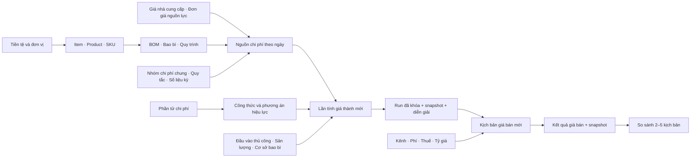

# 02. Bản đồ chức năng và nghiệp vụ

**[HỆ THỐNG HIỆN TẠI] — kiểm chứng ngày 09/10/2026.** Dùng chương này để tìm đúng nơi nhập dữ liệu, chạy tính, xem kết quả và tra nguồn. Chi tiết từng trường nằm ở [Field Reference](12_FIELD_REFERENCE.md); điều kiện có trước và ảnh hưởng khi sửa nằm ở [Ma trận phụ thuộc](13_DEPENDENCY_MATRIX.md).

## 1. Tìm chức năng trên thanh bên

Thanh bên có **28 mục trong 5 nhóm**. Một mục có thể mở nhiều màn hình tạo, sửa, chi tiết, phiên bản hoặc bảng con. Mục “Lần tính giá thành” là nơi làm việc với kết quả tính; các mục còn lại chuẩn bị dữ liệu hoặc tính giá bán.

| STT | Nhóm → đúng tên menu | Nhập hoặc xem gì? | Đầu ra dùng ở đâu? | Hướng dẫn |
|---|---|---|---|---|
| 1 | TỔNG QUAN → Lần tính giá thành | Chọn sản phẩm/SKU, phương án, ngày, sản lượng, cơ sở bao bì và đầu vào thủ công; xem kết quả từng lần | Giá vốn đầu vào cho kịch bản giá bán; đối soát nguồn và diễn giải | [06](06_HUONG_DAN_FORMULA_VA_COSTING.md) |
| 2 | DỮ LIỆU DANH MỤC → Phần tử chi phí | Từ điển biến chi phí: mã, kiểu giá trị, đơn vị, tiền tệ, cách cấp nguồn | Công thức, thành phần phương án, dòng kết quả | [04](04_HUONG_DAN_DANH_MUC.md) |
| 3 | DỮ LIỆU DANH MỤC → Nhóm sản phẩm | Danh sách nhóm dùng chung cho Item và Product | Phân loại; phạm vi phí theo nhóm Product | [04](04_HUONG_DAN_DANH_MUC.md) |
| 4 | DỮ LIỆU DANH MỤC → Vật tư / Hàng hóa | Nguyên liệu, bao bì, bán thành phẩm, hàng hóa; đơn vị và số đo | Giá nhà cung cấp, BOM, bao bì, liên kết Item đầu ra/Item bán | [04](04_HUONG_DAN_DANH_MUC.md) |
| 5 | DỮ LIỆU DANH MỤC → Sản phẩm | Đối tượng sản xuất và đơn vị tính giá thành | SKU, BOM, bao bì, quy trình, lần tính | [04](04_HUONG_DAN_DANH_MUC.md) |
| 6 | DỮ LIỆU DANH MỤC → SKU | Biến thể/quy cách bán, lượng tịnh và đơn vị | Gán bao bì, chạy tính, phí riêng SKU, định giá và so sánh | [04](04_HUONG_DAN_DANH_MUC.md) |
| 7 | DỮ LIỆU DANH MỤC → Tiền tệ | Mã tiền, tên, số chữ số lẻ, trạng thái hoạt động | Giá mua, chi phí, phí/thuế, tỷ giá, kết quả tiền | [04](04_HUONG_DAN_DANH_MUC.md) |
| 8 | DỮ LIỆU DANH MỤC → Nhóm đơn vị tính | Nhóm đại lượng như khối lượng, thời gian, số lượng | Phân loại đơn vị và kiểm tra đại lượng | [04](04_HUONG_DAN_DANH_MUC.md) |
| 9 | DỮ LIỆU DANH MỤC → Đơn vị tính | kg, g, giờ, phút, hộp… với nhóm và độ chính xác | Tất cả dữ liệu lượng, định mức, đơn giá, đầu ra | [04](04_HUONG_DAN_DANH_MUC.md) |
| 10 | DỮ LIỆU DANH MỤC → Quy đổi đơn vị tính | Cặp đơn vị, hệ số, Item riêng nếu cần, kỳ áp dụng | Đổi lượng/giá/thời gian khi tính; kiểm tra dòng nguồn | [04](04_HUONG_DAN_DANH_MUC.md) |
| 11 | DỮ LIỆU DANH MỤC → Nhà cung cấp | Mã, tên, thông tin, tiền tệ mặc định | Giá nhà cung cấp | [04](04_HUONG_DAN_DANH_MUC.md) |
| 12 | DỮ LIỆU DANH MỤC → Giá nhà cung cấp | Item, nhà cung cấp, đơn giá, đơn vị giá, ngưỡng lượng, thuế và kỳ | Chi phí nguyên liệu/bao bì khi nguồn đủ điều kiện | [04](04_HUONG_DAN_DANH_MUC.md) |
| 13 | SẢN XUẤT → BOM / Công thức sản xuất | Định mức nguyên liệu theo Product; phiên bản, đầu ra, yield/scrap, dòng vật tư | Nguồn `MATERIAL_COST` | [05](05_HUONG_DAN_SAN_XUAT.md) |
| 14 | SẢN XUẤT → Cấu hình bao bì | Phiên bản bao bì, vật tư/cấp đóng gói và liên kết SKU theo kỳ | Nguồn `PACKAGING_COST` theo cơ sở người chạy nhập | [05](05_HUONG_DAN_SAN_XUAT.md) |
| 15 | SẢN XUẤT → Trung tâm sản xuất | Đơn vị tổ chức sản xuất, đơn vị/công suất tham chiếu | Nguồn lực và công đoạn quy trình | [05](05_HUONG_DAN_SAN_XUAT.md) |
| 16 | SẢN XUẤT → Nguồn lực | Máy, nhân công, trung tâm hoặc dịch vụ; đơn vị công suất | Đơn giá nguồn lực, nguồn lực chính của công đoạn | [05](05_HUONG_DAN_SAN_XUAT.md) |
| 17 | SẢN XUẤT → Đơn giá nguồn lực | Giá, tiền tệ, đơn vị cơ sở, loại đơn giá, kỳ | Nguồn `RESOURCE_COST` | [05](05_HUONG_DAN_SAN_XUAT.md) |
| 18 | SẢN XUẤT → Quy trình sản xuất | Phiên bản, cỡ mẻ, công đoạn, thời gian chuẩn bị/chạy và nguồn lực | Lượng thời gian × đơn giá nguồn lực | [05](05_HUONG_DAN_SAN_XUAT.md) |
| 19 | SẢN XUẤT → Nhóm chi phí chung | Từ điển nhóm chi phí cần phân bổ | Quy tắc phân bổ; số liệu chi phí theo kỳ do người phụ trách chuẩn bị | [05](05_HUONG_DAN_SAN_XUAT.md) |
| 20 | SẢN XUẤT → Quy tắc phân bổ | Nhóm chi phí, driver, phương pháp, đơn vị, kỳ | Nguồn `ALLOCATION:<mã quy tắc>` | [05](05_HUONG_DAN_SAN_XUAT.md) |
| 21 | CÔNG THỨC & QUY TẮC → Thiết lập công thức | Biểu thức, phần tử đầu ra, phiên bản, kiểm thử, kích hoạt | Nguồn FORMULA của phương án hoặc công thức khác | [06](06_HUONG_DAN_FORMULA_VA_COSTING.md) |
| 22 | CÔNG THỨC & QUY TẮC → Phương án tính giá thành | Tập hợp thành phần, nguồn SYSTEM/MANUAL/FORMULA, kết quả và phiên bản | Chọn cấu hình cho lần tính giá thành | [06](06_HUONG_DAN_FORMULA_VA_COSTING.md) |
| 23 | GIÁ BÁN → Kênh bán | Kênh, loại, nền tảng, thị trường, tiền tệ/khu vực mặc định | Phí kênh và kịch bản giá bán | [07](07_HUONG_DAN_PRICING.md) |
| 24 | GIÁ BÁN → Quy tắc phí kênh | Loại/cơ sở phí, tỷ lệ/tiền cố định, sàn/trần, phạm vi và kỳ | Khoản trừ khi giải giá bán | [07](07_HUONG_DAN_PRICING.md) |
| 25 | GIÁ BÁN → Quy tắc thuế | Loại/cơ sở thuế, tỷ lệ/tiền, cách gồm thuế, phạm vi và kỳ | Thuế trong kịch bản giá bán | [07](07_HUONG_DAN_PRICING.md) |
| 26 | GIÁ BÁN → Tỷ giá | Tiền nguồn → đích, tỷ giá, loại và thời điểm | Đổi tiền giá vốn/phí/thuế của Pricing | [07](07_HUONG_DAN_PRICING.md) |
| 27 | GIÁ BÁN → Kịch bản giá bán | Run đã khóa, kênh/ngày, mục tiêu margin/markup/lãi tiền, giá sàn | Giá bán, lợi nhuận, bảng phân rã và nguồn đã lưu | [07](07_HUONG_DAN_PRICING.md) |
| 28 | GIÁ BÁN → So sánh kịch bản | Chọn 2–5 kịch bản đã tính có cơ sở tương thích | Bảng so sánh, chênh lệch và diễn giải từ snapshot | [07](07_HUONG_DAN_PRICING.md) |

Nguồn tên/menu: [navigation.py](../../apps/master_data/navigation.py). Không có menu riêng cho nhập kho, đơn mua, đơn bán, khấu hao tài sản, bảng giá khách hàng, khuyến mại, số liệu kỳ chi phí chung hoặc nhóm phần tử chi phí. Xem [Giới hạn hiện tại](GAP_REGISTER.md) trước khi coi các nội dung đó là chức năng có sẵn.

## 2. Dữ liệu đi qua hệ thống như thế nào?

Luồng chuẩn gồm bốn việc: chuẩn bị danh mục; chuẩn bị nguồn/cấu hình đủ hiệu lực; chạy Costing và kiểm tra nguồn; dùng **Run đã khóa** để tính Pricing. Formula là phép tính trên biến; Scheme chỉ định biến lấy từ đâu và kết quả nào cần dùng. Pricing không tự chạy lại Costing.

**Điểm dừng thực tế:** UI lưu giá nhà cung cấp/đơn giá nguồn lực và các phiên bản sản xuất mới ở Nháp, nhưng chưa có thao tác đưa những nguồn này vào hiệu lực; số liệu kỳ/công suất chi phí chung chưa có màn hình nhập. Vì vậy không thể hoàn thành toàn bộ luồng từ database rỗng chỉ bằng giao diện. Người dùng làm việc với nguồn hợp lệ đã được người phụ trách chuẩn bị; không tự sửa trạng thái trong database. Xem [Thứ tự khởi tạo](03_THU_TU_KHOI_TAO_DU_LIEU.md).

| Công việc của bộ phận | Điểm vào | Kết quả cần bàn giao |
|---|---|---|
| Mua hàng chuẩn bị giá | Vật tư / Hàng hóa → Nhà cung cấp → Giá nhà cung cấp | Đơn vị/tiền tệ/ngày/ngưỡng đúng; nguồn đủ điều kiện; tránh trùng |
| Sản xuất chuẩn bị định mức | BOM / Công thức sản xuất → Cấu hình bao bì → Quy trình sản xuất | Product/SKU, đầu ra, lượng, yield/scrap, thời gian và phiên bản đúng kỳ |
| Kế toán xây cấu trúc giá thành | Phần tử chi phí → Thiết lập công thức → Phương án tính giá thành | Biến, công thức kiểm thử được, phương án kiểm tra/kích hoạt được |
| Kế toán tính/đối soát | Lần tính giá thành | Tổng giá thành, giá thành đơn vị, nguồn, lỗi/cảnh báo, Run đã khóa |
| Kinh doanh định giá | Kênh bán → Phí/Thuế/Tỷ giá → Kịch bản giá bán | Giá đáp ứng mục tiêu, cấu phần phí/thuế/lãi, nguồn đã lưu |
| Người phân tích so phương án | So sánh kịch bản | 2–5 kết quả tương thích; chênh lệch theo mốc và lý do |

Đây là phân công nghiệp vụ đề nghị, không phải cơ chế quyền trên giao diện.

## 3. Những nhóm màn hình và thao tác thực sự có

Các danh sách có tìm kiếm/lọc, sắp xếp và phân trang theo từng module. Nhấp mã/tên hoặc **Xem chi tiết** để mở bản ghi; dùng **Chỉnh sửa** khi được phép. Thay bộ lọc hoặc số dòng chỉ đổi cách xem, không đổi bản ghi. Các bảng con ở màn hình chi tiết cũng có phân trang riêng. Tên chính xác từng trường lọc nằm tại [Field Reference](12_FIELD_REFERENCE.md).

| Nhóm màn hình | Màn hình/form mở được | Thao tác và kết quả |
|---|---|---|
| 11 danh mục nền | Danh sách, tạo, chi tiết, sửa cho từng menu 2–12 | **+ Thêm mới**, **Chỉnh sửa**, nút Lưu của loại bản ghi, **Hủy**; lưu không tạo version. Không có xóa cứng danh mục |
| BOM | Danh sách; tạo thông tin + phiên bản đầu; sửa thông tin; chi tiết/latest; lịch sử; tạo/sửa/chi tiết phiên bản; thêm/sửa/xóa dòng | **+ Thêm thành phần**, **Lưu thành phần**, **Xóa → Xác nhận xóa**. Sao chép từ phiên bản bằng liên kết tạo mới, không sửa phiên bản khóa |
| Bao bì | Các màn hình header/version/dòng như BOM; thêm danh sách và tạo/sửa liên kết SKU | **Lưu thành phần bao bì**; liên kết SKU có kỳ và cờ cấu hình chính. Không có xóa liên kết hoặc xóa header/version |
| Trung tâm/Nguồn lực/Đơn giá | Danh sách, tạo, chi tiết, sửa; chi tiết nguồn lực có bảng lịch sử đơn giá | Lưu thông tin/đơn giá. Nguồn lực thuộc trung tâm tùy chọn; đơn giá mới Nháp; không có nút kích hoạt đơn giá |
| Quy trình | Header/version như BOM; thêm/sửa/xóa công đoạn | **+ Thêm công đoạn**, **Lưu công đoạn**, **Xác nhận xóa**; đổi trung tâm tải lại lựa chọn nguồn lực chính |
| Nhóm chi phí chung/Phân bổ | Danh sách, tạo, chi tiết, sửa; chi tiết nhóm có các quy tắc liên quan | Lưu nhóm/quy tắc; không có màn hình “dòng chi phí của nhóm” hoặc “nhập số liệu kỳ” |
| Formula Studio | Danh sách; tạo header + biểu thức đầu; sửa header; tạo/sửa version; chi tiết/latest và lịch sử | **Kiểm tra công thức**, **Kiểm thử**, **Lưu công thức**; kiểm tra/kiểm thử không tự lưu biểu thức |
| Kiểm thử và kích hoạt Formula | Bảng nhập biến động; kết quả; bộ kiểm thử đã lưu; hộp xác nhận | **Lưu bộ kiểm thử**, **Chạy bộ kiểm thử đã lưu**, **Ngừng sử dụng**; **Kích hoạt phiên bản → Xác nhận kích hoạt** kiểm tra lại và khóa version |
| Scheme | Header/version/lịch sử; dòng cấu hình; báo cáo kiểm tra | **+ Thêm phương án**, **+ Thêm thành phần**, **Lưu thành phần**, **Kiểm tra cấu hình**, **Kích hoạt phiên bản → Xác nhận kích hoạt** |
| Run | Danh sách; form chạy mới; kết quả; bảng dòng; diễn giải từng dòng; dữ liệu/phiên bản đã dùng; form chạy lại | **+ Chạy tính giá**, **Chạy tính giá**, **Nguồn dữ liệu / Diễn giải**, **Xem dữ liệu và phiên bản đã sử dụng**, **Tạo lần tính mới**. Chạy lại tạo Run khác |
| Kênh và Pricing Foundation | Kênh: danh sách/tạo/chi tiết/sửa. Phí, thuế, FX: thêm form đóng kỳ | **+ Thêm mới**, các nút Lưu; **Kết thúc hiệu lực** chỉ đóng kỳ đủ điều kiện, không sửa định nghĩa đã chốt |
| Kịch bản giá bán | Danh sách; tạo/sửa Nháp; chi tiết kết quả và nguồn; form nhân bản | **Lưu Nháp**, **Tính giá bán**, **Nhân bản thành kịch bản mới**. Kết quả CALCULATED chỉ đọc |
| So sánh | Danh sách chọn kết quả; bảng so; phần nguồn/diễn giải từng kịch bản | **So sánh kịch bản**, **Bỏ chọn**, **Xem nguồn và diễn giải kịch bản**. Chọn 2–5; không tạo bản ghi so sánh |

Các form thêm/sửa dòng có thể hiện ngay trong chi tiết bằng khung nhỏ. Mở trực tiếp cùng URL có thể thành trang đầy đủ; đây là hai cách trình bày của cùng thao tác. **Xóa** chỉ xuất hiện cho dòng BOM/bao bì/công đoạn/thành phần Scheme trong phiên bản còn sửa được, và phải xác nhận. Không suy ra quyền xóa các đối tượng khác từ nút này.

### 3.1. Phiên bản, ngày hiệu lực và kết quả lịch sử

| Đối tượng | Có version riêng? | Có thể chỉnh gì? | Đổi để dùng lần sau |
|---|---|---|---|
| Danh mục, giá mua, đơn giá nguồn lực, phân bổ | Không | Form sửa cập nhật bản ghi đó; việc sửa không tự sinh lịch sử version | Kiểm tra ngày và tránh nguồn trùng; với dữ liệu giá cần giữ bản kỳ cũ theo chính sách doanh nghiệp |
| BOM, bao bì, quy trình | Có | DRAFT/IN_REVIEW sửa được; APPROVED/EFFECTIVE/RETIRED khóa | Tạo/sao chép phiên bản Nháp; UI chưa có thao tác đưa vào hiệu lực |
| Formula, Scheme | Có | Nháp/còn sửa được; sau kích hoạt khóa nội dung version | Tạo phiên bản mới, kiểm tra/kiểm thử, kích hoạt qua UI |
| Phí, thuế, FX | Không có bảng version | Chỉ định nghĩa Nháp; bản đã chốt chỉ đọc; có đóng kỳ riêng | Đóng kỳ tương lai khi được phép, thêm bản mới đúng thời điểm |
| Costing Run | Mỗi Run là kết quả riêng | Không sửa kết quả đã lưu | **Tạo lần tính mới**, xem lại đầu vào và tính bằng nguồn hiện tại đúng ngày chọn |
| Price Scenario | Không có version riêng | Nháp sửa được; đã tính chỉ đọc | **Nhân bản thành kịch bản mới**, đổi Run/mục tiêu/kênh/ngày rồi tính |

Chi tiết header thường hiển thị **phiên bản mới nhất**. Điều đó không khẳng định phiên bản ấy là nguồn hiệu lực được chọn cho ngày chạy. Trạng thái bản ghi và nhãn hiệu lực theo ngày cũng là hai thông tin riêng. Quy ước ngày của Costing upstream gồm ngày cuối; phí/thuế/FX Pricing dùng khoảng bắt đầu gồm, kết thúc không gồm. Xem câu hỏi tương ứng ở [FAQ](11_FAQ_VA_GLOSSARY.md).

### 3.2. Tác vụ có chung địa chỉ hoặc không có địa chỉ riêng

- Form tạo/sửa: GET mở form, POST gửi cùng địa chỉ. Không có thêm một route “save” cho mỗi nút Lưu.
- Formula Studio: trường `action` phân biệt kiểm tra, kiểm thử và lưu trên cùng route. Trang version và `/test/` dùng cùng phần chi tiết/kiểm thử; `/test/` không phải một thiết kế màn hình độc lập.
- Bộ kiểm thử: **Lưu bộ kiểm thử** và **Chạy bộ kiểm thử đã lưu** gửi vào route chi tiết version hoặc route `/test/`; **Ngừng sử dụng** có route POST riêng.
- Sao chép phiên bản sản xuất: dùng route tạo phiên bản với `?source=<id phiên bản>`. Nhân bản Scenario: dùng route tạo với `?source=<id kịch bản>`. Không có route “clone” riêng.
- Kiểm tra Scheme: GET chỉ xem báo cáo; kích hoạt có POST riêng. Kiểm tra cấu hình không chạy lấy giá mua/đơn giá và không tạo Run.
- Lọc/sắp xếp/phân trang, mở nguồn/diễn giải Scenario và chọn kịch bản so sánh dùng query trên địa chỉ xem hiện có. Không có bản ghi “lịch sử so sánh” mới.

## 4. Khi bấm một nút, dữ liệu được xử lý ở đâu?

Phần này giúp người vận hành mô tả sự cố cho người hỗ trợ. Người dùng chỉ cần bấm nút trên giao diện; không phải gọi những hàm trong bảng. “Đọc” lấy dữ liệu để trình bày; “Lưu” kiểm tra rồi ghi; “Tính” chạy bộ tính và lưu kết quả/nguồn.

| Thao tác nghiệp vụ | Chuỗi xử lý và kết quả | Nguồn kiểm chứng |
|---|---|---|
| Xem danh sách/chi tiết | View nhận bộ lọc → selector lấy đúng dữ liệu → template dựng bảng/chi tiết; không tính lại số lịch sử | [Danh mục](../../apps/master_data/views.py), [sản phẩm](../../apps/product/views.py), [selector Run](../../apps/costing/run_selectors.py) |
| Lưu danh mục | Form kiểm tra kiểu/tham chiếu → validator kiểm tra nghiệp vụ → `save_cost_element`, `save_currency`, `save_uom_category`, `save_uom`, `save_uom_conversion`, `save_supplier`, `save_supplier_price` → mở chi tiết | [Forms](../../apps/master_data/forms.py), [services](../../apps/master_data/services.py) |
| Lưu Item/Product/SKU/nhóm | Form/validator → `save_category`, `save_item`, `save_product`, `save_sku`; không tự tạo nguồn sản xuất, giá, quy đổi hay Item liên quan | [Forms](../../apps/product/forms.py), [services](../../apps/product/services.py) |
| Lưu/sao chép BOM | `save_recipe`, `create_version`, `update_version`, `save_line`, `remove_line`; tạo/sao chép cấu hình và các dòng trong giao dịch | [views](../../apps/bom/views.py), [services](../../apps/bom/services.py) |
| Lưu/sao chép bao bì hoặc liên kết SKU | `save_config`, `create_version`, `update_version`, `save_line`, `remove_line`, `save_assignment`; liên kết SKU là dữ liệu riêng có ngày | [views](../../apps/bom/packaging_views.py), [services](../../apps/bom/packaging_services.py) |
| Lưu trung tâm/nguồn lực/đơn giá | `save_work_center`, `save_resource`, `save_resource_rate`; bảng lịch sử đơn giá chỉ đọc nguồn đã lưu | [views](../../apps/bom/resource_views.py), [services](../../apps/bom/resource_services.py) |
| Lưu/sao chép quy trình, công đoạn | `save_routing`, `create_version`, `update_version`, `save_operation`, `remove_operation`; options endpoint lọc nguồn lực theo trung tâm | [views](../../apps/bom/routing_views.py), [services](../../apps/bom/routing_services.py) |
| Lưu nhóm chi phí/quy tắc | `save_cost_pool`, `save_allocation_rule`; không tạo số liệu kỳ CostPoolPeriod | [views](../../apps/bom/overhead_views.py), [services](../../apps/bom/overhead_services.py) |
| Kiểm tra/kiểm thử Formula | Form dựng kế hoạch `build_plan` → kiểm tra cú pháp/kiểu/phụ thuộc → `plan.run` với biến nhập; so kết quả kỳ vọng nếu có | [views](../../apps/formula_engine/views.py), [engine](../../apps/formula_engine/engine.py) |
| Lưu/kích hoạt Formula | `save_formula`, `save_version`; `save_test_case`, `run_cases`, `deactivate_test_case` quản lý kiểm thử; `activate_version` kiểm tra lại và khóa | [services](../../apps/formula_engine/services.py) |
| Lưu/kiểm tra/kích hoạt Scheme | `save_scheme`, `save_version`, `save_line`, `remove_line`; báo cáo validation riêng; `activate_version` kiểm tra rồi chốt | [views](../../apps/costing/views.py), [services](../../apps/costing/services.py) |
| Chạy giá thành/chạy lại | `RunForm` → `create_run` → engine chọn nguồn theo ngày, tính Decimal → lưu Run/dòng/snapshot/diễn giải. Thành công LOCKED; lỗi FAILED có chẩn đoán | [views](../../apps/costing/run_views.py), [service](../../apps/costing/run_services.py), [engine](../../apps/costing/engine/runner.py) |
| Xem nguồn/diễn giải Run cũ | Selector đọc snapshot và trace đã lưu; không chọn lại giá hay công thức hiện tại | [views](../../apps/costing/run_views.py), [selectors](../../apps/costing/run_selectors.py) |
| Lưu/đóng kỳ Pricing Foundation | `save_channel`, `save_channel_fee_rule`, `save_tax_rule`, `save_fx_rate`; `close_period` chỉ thay mốc kết thúc hợp lệ | [views](../../apps/pricing/views.py), [services](../../apps/pricing/services.py) |
| Lưu/tính kịch bản giá bán | `save_scenario` lưu Nháp; `calculate_scenario` đọc Run khóa, chọn phí/thuế/FX, giải giá và lưu snapshot; lỗi giữ Nháp kèm chẩn đoán | [views](../../apps/pricing/scenario_views.py), [services](../../apps/pricing/scenario_services.py) |
| So sánh kịch bản | Selector kiểm tra 2–5 snapshot tương thích/hợp lệ → trình bày kết quả và chênh lệch; không gọi engine và không ghi bản so sánh | [views](../../apps/pricing/comparison_views.py), [selectors](../../apps/pricing/comparison_selectors.py) |

## 5. Kiểm kê form và hành động để tra cứu

Nguồn kiểm kê có **43 lớp form**. Trong đó 4 lớp dùng làm nền, không là màn hình độc lập; **39 lớp phục vụ form cụ thể**, gồm cả bộ kiểm thử và form đóng kỳ có trường tạo lúc chạy. Một lớp có thể dùng chung cho tạo/sửa, hoặc xuất hiện cùng lớp khác trên một trang. Vì vậy số lớp form, số form mở được và số ô người dùng thấy không phải cùng một số.

Số trường dưới đây là **trường khai báo cơ sở** tại source, có thể gồm trường ẩn và chưa gồm trường động. Không dùng số này để bỏ qua yêu cầu/điều kiện của trường trên form đang mở. Ví dụ Run có khóa chống gửi trùng ẩn và các biến MANUAL động; TestForm thêm đầu vào theo biểu thức; ClosePeriodForm thêm đúng một ngày hoặc thời điểm kết thúc. Field Reference mô tả trường, điều kiện tạo/sửa và ví dụ cụ thể.

<!-- FORM_INVENTORY_START -->

| STT | Form nghiệp vụ / lớp nguồn | Trường cơ sở | Xuất hiện và hành động | Source |
|---|---|---|---|---|
| 1 | BOM: thông tin định mức · `RecipeForm` | 5 | Tạo/sửa header; lúc tạo kèm RecipeVersionForm | [forms.py](../../apps/bom/forms.py#L27) |
| 2 | BOM: dòng nguyên liệu · `RecipeLineForm` | 9 | Thêm/sửa dòng ở version còn sửa được | [forms.py](../../apps/bom/forms.py#L86) |
| 3 | BOM: phiên bản · `RecipeVersionForm` | 6 | Tạo/sao chép/sửa version; kèm form header khi tạo BOM | [forms.py](../../apps/bom/forms.py#L54) |
| 4 | Quy tắc phân bổ · `AllocationRuleForm` | 9 | Tạo/sửa quy tắc | [overhead_forms.py](../../apps/bom/overhead_forms.py#L29) |
| 5 | Nhóm chi phí chung · `CostPoolForm` | 5 | Tạo/sửa nhóm; không nhập số liệu kỳ | [overhead_forms.py](../../apps/bom/overhead_forms.py#L12) |
| 6 | Bao bì: liên kết SKU · `PackagingAssignmentForm` | 4 | Tạo/sửa liên kết cấu hình với SKU theo kỳ | [packaging_forms.py](../../apps/bom/packaging_forms.py#L122) |
| 7 | Bao bì: thông tin cấu hình · `PackagingConfigForm` | 5 | Tạo/sửa header; lúc tạo kèm PackagingVersionForm | [packaging_forms.py](../../apps/bom/packaging_forms.py#L14) |
| 8 | Bao bì: dòng vật tư · `PackagingLineForm` | 10 | Thêm/sửa dòng ở version còn sửa được | [packaging_forms.py](../../apps/bom/packaging_forms.py#L76) |
| 9 | Bao bì: phiên bản · `PackagingVersionForm` | 9 | Tạo/sao chép/sửa version; kèm form header khi tạo | [packaging_forms.py](../../apps/bom/packaging_forms.py#L39) |
| 10 | Lớp nền sản xuất · `ProductionReferenceForm` | 0 | Lớp nền; không có màn hình độc lập | [resource_forms.py](../../apps/bom/resource_forms.py#L12) |
| 11 | Nguồn lực · `ResourceForm` | 7 | Tạo/sửa nguồn lực | [resource_forms.py](../../apps/bom/resource_forms.py#L50) |
| 12 | Đơn giá nguồn lực · `ResourceRateForm` | 8 | Tạo/sửa đơn giá | [resource_forms.py](../../apps/bom/resource_forms.py#L67) |
| 13 | Trung tâm sản xuất · `WorkCenterForm` | 7 | Tạo/sửa trung tâm | [resource_forms.py](../../apps/bom/resource_forms.py#L34) |
| 14 | Quy trình: thông tin chung · `RoutingForm` | 4 | Tạo/sửa header; lúc tạo kèm RoutingVersionForm | [routing_forms.py](../../apps/bom/routing_forms.py#L10) |
| 15 | Quy trình: công đoạn · `RoutingOperationForm` | 11 | Thêm/sửa công đoạn; nguồn lực phụ thuộc trung tâm | [routing_forms.py](../../apps/bom/routing_forms.py#L65) |
| 16 | Quy trình: phiên bản · `RoutingVersionForm` | 5 | Tạo/sao chép/sửa version; kèm form header khi tạo | [routing_forms.py](../../apps/bom/routing_forms.py#L34) |
| 17 | Phương án: thông tin chung · `SchemeForm` | 6 | Tạo/sửa header; lúc tạo kèm SchemeVersionForm | [forms.py](../../apps/costing/forms.py#L14) |
| 18 | Phương án: thành phần · `SchemeLineForm` | 18 | Thêm/sửa dòng; nguồn/biểu thức phụ thuộc cách cấp nguồn | [forms.py](../../apps/costing/forms.py#L62) |
| 19 | Phương án: phiên bản · `SchemeVersionForm` | 3 | Tạo/sao chép/sửa version; kèm form header khi tạo | [forms.py](../../apps/costing/forms.py#L37) |
| 20 | Lần tính giá thành · `RunForm` | 12 | Chạy mới/chạy lại; 12 trường cơ sở gồm khóa ẩn chống gửi trùng; cộng trường MANUAL động | [run_forms.py](../../apps/costing/run_forms.py#L11) |
| 21 | Công thức: thông tin chung · `FormulaForm` | 5 | Tạo/sửa header; lúc tạo kèm VersionForm | [forms.py](../../apps/formula_engine/forms.py#L22) |
| 22 | Công thức: kiểm thử · `TestForm` | 1 | 1 trường cơ sở test_name; thêm biến và expected theo biểu thức/kiểu đầu ra | [forms.py](../../apps/formula_engine/forms.py#L76) |
| 23 | Công thức: phiên bản biểu thức · `VersionForm` | 4 | Tạo/sửa/kiểm tra/kiểm thử biểu thức trong Studio | [forms.py](../../apps/formula_engine/forms.py#L45) |
| 24 | Phần tử chi phí · `CostElementForm` | 15 | Tạo/sửa từ điển biến | [forms.py](../../apps/master_data/forms.py#L40) |
| 25 | Tiền tệ · `CurrencyForm` | 4 | Tạo/sửa; mã bị khóa khi sửa | [forms.py](../../apps/master_data/forms.py#L145) |
| 26 | Lớp nền danh mục · `ReferenceDataForm` | 0 | Lớp nền; không có màn hình độc lập | [forms.py](../../apps/master_data/forms.py#L111) |
| 27 | Nhà cung cấp · `SupplierForm` | 6 | Tạo/sửa | [forms.py](../../apps/master_data/forms.py#L212) |
| 28 | Giá nhà cung cấp · `SupplierPriceForm` | 13 | Tạo/sửa; tạo Nháp, không có trường chuyển hiệu lực | [forms.py](../../apps/master_data/forms.py#L241) |
| 29 | Nhóm đơn vị tính · `UomCategoryForm` | 5 | Tạo/sửa | [forms.py](../../apps/master_data/forms.py#L162) |
| 30 | Quy đổi đơn vị tính · `UomConversionForm` | 7 | Tạo/sửa cặp hệ số theo kỳ | [forms.py](../../apps/master_data/forms.py#L188) |
| 31 | Đơn vị tính · `UomForm` | 7 | Tạo/sửa | [forms.py](../../apps/master_data/forms.py#L173) |
| 32 | Quy tắc phí kênh · `ChannelFeeRuleForm` | 17 | Tạo/sửa Nháp; trạng thái cho phép đưa hiệu lực qua validation | [forms.py](../../apps/pricing/forms.py#L85) |
| 33 | Kênh bán · `ChannelForm` | 8 | Tạo/sửa | [forms.py](../../apps/pricing/forms.py#L65) |
| 34 | Đóng kỳ phí/thuế/FX · `ClosePeriodForm` | 0 | Trường động effective_to (ngày hoặc thời điểm); dùng ở 3 route close | [forms.py](../../apps/pricing/forms.py#L131) |
| 35 | Lớp nền kỳ Pricing · `DatedRuleForm` | 6 | 6 trường dùng chung; lớp nền, không có màn hình độc lập | [forms.py](../../apps/pricing/forms.py#L76) |
| 36 | Tỷ giá · `FxRateForm` | 9 | Tạo/sửa Nháp; trạng thái cho phép đưa hiệu lực qua validation | [forms.py](../../apps/pricing/forms.py#L115) |
| 37 | Lớp nền Pricing · `PricingForm` | 0 | Lớp nền; không có màn hình độc lập | [forms.py](../../apps/pricing/forms.py#L20) |
| 38 | Quy tắc thuế · `TaxRuleForm` | 16 | Tạo/sửa Nháp; trạng thái cho phép đưa hiệu lực qua validation | [forms.py](../../apps/pricing/forms.py#L101) |
| 39 | Kịch bản giá bán · `ScenarioForm` | 19 | Tạo/nhân bản/sửa Nháp; chọn phương pháp quyết định mục tiêu cần nhập | [scenario_forms.py](../../apps/pricing/scenario_forms.py#L27) |
| 40 | Vật tư / Hàng hóa · `ItemForm` | 17 | Tạo/sửa; số đo quyết định yêu cầu đơn vị | [forms.py](../../apps/product/forms.py#L24) |
| 41 | Nhóm sản phẩm · `ProductCategoryForm` | 4 | Tạo/sửa nhóm phẳng | [forms.py](../../apps/product/forms.py#L10) |
| 42 | Sản phẩm · `ProductForm` | 8 | Tạo/sửa | [forms.py](../../apps/product/forms.py#L74) |
| 43 | SKU · `SkuForm` | 9 | Tạo/sửa quy cách bán | [forms.py](../../apps/product/forms.py#L107) |

<!-- FORM_INVENTORY_END -->

Hành động Lưu của từng form gửi vào route tạo/sửa tương ứng; **Hủy/Quay lại** chỉ điều hướng. Các hành động không có schema form riêng gồm: xác nhận xóa dòng; xác nhận kích hoạt Formula/Scheme; ngừng bộ kiểm thử; **Tính giá bán**; lọc/tìm/sắp xếp/phân trang; chọn/bỏ chọn kịch bản so sánh. Những hành động này vẫn được kiểm kê ở mục 3 và route bên dưới, không bị loại vì thiếu lớp form.

## 6. Phụ lục phủ toàn bộ địa chỉ và hành động

Đối chiếu [cấu hình URL gốc](../../config/urls.py) và URL/view của từng app, có **163 route**: **152 địa chỉ nghiệp vụ có thể nhận GET**, **4 endpoint cập nhật lựa chọn phụ thuộc**, **4 hành động chỉ POST**, **1 chuyển hướng trang đầu** và **2 đầu dò kỹ thuật**. Đây là số địa chỉ, **không phải 152 thiết kế màn hình khác nhau**. Nhóm 152 còn có catalogue token của Formula, vốn trả mảnh nội dung; các chi tiết header/version, form tạo/sửa và route `/test/` cũng tái sử dụng thiết kế.

GET là mở/xem; GET+POST là mở rồi gửi cùng địa chỉ; POST là thực hiện từ nút/form trên trang. Không gõ địa chỉ POST vào thanh trình duyệt để kích hoạt. Các ký hiệu `<int:pk>`, `<int:version_pk>`, `<uuid:public_id>`… là ID do hệ thống điền khi nhấp liên kết, không phải nội dung để người vận hành nhập nguyên văn. Bốn endpoint lựa chọn phụ thuộc và catalogue không phải menu thao tác riêng.

<!-- ROUTE_INVENTORY_START -->

| STT | Tên route | Địa chỉ | Phương thức / nhóm | Mục đích, hành động | View nguồn |
|---|---|---|---|---|---|
| 1 | `health` | `/health/` | GET · kỹ thuật | Đầu dò kỹ thuật: tiến trình web còn phục vụ; không phải trang nghiệp vụ | [health.py](../../config/health.py#L22) |
| 2 | `ready` | `/ready/` | GET · kỹ thuật | Đầu dò kỹ thuật: kiểm tra sẵn sàng/kết nối; không phải trang nghiệp vụ | [health.py](../../config/health.py#L28) |
| 3 | `(root)` | `/` | GET · chuyển hướng | Trang đầu chuyển đến danh sách Phần tử chi phí; không có form riêng | [urls.py](../../config/urls.py) |
| 4 | `master_data:supplier_list` | `/master-data/suppliers/` | GET · GET nghiệp vụ | Nhà cung cấp: Danh sách: tìm/lọc, sắp xếp, phân trang | [views.py](../../apps/master_data/views.py#L306) |
| 5 | `master_data:supplier_create` | `/master-data/suppliers/create/` | GET+POST · GET nghiệp vụ | Nhà cung cấp: Mở/gửi form tạo bản ghi | [views.py](../../apps/master_data/views.py#L318) |
| 6 | `master_data:supplier_detail` | `/master-data/suppliers/<int:pk>/` | GET · GET nghiệp vụ | Nhà cung cấp: Xem chi tiết bản ghi; các bảng liên quan nếu có | [views.py](../../apps/master_data/views.py#L312) |
| 7 | `master_data:supplier_edit` | `/master-data/suppliers/<int:pk>/edit/` | GET+POST · GET nghiệp vụ | Nhà cung cấp: Mở/gửi form sửa thông tin khi bản ghi còn được sửa | [views.py](../../apps/master_data/views.py#L324) |
| 8 | `master_data:supplier_price_list` | `/master-data/supplier-prices/` | GET · GET nghiệp vụ | Giá nhà cung cấp: Danh sách: tìm/lọc, sắp xếp, phân trang | [views.py](../../apps/master_data/views.py#L330) |
| 9 | `master_data:supplier_price_create` | `/master-data/supplier-prices/create/` | GET+POST · GET nghiệp vụ | Giá nhà cung cấp: Mở/gửi form tạo bản ghi | [views.py](../../apps/master_data/views.py#L342) |
| 10 | `master_data:supplier_price_detail` | `/master-data/supplier-prices/<int:pk>/` | GET · GET nghiệp vụ | Giá nhà cung cấp: Xem chi tiết bản ghi; các bảng liên quan nếu có | [views.py](../../apps/master_data/views.py#L336) |
| 11 | `master_data:supplier_price_edit` | `/master-data/supplier-prices/<int:pk>/edit/` | GET+POST · GET nghiệp vụ | Giá nhà cung cấp: Mở/gửi form sửa thông tin khi bản ghi còn được sửa | [views.py](../../apps/master_data/views.py#L348) |
| 12 | `master_data:cost_element_list` | `/master-data/cost-elements/` | GET · GET nghiệp vụ | Phần tử chi phí: Danh sách: tìm/lọc, sắp xếp, phân trang | [views.py](../../apps/master_data/views.py#L33) |
| 13 | `master_data:cost_element_create` | `/master-data/cost-elements/create/` | GET+POST · GET nghiệp vụ | Phần tử chi phí: Mở/gửi form tạo bản ghi | [views.py](../../apps/master_data/views.py#L87) |
| 14 | `master_data:cost_element_detail` | `/master-data/cost-elements/<int:pk>/` | GET · GET nghiệp vụ | Phần tử chi phí: Xem chi tiết bản ghi; các bảng liên quan nếu có | [views.py](../../apps/master_data/views.py#L49) |
| 15 | `master_data:cost_element_edit` | `/master-data/cost-elements/<int:pk>/edit/` | GET+POST · GET nghiệp vụ | Phần tử chi phí: Mở/gửi form sửa thông tin khi bản ghi còn được sửa | [views.py](../../apps/master_data/views.py#L93) |
| 16 | `master_data:currency_list` | `/master-data/currencies/` | GET · GET nghiệp vụ | Tiền tệ: Danh sách: tìm/lọc, sắp xếp, phân trang | [views.py](../../apps/master_data/views.py#L210) |
| 17 | `master_data:currency_create` | `/master-data/currencies/create/` | GET+POST · GET nghiệp vụ | Tiền tệ: Mở/gửi form tạo bản ghi | [views.py](../../apps/master_data/views.py#L222) |
| 18 | `master_data:currency_edit` | `/master-data/currencies/<path:code>/edit/` | GET+POST · GET nghiệp vụ | Tiền tệ: Mở/gửi form sửa thông tin khi bản ghi còn được sửa | [views.py](../../apps/master_data/views.py#L228) |
| 19 | `master_data:currency_detail` | `/master-data/currencies/<path:code>/` | GET · GET nghiệp vụ | Tiền tệ: Xem chi tiết bản ghi; các bảng liên quan nếu có | [views.py](../../apps/master_data/views.py#L216) |
| 20 | `master_data:uom_category_list` | `/master-data/uom-categories/` | GET · GET nghiệp vụ | Nhóm đơn vị tính: Danh sách: tìm/lọc, sắp xếp, phân trang | [views.py](../../apps/master_data/views.py#L234) |
| 21 | `master_data:uom_category_create` | `/master-data/uom-categories/create/` | GET+POST · GET nghiệp vụ | Nhóm đơn vị tính: Mở/gửi form tạo bản ghi | [views.py](../../apps/master_data/views.py#L246) |
| 22 | `master_data:uom_category_detail` | `/master-data/uom-categories/<int:pk>/` | GET · GET nghiệp vụ | Nhóm đơn vị tính: Xem chi tiết bản ghi; các bảng liên quan nếu có | [views.py](../../apps/master_data/views.py#L240) |
| 23 | `master_data:uom_category_edit` | `/master-data/uom-categories/<int:pk>/edit/` | GET+POST · GET nghiệp vụ | Nhóm đơn vị tính: Mở/gửi form sửa thông tin khi bản ghi còn được sửa | [views.py](../../apps/master_data/views.py#L252) |
| 24 | `master_data:uom_list` | `/master-data/uoms/` | GET · GET nghiệp vụ | Đơn vị tính: Danh sách: tìm/lọc, sắp xếp, phân trang | [views.py](../../apps/master_data/views.py#L258) |
| 25 | `master_data:uom_create` | `/master-data/uoms/create/` | GET+POST · GET nghiệp vụ | Đơn vị tính: Mở/gửi form tạo bản ghi | [views.py](../../apps/master_data/views.py#L270) |
| 26 | `master_data:uom_detail` | `/master-data/uoms/<int:pk>/` | GET · GET nghiệp vụ | Đơn vị tính: Xem chi tiết bản ghi; các bảng liên quan nếu có | [views.py](../../apps/master_data/views.py#L264) |
| 27 | `master_data:uom_edit` | `/master-data/uoms/<int:pk>/edit/` | GET+POST · GET nghiệp vụ | Đơn vị tính: Mở/gửi form sửa thông tin khi bản ghi còn được sửa | [views.py](../../apps/master_data/views.py#L276) |
| 28 | `master_data:uom_conversion_list` | `/master-data/uom-conversions/` | GET · GET nghiệp vụ | Quy đổi đơn vị tính: Danh sách: tìm/lọc, sắp xếp, phân trang | [views.py](../../apps/master_data/views.py#L282) |
| 29 | `master_data:uom_conversion_create` | `/master-data/uom-conversions/create/` | GET+POST · GET nghiệp vụ | Quy đổi đơn vị tính: Mở/gửi form tạo bản ghi | [views.py](../../apps/master_data/views.py#L294) |
| 30 | `master_data:uom_conversion_detail` | `/master-data/uom-conversions/<int:pk>/` | GET · GET nghiệp vụ | Quy đổi đơn vị tính: Xem chi tiết bản ghi; các bảng liên quan nếu có | [views.py](../../apps/master_data/views.py#L288) |
| 31 | `master_data:uom_conversion_edit` | `/master-data/uom-conversions/<int:pk>/edit/` | GET+POST · GET nghiệp vụ | Quy đổi đơn vị tính: Mở/gửi form sửa thông tin khi bản ghi còn được sửa | [views.py](../../apps/master_data/views.py#L300) |
| 32 | `product:category_list` | `/product/categories/` | GET · GET nghiệp vụ | Nhóm sản phẩm: Danh sách: tìm/lọc, sắp xếp, phân trang | [views.py](../../apps/product/views.py#L161) |
| 33 | `product:category_create` | `/product/categories/create/` | GET+POST · GET nghiệp vụ | Nhóm sản phẩm: Mở/gửi form tạo bản ghi | [views.py](../../apps/product/views.py#L173) |
| 34 | `product:category_detail` | `/product/categories/<int:pk>/` | GET · GET nghiệp vụ | Nhóm sản phẩm: Xem chi tiết bản ghi; các bảng liên quan nếu có | [views.py](../../apps/product/views.py#L167) |
| 35 | `product:category_edit` | `/product/categories/<int:pk>/edit/` | GET+POST · GET nghiệp vụ | Nhóm sản phẩm: Mở/gửi form sửa thông tin khi bản ghi còn được sửa | [views.py](../../apps/product/views.py#L179) |
| 36 | `product:item_list` | `/product/items/` | GET · GET nghiệp vụ | Vật tư / Hàng hóa: Danh sách: tìm/lọc, sắp xếp, phân trang | [views.py](../../apps/product/views.py#L185) |
| 37 | `product:item_create` | `/product/items/create/` | GET+POST · GET nghiệp vụ | Vật tư / Hàng hóa: Mở/gửi form tạo bản ghi | [views.py](../../apps/product/views.py#L197) |
| 38 | `product:item_detail` | `/product/items/<int:pk>/` | GET · GET nghiệp vụ | Vật tư / Hàng hóa: Xem chi tiết bản ghi; các bảng liên quan nếu có | [views.py](../../apps/product/views.py#L191) |
| 39 | `product:item_edit` | `/product/items/<int:pk>/edit/` | GET+POST · GET nghiệp vụ | Vật tư / Hàng hóa: Mở/gửi form sửa thông tin khi bản ghi còn được sửa | [views.py](../../apps/product/views.py#L203) |
| 40 | `product:product_list` | `/product/products/` | GET · GET nghiệp vụ | Sản phẩm: Danh sách: tìm/lọc, sắp xếp, phân trang | [views.py](../../apps/product/views.py#L209) |
| 41 | `product:product_create` | `/product/products/create/` | GET+POST · GET nghiệp vụ | Sản phẩm: Mở/gửi form tạo bản ghi | [views.py](../../apps/product/views.py#L221) |
| 42 | `product:product_detail` | `/product/products/<int:pk>/` | GET · GET nghiệp vụ | Sản phẩm: Xem chi tiết bản ghi; các bảng liên quan nếu có | [views.py](../../apps/product/views.py#L215) |
| 43 | `product:product_edit` | `/product/products/<int:pk>/edit/` | GET+POST · GET nghiệp vụ | Sản phẩm: Mở/gửi form sửa thông tin khi bản ghi còn được sửa | [views.py](../../apps/product/views.py#L227) |
| 44 | `product:sku_list` | `/product/skus/` | GET · GET nghiệp vụ | SKU: Danh sách: tìm/lọc, sắp xếp, phân trang | [views.py](../../apps/product/views.py#L233) |
| 45 | `product:sku_create` | `/product/skus/create/` | GET+POST · GET nghiệp vụ | SKU: Mở/gửi form tạo bản ghi | [views.py](../../apps/product/views.py#L245) |
| 46 | `product:sku_detail` | `/product/skus/<int:pk>/` | GET · GET nghiệp vụ | SKU: Xem chi tiết bản ghi; các bảng liên quan nếu có | [views.py](../../apps/product/views.py#L239) |
| 47 | `product:sku_edit` | `/product/skus/<int:pk>/edit/` | GET+POST · GET nghiệp vụ | SKU: Mở/gửi form sửa thông tin khi bản ghi còn được sửa | [views.py](../../apps/product/views.py#L251) |
| 48 | `bom:bom_list` | `/bom/` | GET · GET nghiệp vụ | BOM: Danh sách: tìm/lọc, sắp xếp, phân trang | [views.py](../../apps/bom/views.py#L30) |
| 49 | `bom:bom_create` | `/bom/create/` | GET+POST · GET nghiệp vụ | BOM: Mở/gửi form tạo bản ghi và phiên bản đầu cùng một thao tác | [views.py](../../apps/bom/views.py#L134) |
| 50 | `bom:bom_detail` | `/bom/<int:pk>/` | GET · GET nghiệp vụ | BOM: Xem chi tiết bản ghi; các bảng liên quan nếu có | [views.py](../../apps/bom/views.py#L83) |
| 51 | `bom:bom_edit` | `/bom/<int:pk>/edit/` | GET+POST · GET nghiệp vụ | BOM: Mở/gửi form sửa thông tin khi bản ghi còn được sửa | [views.py](../../apps/bom/views.py#L140) |
| 52 | `bom:bom_version_list` | `/bom/<int:pk>/versions/` | GET · GET nghiệp vụ | BOM: Danh sách/lịch sử phiên bản | [views.py](../../apps/bom/views.py#L146) |
| 53 | `bom:bom_version_create` | `/bom/<int:pk>/versions/create/` | GET+POST · GET nghiệp vụ | BOM: Mở/gửi form tạo phiên bản Nháp; sao chép cấu hình nguồn khi có | [views.py](../../apps/bom/views.py#L203) |
| 54 | `bom:bom_version_detail` | `/bom/<int:pk>/versions/<int:version_pk>/` | GET · GET nghiệp vụ | BOM: Xem đúng phiên bản và các dòng/biểu thức; tái sử dụng thiết kế chi tiết | [views.py](../../apps/bom/views.py#L89) |
| 55 | `bom:bom_version_edit` | `/bom/<int:pk>/versions/<int:version_pk>/edit/` | GET+POST · GET nghiệp vụ | BOM: Mở/gửi form sửa phiên bản còn chỉnh được | [views.py](../../apps/bom/views.py#L209) |
| 56 | `bom:bom_line_create` | `/bom/<int:pk>/versions/<int:version_pk>/lines/create/` | GET+POST · GET nghiệp vụ | BOM: Mở/gửi form thêm thành phần vào phiên bản còn sửa được | [views.py](../../apps/bom/views.py#L260) |
| 57 | `bom:bom_line_edit` | `/bom/<int:pk>/versions/<int:version_pk>/lines/<int:line_pk>/edit/` | GET+POST · GET nghiệp vụ | BOM: Mở/gửi form sửa thành phần trong phiên bản còn sửa được | [views.py](../../apps/bom/views.py#L266) |
| 58 | `bom:bom_line_remove` | `/bom/<int:pk>/versions/<int:version_pk>/lines/<int:line_pk>/remove/` | GET+POST · GET nghiệp vụ | BOM: Mở xác nhận và gửi Xác nhận xóa thành phần; chỉ phiên bản còn sửa được | [views.py](../../apps/bom/views.py#L272) |
| 59 | `bom:packaging_list` | `/bom/packaging/` | GET · GET nghiệp vụ | Cấu hình bao bì: Danh sách: tìm/lọc, sắp xếp, phân trang | [packaging_views.py](../../apps/bom/packaging_views.py#L31) |
| 60 | `bom:packaging_create` | `/bom/packaging/create/` | GET+POST · GET nghiệp vụ | Cấu hình bao bì: Mở/gửi form tạo bản ghi và phiên bản đầu cùng một thao tác | [packaging_views.py](../../apps/bom/packaging_views.py#L137) |
| 61 | `bom:packaging_detail` | `/bom/packaging/<int:pk>/` | GET · GET nghiệp vụ | Cấu hình bao bì: Xem chi tiết bản ghi; các bảng liên quan nếu có | [packaging_views.py](../../apps/bom/packaging_views.py#L86) |
| 62 | `bom:packaging_edit` | `/bom/packaging/<int:pk>/edit/` | GET+POST · GET nghiệp vụ | Cấu hình bao bì: Mở/gửi form sửa thông tin khi bản ghi còn được sửa | [packaging_views.py](../../apps/bom/packaging_views.py#L143) |
| 63 | `bom:packaging_version_list` | `/bom/packaging/<int:pk>/versions/` | GET · GET nghiệp vụ | Cấu hình bao bì: Danh sách/lịch sử phiên bản | [packaging_views.py](../../apps/bom/packaging_views.py#L149) |
| 64 | `bom:packaging_version_create` | `/bom/packaging/<int:pk>/versions/create/` | GET+POST · GET nghiệp vụ | Cấu hình bao bì: Mở/gửi form tạo phiên bản Nháp; sao chép cấu hình nguồn khi có | [packaging_views.py](../../apps/bom/packaging_views.py#L209) |
| 65 | `bom:packaging_version_detail` | `/bom/packaging/<int:pk>/versions/<int:version_pk>/` | GET · GET nghiệp vụ | Cấu hình bao bì: Xem đúng phiên bản và các dòng/biểu thức; tái sử dụng thiết kế chi tiết | [packaging_views.py](../../apps/bom/packaging_views.py#L92) |
| 66 | `bom:packaging_version_edit` | `/bom/packaging/<int:pk>/versions/<int:version_pk>/edit/` | GET+POST · GET nghiệp vụ | Cấu hình bao bì: Mở/gửi form sửa phiên bản còn chỉnh được | [packaging_views.py](../../apps/bom/packaging_views.py#L215) |
| 67 | `bom:packaging_line_create` | `/bom/packaging/<int:pk>/versions/<int:version_pk>/lines/create/` | GET+POST · GET nghiệp vụ | Cấu hình bao bì: Mở/gửi form thêm thành phần vào phiên bản còn sửa được | [packaging_views.py](../../apps/bom/packaging_views.py#L270) |
| 68 | `bom:packaging_line_edit` | `/bom/packaging/<int:pk>/versions/<int:version_pk>/lines/<int:line_pk>/edit/` | GET+POST · GET nghiệp vụ | Cấu hình bao bì: Mở/gửi form sửa thành phần trong phiên bản còn sửa được | [packaging_views.py](../../apps/bom/packaging_views.py#L276) |
| 69 | `bom:packaging_line_remove` | `/bom/packaging/<int:pk>/versions/<int:version_pk>/lines/<int:line_pk>/remove/` | GET+POST · GET nghiệp vụ | Cấu hình bao bì: Mở xác nhận và gửi Xác nhận xóa thành phần; chỉ phiên bản còn sửa được | [packaging_views.py](../../apps/bom/packaging_views.py#L282) |
| 70 | `bom:packaging_assignment_list` | `/bom/packaging/<int:pk>/skus/` | GET · GET nghiệp vụ | Danh sách liên kết SKU của cấu hình bao bì và kỳ áp dụng | [packaging_views.py](../../apps/bom/packaging_views.py#L288) |
| 71 | `bom:packaging_assignment_create` | `/bom/packaging/<int:pk>/skus/create/` | GET+POST · GET nghiệp vụ | Mở/gửi form gán SKU cho cấu hình bao bì theo kỳ | [packaging_views.py](../../apps/bom/packaging_views.py#L326) |
| 72 | `bom:packaging_assignment_edit` | `/bom/packaging/<int:pk>/skus/<int:assignment_pk>/edit/` | GET+POST · GET nghiệp vụ | Mở/gửi form sửa liên kết SKU–cấu hình bao bì | [packaging_views.py](../../apps/bom/packaging_views.py#L332) |
| 73 | `bom:work_center_list` | `/bom/work-centers/` | GET · GET nghiệp vụ | Trung tâm sản xuất: Danh sách: tìm/lọc, sắp xếp, phân trang | [resource_views.py](../../apps/bom/resource_views.py#L158) |
| 74 | `bom:work_center_create` | `/bom/work-centers/create/` | GET+POST · GET nghiệp vụ | Trung tâm sản xuất: Mở/gửi form tạo bản ghi | [resource_views.py](../../apps/bom/resource_views.py#L170) |
| 75 | `bom:work_center_detail` | `/bom/work-centers/<int:pk>/` | GET · GET nghiệp vụ | Trung tâm sản xuất: Xem chi tiết bản ghi; các bảng liên quan nếu có | [resource_views.py](../../apps/bom/resource_views.py#L164) |
| 76 | `bom:work_center_edit` | `/bom/work-centers/<int:pk>/edit/` | GET+POST · GET nghiệp vụ | Trung tâm sản xuất: Mở/gửi form sửa thông tin khi bản ghi còn được sửa | [resource_views.py](../../apps/bom/resource_views.py#L176) |
| 77 | `bom:resource_list` | `/bom/resources/` | GET · GET nghiệp vụ | Nguồn lực: Danh sách: tìm/lọc, sắp xếp, phân trang | [resource_views.py](../../apps/bom/resource_views.py#L182) |
| 78 | `bom:resource_create` | `/bom/resources/create/` | GET+POST · GET nghiệp vụ | Nguồn lực: Mở/gửi form tạo bản ghi | [resource_views.py](../../apps/bom/resource_views.py#L194) |
| 79 | `bom:resource_detail` | `/bom/resources/<int:pk>/` | GET · GET nghiệp vụ | Nguồn lực: Xem chi tiết bản ghi; các bảng liên quan nếu có | [resource_views.py](../../apps/bom/resource_views.py#L188) |
| 80 | `bom:resource_edit` | `/bom/resources/<int:pk>/edit/` | GET+POST · GET nghiệp vụ | Nguồn lực: Mở/gửi form sửa thông tin khi bản ghi còn được sửa | [resource_views.py](../../apps/bom/resource_views.py#L200) |
| 81 | `bom:resource_rate_list` | `/bom/resource-rates/` | GET · GET nghiệp vụ | Đơn giá nguồn lực: Danh sách: tìm/lọc, sắp xếp, phân trang | [resource_views.py](../../apps/bom/resource_views.py#L206) |
| 82 | `bom:resource_rate_create` | `/bom/resource-rates/create/` | GET+POST · GET nghiệp vụ | Đơn giá nguồn lực: Mở/gửi form tạo bản ghi | [resource_views.py](../../apps/bom/resource_views.py#L218) |
| 83 | `bom:resource_rate_detail` | `/bom/resource-rates/<int:pk>/` | GET · GET nghiệp vụ | Đơn giá nguồn lực: Xem chi tiết bản ghi; các bảng liên quan nếu có | [resource_views.py](../../apps/bom/resource_views.py#L212) |
| 84 | `bom:resource_rate_edit` | `/bom/resource-rates/<int:pk>/edit/` | GET+POST · GET nghiệp vụ | Đơn giá nguồn lực: Mở/gửi form sửa thông tin khi bản ghi còn được sửa | [resource_views.py](../../apps/bom/resource_views.py#L224) |
| 85 | `bom:routing_list` | `/bom/routings/` | GET · GET nghiệp vụ | Quy trình sản xuất: Danh sách: tìm/lọc, sắp xếp, phân trang | [routing_views.py](../../apps/bom/routing_views.py#L30) |
| 86 | `bom:routing_create` | `/bom/routings/create/` | GET+POST · GET nghiệp vụ | Quy trình sản xuất: Mở/gửi form tạo bản ghi và phiên bản đầu cùng một thao tác | [routing_views.py](../../apps/bom/routing_views.py#L134) |
| 87 | `bom:routing_detail` | `/bom/routings/<int:pk>/` | GET · GET nghiệp vụ | Quy trình sản xuất: Xem chi tiết bản ghi; các bảng liên quan nếu có | [routing_views.py](../../apps/bom/routing_views.py#L90) |
| 88 | `bom:routing_edit` | `/bom/routings/<int:pk>/edit/` | GET+POST · GET nghiệp vụ | Quy trình sản xuất: Mở/gửi form sửa thông tin khi bản ghi còn được sửa | [routing_views.py](../../apps/bom/routing_views.py#L140) |
| 89 | `bom:routing_version_list` | `/bom/routings/<int:pk>/versions/` | GET · GET nghiệp vụ | Quy trình sản xuất: Danh sách/lịch sử phiên bản | [routing_views.py](../../apps/bom/routing_views.py#L146) |
| 90 | `bom:routing_version_create` | `/bom/routings/<int:pk>/versions/create/` | GET+POST · GET nghiệp vụ | Quy trình sản xuất: Mở/gửi form tạo phiên bản Nháp; sao chép cấu hình nguồn khi có | [routing_views.py](../../apps/bom/routing_views.py#L204) |
| 91 | `bom:routing_version_detail` | `/bom/routings/<int:pk>/versions/<int:version_pk>/` | GET · GET nghiệp vụ | Quy trình sản xuất: Xem đúng phiên bản và các dòng/biểu thức; tái sử dụng thiết kế chi tiết | [routing_views.py](../../apps/bom/routing_views.py#L96) |
| 92 | `bom:routing_version_edit` | `/bom/routings/<int:pk>/versions/<int:version_pk>/edit/` | GET+POST · GET nghiệp vụ | Quy trình sản xuất: Mở/gửi form sửa phiên bản còn chỉnh được | [routing_views.py](../../apps/bom/routing_views.py#L210) |
| 93 | `bom:routing_operation_resources` | `/bom/routings/<int:pk>/versions/<int:version_pk>/operations/resources/` | GET · lựa chọn phụ thuộc | Tải lại lựa chọn nguồn lực theo trung tâm của form công đoạn; endpoint phụ thuộc | [routing_views.py](../../apps/bom/routing_views.py#L277) |
| 94 | `bom:routing_operation_create` | `/bom/routings/<int:pk>/versions/<int:version_pk>/operations/create/` | GET+POST · GET nghiệp vụ | Quy trình sản xuất: Mở/gửi form thêm công đoạn | [routing_views.py](../../apps/bom/routing_views.py#L259) |
| 95 | `bom:routing_operation_edit` | `/bom/routings/<int:pk>/versions/<int:version_pk>/operations/<int:operation_pk>/edit/` | GET+POST · GET nghiệp vụ | Quy trình sản xuất: Mở/gửi form sửa công đoạn | [routing_views.py](../../apps/bom/routing_views.py#L265) |
| 96 | `bom:routing_operation_remove` | `/bom/routings/<int:pk>/versions/<int:version_pk>/operations/<int:operation_pk>/remove/` | GET+POST · GET nghiệp vụ | Quy trình sản xuất: Mở xác nhận và gửi Xác nhận xóa công đoạn; chỉ phiên bản còn sửa được | [routing_views.py](../../apps/bom/routing_views.py#L271) |
| 97 | `bom:cost_pool_list` | `/bom/cost-pools/` | GET · GET nghiệp vụ | Nhóm chi phí chung: Danh sách: tìm/lọc, sắp xếp, phân trang | [overhead_views.py](../../apps/bom/overhead_views.py#L142) |
| 98 | `bom:cost_pool_create` | `/bom/cost-pools/create/` | GET+POST · GET nghiệp vụ | Nhóm chi phí chung: Mở/gửi form tạo bản ghi | [overhead_views.py](../../apps/bom/overhead_views.py#L154) |
| 99 | `bom:cost_pool_detail` | `/bom/cost-pools/<int:pk>/` | GET · GET nghiệp vụ | Nhóm chi phí chung: Xem chi tiết bản ghi; các bảng liên quan nếu có | [overhead_views.py](../../apps/bom/overhead_views.py#L148) |
| 100 | `bom:cost_pool_edit` | `/bom/cost-pools/<int:pk>/edit/` | GET+POST · GET nghiệp vụ | Nhóm chi phí chung: Mở/gửi form sửa thông tin khi bản ghi còn được sửa | [overhead_views.py](../../apps/bom/overhead_views.py#L160) |
| 101 | `bom:allocation_rule_list` | `/bom/allocation-rules/` | GET · GET nghiệp vụ | Quy tắc phân bổ: Danh sách: tìm/lọc, sắp xếp, phân trang | [overhead_views.py](../../apps/bom/overhead_views.py#L166) |
| 102 | `bom:allocation_rule_create` | `/bom/allocation-rules/create/` | GET+POST · GET nghiệp vụ | Quy tắc phân bổ: Mở/gửi form tạo bản ghi | [overhead_views.py](../../apps/bom/overhead_views.py#L178) |
| 103 | `bom:allocation_rule_detail` | `/bom/allocation-rules/<int:pk>/` | GET · GET nghiệp vụ | Quy tắc phân bổ: Xem chi tiết bản ghi; các bảng liên quan nếu có | [overhead_views.py](../../apps/bom/overhead_views.py#L172) |
| 104 | `bom:allocation_rule_edit` | `/bom/allocation-rules/<int:pk>/edit/` | GET+POST · GET nghiệp vụ | Quy tắc phân bổ: Mở/gửi form sửa thông tin khi bản ghi còn được sửa | [overhead_views.py](../../apps/bom/overhead_views.py#L184) |
| 105 | `formula_engine:formula_list` | `/formula-engine/formulas/` | GET · GET nghiệp vụ | Công thức tính: Danh sách: tìm/lọc, sắp xếp, phân trang | [views.py](../../apps/formula_engine/views.py#L35) |
| 106 | `formula_engine:formula_create` | `/formula-engine/formulas/create/` | GET+POST · GET nghiệp vụ | Công thức tính: Mở/gửi form tạo bản ghi và phiên bản đầu cùng một thao tác | [views.py](../../apps/formula_engine/views.py#L199) |
| 107 | `formula_engine:formula_catalogue` | `/formula-engine/catalogue/` | GET · GET nghiệp vụ | Tìm token phần tử/công thức trong Studio; chỉ trả mảnh catalogue | [views.py](../../apps/formula_engine/views.py#L243) |
| 108 | `formula_engine:formula_detail` | `/formula-engine/formulas/<int:pk>/` | GET · GET nghiệp vụ | Công thức tính: Xem chi tiết bản ghi; các bảng liên quan nếu có | [views.py](../../apps/formula_engine/views.py#L111) |
| 109 | `formula_engine:formula_edit` | `/formula-engine/formulas/<int:pk>/edit/` | GET+POST · GET nghiệp vụ | Công thức tính: Mở/gửi form sửa thông tin khi bản ghi còn được sửa | [views.py](../../apps/formula_engine/views.py#L137) |
| 110 | `formula_engine:formula_test` | `/formula-engine/formulas/<int:pk>/test/` | GET+POST · GET nghiệp vụ | Mở cùng phần chi tiết/kiểm thử latest; POST kiểm thử/lưu bộ/chạy bộ; alias thiết kế chi tiết | [views.py](../../apps/formula_engine/views.py#L121) |
| 111 | `formula_engine:formula_test_deactivate` | `/formula-engine/formulas/<int:pk>/tests/<int:case_id>/deactivate/` | POST · hành động POST | Ngừng sử dụng một bộ kiểm thử đã lưu; gọi từ nút Ngừng sử dụng | [views.py](../../apps/formula_engine/views.py#L126) |
| 112 | `formula_engine:formula_version_list` | `/formula-engine/formulas/<int:pk>/versions/` | GET · GET nghiệp vụ | Công thức tính: Danh sách/lịch sử phiên bản | [views.py](../../apps/formula_engine/views.py#L228) |
| 113 | `formula_engine:formula_version_create` | `/formula-engine/formulas/<int:pk>/versions/create/` | GET+POST · GET nghiệp vụ | Công thức tính: Mở/gửi form tạo phiên bản Nháp; sao chép cấu hình nguồn khi có | [views.py](../../apps/formula_engine/views.py#L204) |
| 114 | `formula_engine:formula_version_detail` | `/formula-engine/formulas/<int:pk>/versions/<int:version_id>/` | GET+POST · GET nghiệp vụ | Công thức tính: Xem đúng phiên bản và các dòng/biểu thức; tái sử dụng thiết kế chi tiết; POST kiểm thử/lưu bộ/chạy bộ | [views.py](../../apps/formula_engine/views.py#L116) |
| 115 | `formula_engine:formula_version_edit` | `/formula-engine/formulas/<int:pk>/versions/<int:version_id>/edit/` | GET+POST · GET nghiệp vụ | Công thức tính: Mở/gửi form sửa phiên bản còn chỉnh được | [views.py](../../apps/formula_engine/views.py#L209) |
| 116 | `formula_engine:formula_version_activate` | `/formula-engine/formulas/<int:pk>/versions/<int:version_id>/activate/` | POST · hành động POST | Xác nhận kích hoạt phiên bản công thức; kiểm tra lại và khóa | [views.py](../../apps/formula_engine/views.py#L216) |
| 117 | `costing:run_list` | `/costing/runs/` | GET · GET nghiệp vụ | Lần tính giá thành: Danh sách: tìm/lọc, sắp xếp, phân trang | [run_views.py](../../apps/costing/run_views.py#L26) |
| 118 | `costing:run_create` | `/costing/runs/create/` | GET+POST · GET nghiệp vụ | Mở/gửi form Chạy tính giá; thực thi và lưu Run mới cùng chẩn đoán/snapshot | [run_views.py](../../apps/costing/run_views.py#L68) |
| 119 | `costing:run_options` | `/costing/runs/options/` | GET · lựa chọn phụ thuộc | Tải lại Scheme/SKU/đầu vào MANUAL theo chọn trên form chạy; ngoài HTMX chuyển về form tạo | [run_views.py](../../apps/costing/run_views.py#L82) |
| 120 | `costing:run_detail` | `/costing/runs/<uuid:public_id>/` | GET · GET nghiệp vụ | Xem kết quả, lỗi/cảnh báo và bảng dòng của Run; không tính lại | [run_views.py](../../apps/costing/run_views.py#L92) |
| 121 | `costing:run_rerun` | `/costing/runs/<uuid:public_id>/rerun/` | GET+POST · GET nghiệp vụ | Mở/gửi form Chạy lại bằng dữ liệu hiện tại; tạo Run mới, giữ kết quả nguồn | [run_views.py](../../apps/costing/run_views.py#L73) |
| 122 | `costing:run_snapshot` | `/costing/runs/<uuid:public_id>/snapshot/` | GET · GET nghiệp vụ | Xem dữ liệu, giá, phiên bản và đầu vào đã lưu của Run; chỉ đọc lịch sử | [run_views.py](../../apps/costing/run_views.py#L131) |
| 123 | `costing:run_trace` | `/costing/runs/<uuid:public_id>/lines/<int:line_pk>/trace/` | GET · GET nghiệp vụ | Xem Nguồn dữ liệu / Diễn giải của một dòng Run; chỉ đọc trace đã lưu | [run_views.py](../../apps/costing/run_views.py#L120) |
| 124 | `costing:scheme_list` | `/costing/schemes/` | GET · GET nghiệp vụ | Phương án tính giá thành: Danh sách: tìm/lọc, sắp xếp, phân trang | [views.py](../../apps/costing/views.py#L37) |
| 125 | `costing:scheme_create` | `/costing/schemes/create/` | GET+POST · GET nghiệp vụ | Phương án tính giá thành: Mở/gửi form tạo bản ghi và phiên bản đầu cùng một thao tác | [views.py](../../apps/costing/views.py#L114) |
| 126 | `costing:scheme_detail` | `/costing/schemes/<int:pk>/` | GET · GET nghiệp vụ | Phương án tính giá thành: Xem chi tiết bản ghi; các bảng liên quan nếu có | [views.py](../../apps/costing/views.py#L80) |
| 127 | `costing:scheme_edit` | `/costing/schemes/<int:pk>/edit/` | GET+POST · GET nghiệp vụ | Phương án tính giá thành: Mở/gửi form sửa thông tin khi bản ghi còn được sửa | [views.py](../../apps/costing/views.py#L119) |
| 128 | `costing:scheme_version_list` | `/costing/schemes/<int:pk>/versions/` | GET · GET nghiệp vụ | Phương án tính giá thành: Danh sách/lịch sử phiên bản | [views.py](../../apps/costing/views.py#L124) |
| 129 | `costing:scheme_version_create` | `/costing/schemes/<int:pk>/versions/create/` | GET+POST · GET nghiệp vụ | Phương án tính giá thành: Mở/gửi form tạo phiên bản Nháp; sao chép cấu hình nguồn khi có | [views.py](../../apps/costing/views.py#L169) |
| 130 | `costing:scheme_version_detail` | `/costing/schemes/<int:pk>/versions/<int:version_pk>/` | GET · GET nghiệp vụ | Phương án tính giá thành: Xem đúng phiên bản và các dòng/biểu thức; tái sử dụng thiết kế chi tiết | [views.py](../../apps/costing/views.py#L85) |
| 131 | `costing:scheme_version_edit` | `/costing/schemes/<int:pk>/versions/<int:version_pk>/edit/` | GET+POST · GET nghiệp vụ | Phương án tính giá thành: Mở/gửi form sửa phiên bản còn chỉnh được | [views.py](../../apps/costing/views.py#L174) |
| 132 | `costing:scheme_version_validate` | `/costing/schemes/<int:pk>/versions/<int:version_pk>/validate/` | GET · GET nghiệp vụ | Xem báo cáo Kiểm tra cấu hình; không chạy lấy giá hoặc tính Run | [views.py](../../apps/costing/views.py#L241) |
| 133 | `costing:scheme_version_activate` | `/costing/schemes/<int:pk>/versions/<int:version_pk>/activate/` | POST · hành động POST | Xác nhận kích hoạt phiên bản phương án; kiểm tra lại và khóa | [views.py](../../apps/costing/views.py#L249) |
| 134 | `costing:scheme_line_create` | `/costing/schemes/<int:pk>/versions/<int:version_pk>/lines/create/` | GET+POST · GET nghiệp vụ | Phương án tính giá thành: Mở/gửi form thêm thành phần vào phiên bản còn sửa được | [views.py](../../apps/costing/views.py#L213) |
| 135 | `costing:scheme_line_sources` | `/costing/schemes/<int:pk>/versions/<int:version_pk>/lines/sources/` | GET · lựa chọn phụ thuộc | Tải lại trường nguồn của thành phần theo lựa chọn; endpoint phụ thuộc | [views.py](../../apps/costing/views.py#L228) |
| 136 | `costing:scheme_line_edit` | `/costing/schemes/<int:pk>/versions/<int:version_pk>/lines/<int:line_pk>/edit/` | GET+POST · GET nghiệp vụ | Phương án tính giá thành: Mở/gửi form sửa thành phần trong phiên bản còn sửa được | [views.py](../../apps/costing/views.py#L218) |
| 137 | `costing:scheme_line_remove` | `/costing/schemes/<int:pk>/versions/<int:version_pk>/lines/<int:line_pk>/remove/` | GET+POST · GET nghiệp vụ | Phương án tính giá thành: Mở xác nhận và gửi Xác nhận xóa thành phần; chỉ phiên bản còn sửa được | [views.py](../../apps/costing/views.py#L223) |
| 138 | `pricing:scenario_compare` | `/pricing/scenarios/compare/` | GET · GET nghiệp vụ | Chọn 2–5 kịch bản đã tính, xem so sánh/nguồn snapshot; chỉ đọc | [comparison_views.py](../../apps/pricing/comparison_views.py#L16) |
| 139 | `pricing:scenario_list` | `/pricing/scenarios/` | GET · GET nghiệp vụ | Kịch bản giá bán: Danh sách: tìm/lọc, sắp xếp, phân trang | [scenario_views.py](../../apps/pricing/scenario_views.py#L27) |
| 140 | `pricing:scenario_create` | `/pricing/scenarios/create/` | GET+POST · GET nghiệp vụ | Mở/gửi form Lưu Nháp; ?source=<id> nhân bản thành kịch bản mới | [scenario_views.py](../../apps/pricing/scenario_views.py#L63) |
| 141 | `pricing:scenario_options` | `/pricing/scenarios/options/` | GET · lựa chọn phụ thuộc | Tải lại SKU/Run theo Product trên form kịch bản; ngoài HTMX dựng form tạo | [scenario_views.py](../../apps/pricing/scenario_views.py#L89) |
| 142 | `pricing:scenario_detail` | `/pricing/scenarios/<int:pk>/` | GET · GET nghiệp vụ | Xem Nháp/chẩn đoán hoặc giá bán, bảng phân rã, nguồn đã lưu | [scenario_views.py](../../apps/pricing/scenario_views.py#L55) |
| 143 | `pricing:scenario_edit` | `/pricing/scenarios/<int:pk>/edit/` | GET+POST · GET nghiệp vụ | Mở/gửi form sửa kịch bản còn Nháp; đã tính chỉ đọc | [scenario_views.py](../../apps/pricing/scenario_views.py#L63) |
| 144 | `pricing:scenario_calculate` | `/pricing/scenarios/<int:pk>/calculate/` | POST · hành động POST | Tính giá bán từ Run khóa và cấu hình theo ngày; lưu snapshot hoặc lỗi trên Nháp | [scenario_views.py](../../apps/pricing/scenario_views.py#L98) |
| 145 | `pricing:channel_list` | `/pricing/channels/` | GET · GET nghiệp vụ | Kênh bán: Danh sách: tìm/lọc, sắp xếp, phân trang | [views.py](../../apps/pricing/views.py#L26) |
| 146 | `pricing:channel_create` | `/pricing/channels/create/` | GET+POST · GET nghiệp vụ | Kênh bán: Mở/gửi form tạo bản ghi | [views.py](../../apps/pricing/views.py#L57) |
| 147 | `pricing:channel_detail` | `/pricing/channels/<int:pk>/` | GET · GET nghiệp vụ | Kênh bán: Xem chi tiết bản ghi; các bảng liên quan nếu có | [views.py](../../apps/pricing/views.py#L40) |
| 148 | `pricing:channel_edit` | `/pricing/channels/<int:pk>/edit/` | GET+POST · GET nghiệp vụ | Kênh bán: Mở/gửi form sửa thông tin khi bản ghi còn được sửa | [views.py](../../apps/pricing/views.py#L57) |
| 149 | `pricing:channel_fee_rule_list` | `/pricing/channel-fee-rules/` | GET · GET nghiệp vụ | Quy tắc phí kênh: Danh sách: tìm/lọc, sắp xếp, phân trang | [views.py](../../apps/pricing/views.py#L26) |
| 150 | `pricing:channel_fee_rule_create` | `/pricing/channel-fee-rules/create/` | GET+POST · GET nghiệp vụ | Quy tắc phí kênh: Mở/gửi form tạo bản ghi | [views.py](../../apps/pricing/views.py#L57) |
| 151 | `pricing:channel_fee_rule_detail` | `/pricing/channel-fee-rules/<int:pk>/` | GET · GET nghiệp vụ | Quy tắc phí kênh: Xem chi tiết bản ghi; các bảng liên quan nếu có | [views.py](../../apps/pricing/views.py#L40) |
| 152 | `pricing:channel_fee_rule_edit` | `/pricing/channel-fee-rules/<int:pk>/edit/` | GET+POST · GET nghiệp vụ | Quy tắc phí kênh: Mở/gửi form sửa thông tin khi bản ghi còn được sửa | [views.py](../../apps/pricing/views.py#L57) |
| 153 | `pricing:channel_fee_rule_close` | `/pricing/channel-fee-rules/<int:pk>/close/` | GET+POST · GET nghiệp vụ | Quy tắc phí kênh: Mở/gửi form Kết thúc hiệu lực; chỉ đóng kỳ tương lai đủ điều kiện | [views.py](../../apps/pricing/views.py#L77) |
| 154 | `pricing:tax_rule_list` | `/pricing/tax-rules/` | GET · GET nghiệp vụ | Quy tắc thuế: Danh sách: tìm/lọc, sắp xếp, phân trang | [views.py](../../apps/pricing/views.py#L26) |
| 155 | `pricing:tax_rule_create` | `/pricing/tax-rules/create/` | GET+POST · GET nghiệp vụ | Quy tắc thuế: Mở/gửi form tạo bản ghi | [views.py](../../apps/pricing/views.py#L57) |
| 156 | `pricing:tax_rule_detail` | `/pricing/tax-rules/<int:pk>/` | GET · GET nghiệp vụ | Quy tắc thuế: Xem chi tiết bản ghi; các bảng liên quan nếu có | [views.py](../../apps/pricing/views.py#L40) |
| 157 | `pricing:tax_rule_edit` | `/pricing/tax-rules/<int:pk>/edit/` | GET+POST · GET nghiệp vụ | Quy tắc thuế: Mở/gửi form sửa thông tin khi bản ghi còn được sửa | [views.py](../../apps/pricing/views.py#L57) |
| 158 | `pricing:tax_rule_close` | `/pricing/tax-rules/<int:pk>/close/` | GET+POST · GET nghiệp vụ | Quy tắc thuế: Mở/gửi form Kết thúc hiệu lực; chỉ đóng kỳ tương lai đủ điều kiện | [views.py](../../apps/pricing/views.py#L77) |
| 159 | `pricing:fx_rate_list` | `/pricing/fx-rates/` | GET · GET nghiệp vụ | Tỷ giá: Danh sách: tìm/lọc, sắp xếp, phân trang | [views.py](../../apps/pricing/views.py#L26) |
| 160 | `pricing:fx_rate_create` | `/pricing/fx-rates/create/` | GET+POST · GET nghiệp vụ | Tỷ giá: Mở/gửi form tạo bản ghi | [views.py](../../apps/pricing/views.py#L57) |
| 161 | `pricing:fx_rate_detail` | `/pricing/fx-rates/<int:pk>/` | GET · GET nghiệp vụ | Tỷ giá: Xem chi tiết bản ghi; các bảng liên quan nếu có | [views.py](../../apps/pricing/views.py#L40) |
| 162 | `pricing:fx_rate_edit` | `/pricing/fx-rates/<int:pk>/edit/` | GET+POST · GET nghiệp vụ | Tỷ giá: Mở/gửi form sửa thông tin khi bản ghi còn được sửa | [views.py](../../apps/pricing/views.py#L57) |
| 163 | `pricing:fx_rate_close` | `/pricing/fx-rates/<int:pk>/close/` | GET+POST · GET nghiệp vụ | Tỷ giá: Mở/gửi form Kết thúc hiệu lực; chỉ đóng kỳ tương lai đủ điều kiện | [views.py](../../apps/pricing/views.py#L77) |

<!-- ROUTE_INVENTORY_END -->

Các màn hình và nút ở chương này chỉ nói năng lực hiện có. Một mã nguồn chi phí, cơ sở phí/thuế hoặc driver nhập được trên form chưa chắc có bộ xử lý thực thi. Khi không chắc, tra [Ma trận năng lực](14_BUSINESS_CAPABILITY_MATRIX.md), [Giới hạn hiện tại](GAP_REGISTER.md) và [Lỗi thường gặp](10_LOI_THUONG_GAP_VA_CACH_XU_LY.md).
