# HƯỚNG DẪN SỬ DỤNG HỆ THỐNG TÍNH GIÁ THÀNH VÀ GIÁ BÁN

**Bản đầy đủ theo chức năng · Cập nhật 23/10/2026 · Dành cho người dùng trên máy tính**

[Mở bản PDF đầy đủ dành cho desktop](HUONG_DAN_SU_DUNG_DAY_DU_DESKTOP.pdf) · [Đối chiếu độ phủ chức năng](DO_PHU_HUONG_DAN_CO_ANH.md)

Tài liệu hướng dẫn các chức năng hiện có, từ thêm/xem/sửa/xóa dữ liệu đến thiết lập thành phần, quản lý phiên bản, kiểm thử, kích hoạt, chạy giá thành và so sánh giá bán. Mỗi phần nêu **dùng khi nào → chuẩn bị gì → làm thế nào → kiểm tra kết quả → sửa/xóa ra sao**. Ảnh chụp dùng giao diện desktop và dữ liệu mẫu của phần mềm; số liệu trong ảnh không phải dữ liệu kinh doanh thực tế của công ty.

**Cách đọc:** người mới đọc mục 1–2 rồi thực hiện theo thứ tự danh mục → sản xuất → công thức/phương án → lần tính → giá bán. Người đã có dữ liệu có thể mở thẳng chức năng cần dùng trong mục lục. Các trường ít dùng có bảng tra tại [Tham chiếu từng trường](12_FIELD_REFERENCE.md). Những giới hạn giao diện được ghi ngay tại thao tác có liên quan, tránh nhầm “đã lưu” với “đã sẵn sàng tính”.

## Mục lục

1. [Luồng làm việc và các khái niệm](#chuong-1)
2. [Thao tác chung: tìm kiếm, thêm, xem, sửa, ngừng hoạt động và xóa](#chuong-2)
3. [Tiền tệ, nhóm đơn vị, đơn vị và quy đổi](#chuong-3)
4. [Phần tử chi phí, nhóm sản phẩm, vật tư, sản phẩm và SKU](#chuong-4)
5. [Nhà cung cấp và giá mua theo kỳ](#chuong-5)
6. [Định mức nguyên vật liệu / BOM](#chuong-6)
7. [Cấu hình bao bì và liên kết SKU](#chuong-7)
8. [Trung tâm sản xuất, nguồn lực và đơn giá](#chuong-8)
9. [Quy trình sản xuất và công đoạn](#chuong-9)
10. [Nhóm chi phí chung và quy tắc phân bổ](#chuong-10)
11. [Công thức: soạn thảo, kiểm tra, kiểm thử và kích hoạt](#chuong-11)
12. [Phương án tính giá thành và các dòng thành phần](#chuong-12)
13. [Lần tính giá thành, nguồn dữ liệu, diễn giải và chạy lại](#chuong-13)
14. [Kênh bán, phí, thuế và tỷ giá](#chuong-14)
15. [Kịch bản giá bán, nhân bản và so sánh](#chuong-15)
16. [Thực hành, xử lý lỗi và kiểm tra cuối](#chuong-16)

## 1. Luồng làm việc và các khái niệm

Phần mềm tính **giá thành sản xuất** trước, sau đó dùng **giá thành một đơn vị đã lưu** để đề xuất giá bán theo kênh và mục tiêu lợi nhuận. Truy cập trực tiếp địa chỉ do công ty cung cấp; không có bước đăng nhập hoặc chọn công ty.

| Thứ tự | Nhóm công việc | Kết quả cần có trước khi sang bước tiếp |
|---|---|---|
| 1 | Tiền tệ, đơn vị, vật tư, sản phẩm/SKU | Chọn được đúng đối tượng, đơn vị và quy cách |
| 2 | Nhà cung cấp, giá mua, quy đổi | Mỗi vật tư cần tính có đúng một nguồn giá/quy đổi phù hợp |
| 3 | BOM, bao bì; quy trình/nguồn lực/phân bổ nếu phương án dùng | Có cấu hình và nguồn hiệu lực đúng ngày |
| 4 | Phần tử chi phí, công thức, phương án | Đủ đầu vào và một dòng tổng đầu ra |
| 5 | Lần tính giá thành | Trạng thái **Đã khóa**, có tổng và giá thành một đơn vị |
| 6 | Kênh, phí, thuế, tỷ giá, kịch bản | Kết quả giá bán **Đã tính**, có nguồn và diễn giải |

**Vật tư / Hàng hóa** là thứ mua hoặc tiêu hao, như cà phê, đường, túi, hộp. **Sản phẩm** là sản phẩm gốc. **SKU** là một mã quy cách bán cụ thể, chẳng hạn túi 50 gói × 18 g. **BOM** mô tả nguyên liệu để tạo sản phẩm; **Bao bì** mô tả vật tư đóng gói và được gán cho SKU; **Quy trình** mô tả công đoạn và nguồn lực sử dụng. **Công thức** là phép tính; **Phương án** nối dữ liệu với công thức; **Lần tính** là kết quả tại một ngày và sản lượng cụ thể.

**Phiên bản mới nhất** có thể còn Nháp. **Đang hoạt động** là tình trạng danh mục. **Đang hiệu lực** là trạng thái bản ghi đã được đưa vào sử dụng. **Hiệu lực theo ngày** chỉ cho biết hôm nay nằm trước/trong/sau khoảng ngày. Cần kiểm tra cả ba thông tin; nhập ngày hôm nay không tự kích hoạt bản Nháp.

## 2. Thao tác chung

### 2.1. Tìm kiếm, bộ lọc, sắp xếp và phân trang

1. Mở menu bên trái. Nhập mã/tên vào **Tìm kiếm**; bảng cập nhật sau một nhịp dừng gõ.
2. Chọn các bộ lọc phù hợp rồi bấm **Lọc** nếu màn hình có nút này. Các điều kiện kết hợp với nhau; bảng trống có thể do bộ lọc chứ không phải mất dữ liệu.
3. Chọn **Sắp xếp** hoặc tiêu đề cột có hỗ trợ. Chọn số dòng **Mỗi trang** và các nút chuyển trang. Điều kiện được giữ trên địa chỉ trang.
4. Bấm **Đặt lại** khi muốn bỏ điều kiện tìm/lọc. Biểu tượng **con mắt** mở chi tiết; **bút** mở chỉnh sửa. Di chuột lên biểu tượng để đọc tên thao tác.

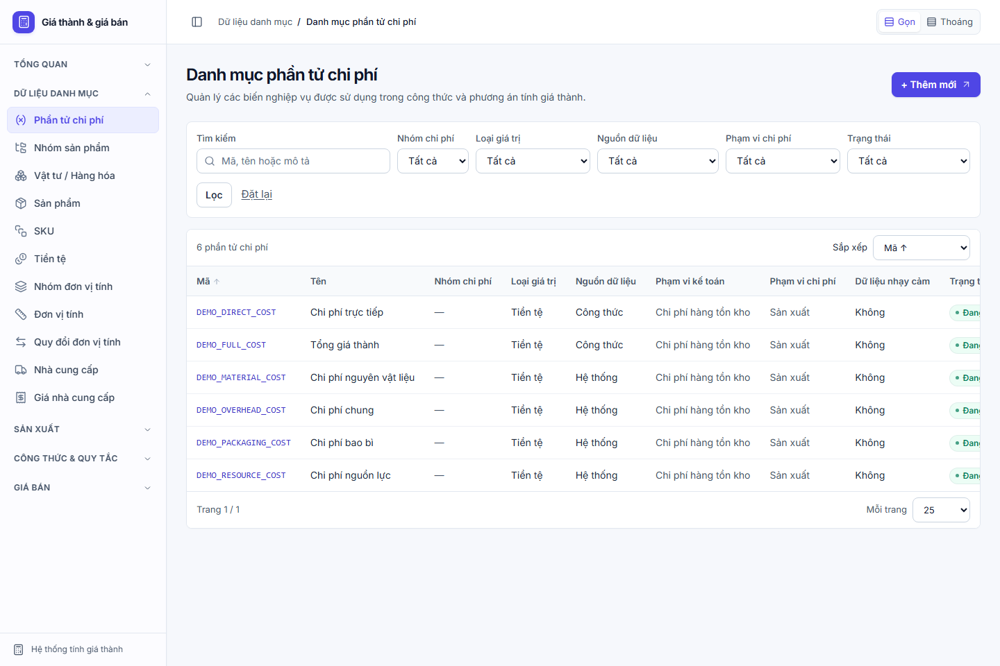

*Hình 1. Bố cục danh sách chung: nút thêm, tìm/lọc, sắp xếp, thao tác trên dòng và phân trang.*

Có thể thu/mở thanh bên và chọn mật độ **Gọn / Thoáng** ở thanh trên. Đây là cách trình bày, không thay đổi dữ liệu hay kết quả tính.

### 2.2. Thêm mới, xem và chỉnh sửa

1. Chọn **+ Thêm mới** hoặc nút thêm có tên tương ứng. Điền các ô bắt buộc có dấu `*`.
2. Chọn đối tượng trong danh sách theo **mã – tên**, không nhập mã định danh số. Nếu thiếu lựa chọn, tạo danh mục cần thiết trước và kiểm tra trạng thái hoạt động.
3. Bấm **Lưu…**. Nếu lỗi, đọc thông báo đầu form và ngay dưới ô, sửa rồi lưu lại. **Hủy / Quay lại** rời form; dữ liệu chưa lưu không có hiệu lực.
4. Khi thành công, kiểm tra thông báo xác nhận và chi tiết bản ghi. Để sửa, mở chi tiết → **Chỉnh sửa**, sửa các ô được phép rồi lưu. Phiên bản/bản ghi đã chốt có thể chỉ xem; dùng bản mới theo hướng dẫn từng phần.

**Quy ước nhập số:** ô nhập dùng dấu chấm thập phân, không gõ dấu phân cách hàng nghìn: `125000.5`, `0.018`. Bảng có thể hiển thị `125.000,5`, `0,018`. Các ô có ký hiệu **(%)** như phí 10% thường nhập `10`; riêng tỷ lệ thuế mua, biến tỷ lệ trong kiểm thử và đầu vào thủ công tỷ lệ dùng phần số, ví dụ `0.1`. Đọc gợi ý từng form. Ngày hiển thị theo ngày/tháng/năm.

### 2.3. Ngừng hoạt động

Với danh mục có ô **Đang hoạt động**, mở **Chỉnh sửa**, bỏ chọn và lưu; nếu có xác nhận **Ngừng hoạt động danh mục**, chọn **Xác nhận và lưu**. Cách này giữ lịch sử, hạn chế dùng cho dữ liệu mới. Muốn dùng lại, đánh dấu hoạt động và lưu. Ngừng danh mục không thay kết quả cũ, nhưng có thể làm lần tính mới thiếu nguồn; cần kiểm tra các cấu hình đang dùng trước.

### 2.4. Xóa dữ liệu nhập nhầm

1. Mở **chi tiết** → **Xóa…**. Với dòng thành phần/liên kết, dùng nút xóa ngay trên dòng.
2. Đọc tên bản ghi, các thành phần sẽ bị xóa cùng và các ràng buộc. Chỉ xác nhận khi đúng đối tượng.
3. Bấm nút **Xóa / Xác nhận xóa** theo hộp thoại; chọn **Hủy** hoặc Escape nếu không xóa. Mở hộp thoại chưa xóa dữ liệu.
4. Nếu bị chặn, xem loại dữ liệu đang sử dụng bản ghi và xử lý đúng nguồn; không xóa lịch sử liên quan chỉ để xóa được danh mục.

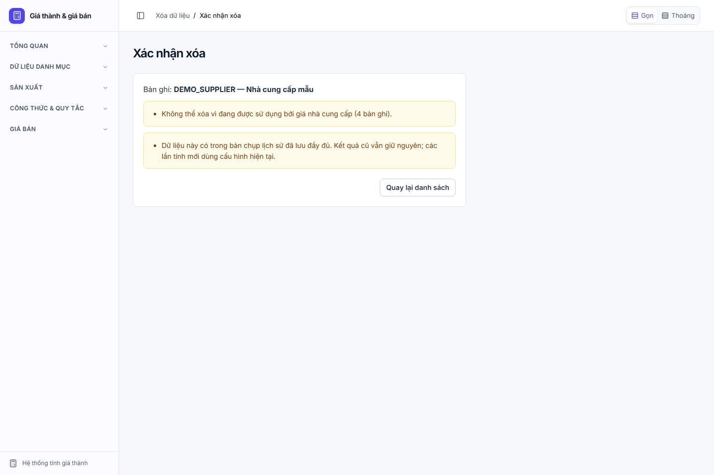

*Hình 2. Nhà cung cấp còn báo giá bị chặn xóa. Đọc lý do thay vì xóa lần lượt các dữ liệu nghiệp vụ để vượt ràng buộc.*

| Loại dữ liệu | Khi nào được xóa? | Khi không được xóa thì làm gì? |
|---|---|---|
| Danh mục: tiền tệ, đơn vị, vật tư, sản phẩm, SKU, nhà cung cấp, trung tâm, nguồn lực, kênh… | Độc lập, không còn ràng buộc/tham chiếu cần bảo vệ | Ngừng hoạt động nếu có; giữ cho lịch sử |
| Giá mua, đơn giá nguồn lực, quy tắc phân bổ, phí/thuế/tỷ giá | Còn **Nháp**, chưa được tham chiếu | Lập bản/kỳ mới, không xóa bản đã chốt |
| BOM, bao bì, quy trình, công thức, phương án | Hồ sơ cha chỉ xóa khi không còn phiên bản/liên kết gây ràng buộc | Giữ hồ sơ, thay bằng phiên bản mới |
| Phiên bản và dòng thành phần | Phiên bản còn sửa được, chưa được tham chiếu; xem cảnh báo dòng sở hữu | Bản đã chốt: tạo phiên bản mới |
| Liên kết SKU – bao bì | Có thao tác thùng rác, chỉ xóa khi các kiểm tra cho phép | Kết thúc liên kết đúng kỳ hoặc giữ dữ liệu |
| Bộ kiểm thử công thức | Không xóa vật lý | Chọn **Ngừng sử dụng** |
| Lần tính giá thành đã lưu | Không xóa, kể cả lần thất bại | Tạo lần tính mới, giữ mã tham chiếu |
| Kịch bản giá bán | Nháp, chưa có kết quả thành công và không bị tham chiếu | Đã tính: nhân bản thành bản mới |
| So sánh kịch bản | Chỉ xem, không tạo bản ghi để xóa | Bỏ chọn kịch bản hoặc đổi bộ lọc |

Các ràng buộc còn tính cả dữ liệu ngừng hoạt động, ngày cũ và tham chiếu trong công thức/lịch sử. Chi tiết xem [Chính sách xóa](../delete-feature/DELETE_POLICY.md).

## 3. Tiền tệ và đơn vị tính

### 3.1. Tiền tệ

**Dữ liệu danh mục → Tiền tệ.** Dùng trước khi tạo giá mua, đơn giá, phần tử tiền hoặc kênh bán.

1. Chọn **+ Thêm mới**, nhập mã ba ký tự (VND, USD…), tên và **Số chữ số thập phân** phù hợp, giữ hoạt động rồi **Lưu tiền tệ**.
2. Mở chi tiết kiểm tra mã và cấu hình số lẻ. Tìm bằng mã/tên; lọc hoạt động; sắp xếp mã, tên hoặc số lẻ.
3. **Chỉnh sửa** tên/cấu hình cho phép; mã tiền tệ không đổi tùy tiện khi sửa. Chỉ xóa khi không còn tham chiếu, ví dụ không còn báo giá/Run sử dụng. Thường ngừng hoạt động nếu không dùng nữa.

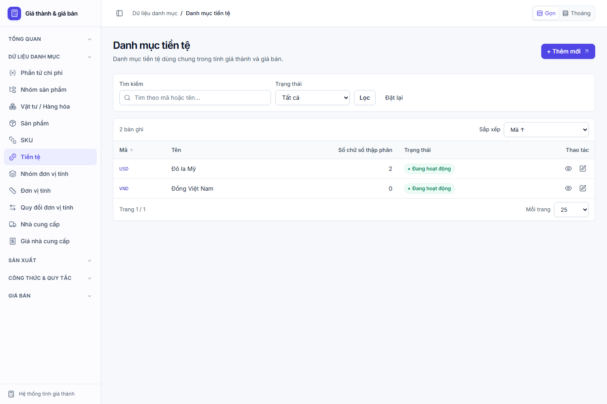

*Hình 3. Tiền tệ là dữ liệu dùng chung cho các mức giá và kết quả.*

### 3.2. Nhóm đơn vị tính

**Dữ liệu danh mục → Nhóm đơn vị tính.** Nhóm cho biết đại lượng như khối lượng, thời gian, số lượng.

1. Thêm mới; nhập mã, tên, **Mã đại lượng** và mô tả nếu cần; lưu.
2. Ví dụ nhóm Khối lượng có đại lượng `MASS`, Thời gian là `TIME`. Dùng mã đại lượng đã thống nhất, không tạo nhiều nhóm trùng ý nghĩa để thử.
3. Xem/sửa bằng thao tác trên dòng. Nhóm còn đơn vị thành viên không được xóa; ngừng hoạt động có thể ảnh hưởng lựa chọn mới.

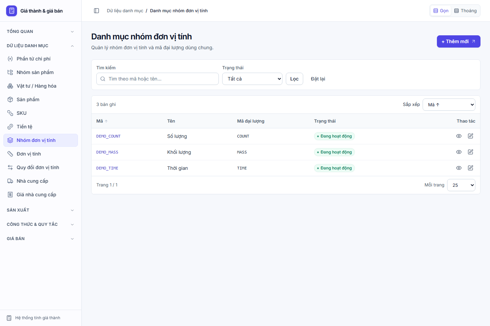

*Hình 4. Tạo nhóm trước, sau đó mới tạo các đơn vị thuộc nhóm.*

### 3.3. Đơn vị tính

**Dữ liệu danh mục → Đơn vị tính.** Chọn nhóm, nhập mã, tên, ký hiệu, số chữ số thập phân; đánh dấu **Đơn vị cơ sở** nếu phù hợp rồi lưu. Ví dụ Kilôgam (kg) thuộc Khối lượng; Phút thuộc Thời gian.

Tìm mã/tên/ký hiệu; lọc nhóm, đơn vị cơ sở và hoạt động. Khi sửa, kiểm tra việc đổi nhóm không làm quy đổi chung thành khác đại lượng. Cờ Đơn vị cơ sở không tự sinh hệ số quy đổi. Đơn vị còn trong vật tư, BOM, báo giá, lần tính… sẽ bị chặn xóa.

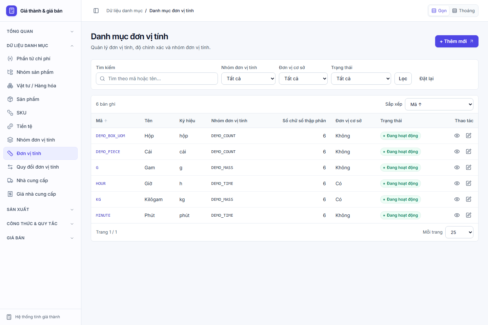

*Hình 5. Kiểm tra nhóm đại lượng và ký hiệu, không chỉ nhìn tên đơn vị.*

### 3.4. Quy đổi đơn vị tính

**Dữ liệu danh mục → Quy đổi đơn vị tính.** Chuẩn bị hai đơn vị và vật tư nếu quy đổi riêng.

1. Thêm mới; chọn **Đơn vị nguồn**, **Đơn vị đích**, nhập hệ số dương. Ví dụ `g → kg`, hệ số `0.001`, nghĩa là 200 g thành 0,2 kg.
2. Để trống Vật tư nếu quy đổi chung; chọn vật tư nếu là quy đổi riêng theo quy cách của vật tư. Nhập ngày hiệu lực và tài liệu tham chiếu, lưu.
3. Xem/sửa để kiểm tra chiều và ngày. Không chọn hai đơn vị giống nhau; quy đổi chung cần cùng đại lượng. Bộ tính dùng cặp trực tiếp hoặc chiều ngược, không tự nối nhiều bước.
4. Không tạo cả hai chiều cùng kỳ chỉ để “đủ chiều”; có thể gây nhiều nguồn. Cặp đang được cấu hình hoặc lịch sử sử dụng có thể không xóa được. Quy đổi dùng chung chỉ xem theo chính sách hiện tại.

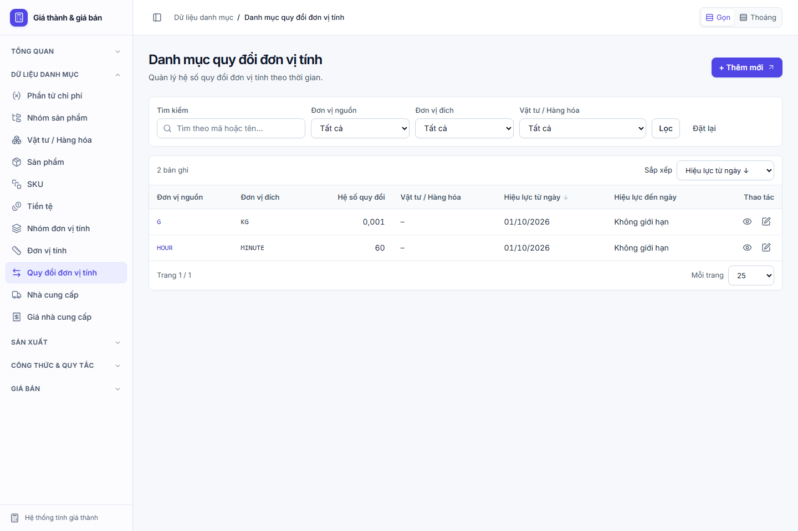

*Hình 6. Hệ số luôn được đọc theo chiều từ đơn vị nguồn sang đơn vị đích.*

**Kiểm tra cuối chương:** có tiền tệ/đơn vị đang hoạt động; kg/g/phút/giờ đúng đại lượng; các cặp cần dùng có đúng một quy đổi phù hợp ngày. Không tạo quy đổi chung “Cái → kg” cho mọi vật tư.

## 4. Phần tử chi phí và danh mục sản phẩm

### 4.1. Phần tử chi phí

**Dữ liệu danh mục → Phần tử chi phí.** Một phần tử đặt tên và kiểu cho một giá trị: chi phí nguyên liệu, sản lượng, tỷ lệ hao hụt, tổng giá thành… Tạo phần tử chưa tự sinh số tiền.

1. Thêm mới, nhập mã ổn định và tên dễ hiểu. Chọn **Nhóm chi phí** nếu đã có nhóm phù hợp; nhóm này khác Nhóm chi phí chung dùng phân bổ.
2. Chọn **Loại giá trị**: tiền, số lượng, số thường, tỷ lệ, có/không hoặc văn bản. Tiền cần tiền tệ; số lượng cần đơn vị và đại lượng phù hợp. Chọn nguồn dữ liệu mặc định, phạm vi kế toán/chi phí và cách làm tròn theo quy ước công ty.
3. Lưu, mở chi tiết kiểm tra. Tìm/lọc theo nhóm, loại, nguồn và trạng thái. **Chỉnh sửa** chỉ nên đổi kiểu/đơn vị sau khi kiểm tra các công thức và phương án dùng phần tử này.
4. Muốn có số tự động, gán phần tử vào dòng phương án ở mục 12. Khi phần tử còn trong công thức/dòng phương án/kết quả, xóa có thể bị chặn; ngừng hoạt động nếu phù hợp.

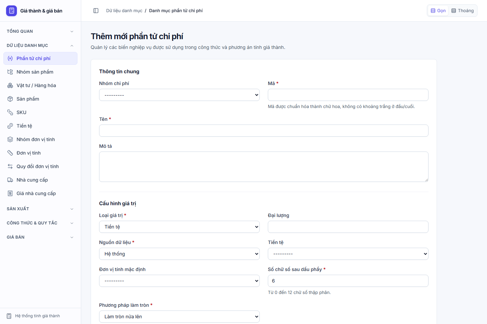

*Hình 7. Chọn đúng kiểu và đơn vị trước khi dùng mã phần tử trong công thức.*

**Ví dụ:** phần tử `MATERIAL_TOTAL` là Tiền tệ/VND; trong phương án, chọn nguồn Hệ thống với mã nguồn `MATERIAL_COST`. Mã phần tử là tên biến, mã nguồn là cách lấy số; hai mã không bắt buộc giống nhau.

### 4.2. Nhóm sản phẩm

**Dữ liệu danh mục → Nhóm sản phẩm.** Tạo mã, tên, mô tả và giữ hoạt động rồi lưu. Dùng để phân loại vật tư/sản phẩm; nhóm của Sản phẩm còn được dùng khi chọn phí bán theo nhóm. Tìm theo mã/tên/mô tả, lọc hoạt động, sắp xếp mã/tên/ngày tạo.

Xem/sửa bằng thao tác trên dòng. Nhóm còn vật tư, sản phẩm, nhóm con hoặc quy tắc phí tham chiếu không được xóa. Ngừng nhóm không tự chuyển các bản ghi sang nhóm khác.

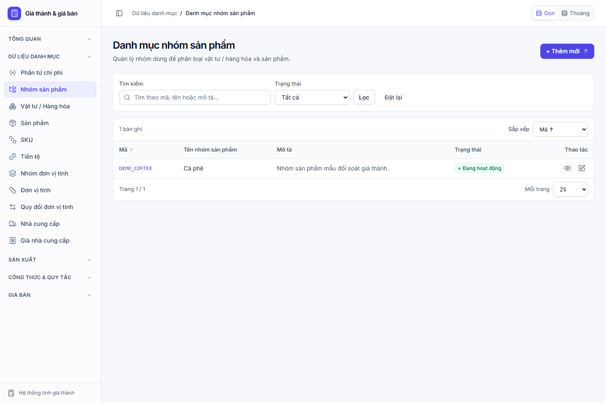

*Hình 8. Nhóm sản phẩm phục vụ phân loại; không phải BOM hay một SKU.*

### 4.3. Vật tư / Hàng hóa

**Dữ liệu danh mục → Vật tư / Hàng hóa.** Chuẩn bị đơn vị trước; có thể tạo nguyên liệu, bao bì, bán thành phẩm, thành phẩm, dịch vụ hoặc phụ phẩm.

1. Thêm mới; chọn nhóm nếu cần, nhập mã/tên, chọn loại và **Đơn vị cơ sở** bắt buộc.
2. Khai báo **Đơn vị mua / Đơn vị sản xuất** khi cần. Chọn chúng không tự sinh quy đổi. Nhập mã nhóm thuế nếu đã thống nhất.
3. Nếu có trọng lượng: nhập khối lượng tịnh/tổng không âm và đơn vị khối lượng. Tổng không được nhỏ hơn tịnh. Nếu có chiều dài/rộng/cao: nhập không âm và đơn vị chiều dài.
4. Đánh dấu **Theo dõi tồn kho** theo cách quản lý; đây là thông tin phân loại, chưa phải chức năng nhập/xuất kho. Giữ hoạt động rồi **Lưu vật tư / hàng hóa**.
5. Tìm bằng mã/tên, lọc nhóm, loại, đơn vị cơ sở, tồn kho và trạng thái. Xem chi tiết để kiểm tra các nhóm thông tin trước khi đưa vào BOM/bao bì/báo giá.

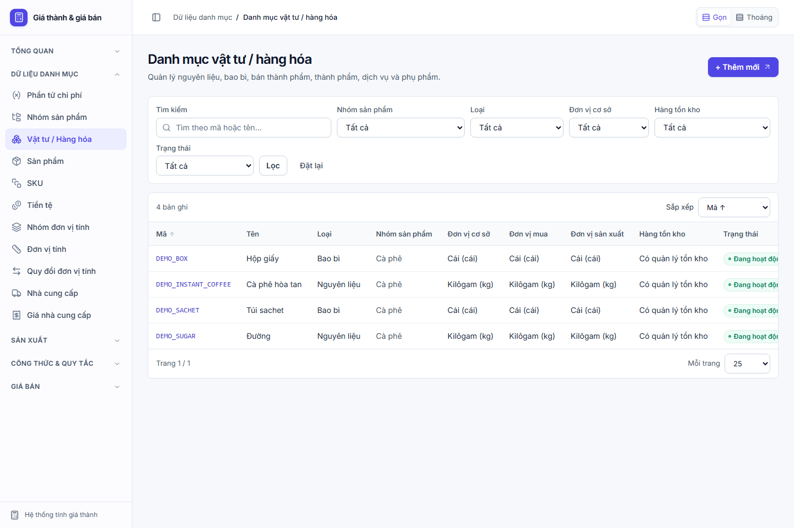

*Hình 9. Mỗi vật tư là một dòng dữ liệu riêng để các màn hình khác tham chiếu.*

Sửa số đo, đơn vị hoặc loại chỉ khi đã kiểm tra cấu hình liên quan. Vật tư đang trong báo giá, BOM, bao bì, quy đổi riêng hoặc liên kết sản phẩm/SKU không xóa được. Ngừng hoạt động giữ bản ghi cũ nhưng có thể làm nguồn không đủ điều kiện cho lần tính mới.

### 4.4. Sản phẩm

**Dữ liệu danh mục → Sản phẩm.** Chuẩn bị đơn vị tính giá thành; nhóm và vật tư đầu ra là tùy chọn.

1. Thêm mới; nhập mã, tên, nhóm nếu cần và mô tả.
2. Chọn **Đơn vị tính giá thành**, ví dụ Gói 18 g. Nếu cần liên kết thành phẩm với Item đã có, chọn **Vật tư / Hàng hóa đầu ra**. Tạo sản phẩm không tự tạo Item.
3. Nhập mã nhóm thuế nếu có, giữ hoạt động và **Lưu sản phẩm**. Mở chi tiết kiểm tra, sau đó tạo SKU/BOM/quy trình.
4. Tìm mã/tên/mô tả; lọc nhóm, đơn vị và trạng thái. Sửa qua **Chỉnh sửa**. Product còn SKU/BOM/bao bì/quy trình hoặc Run tham chiếu bị chặn xóa.

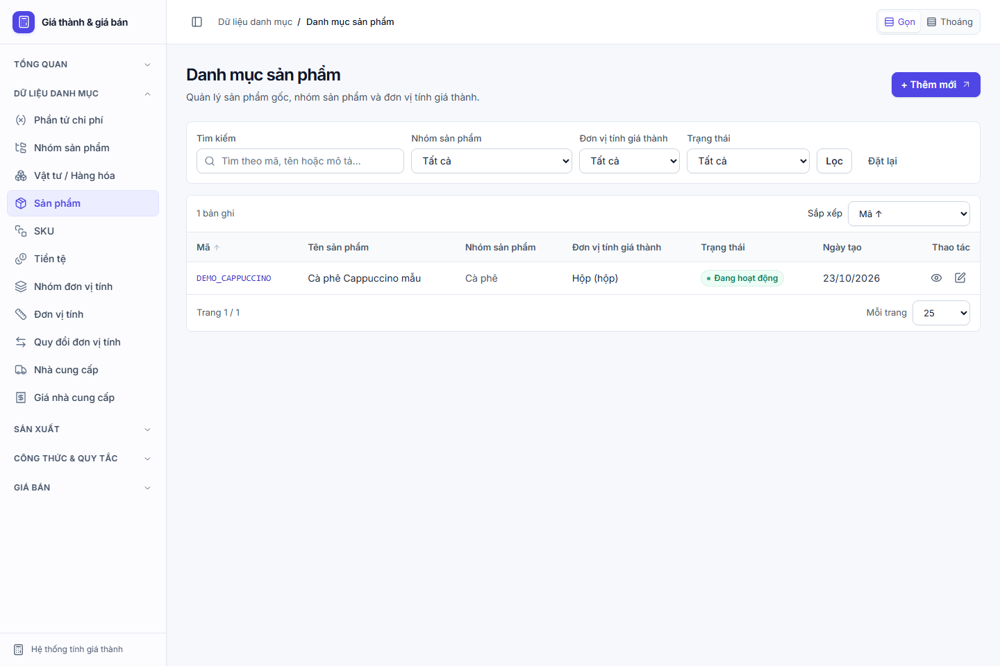

*Hình 10. Đơn vị tính giá thành của sản phẩm là thông tin cần kiểm tra cùng đơn vị sản lượng khi chạy.*

### 4.5. SKU – quy cách bán cụ thể

**Dữ liệu danh mục → SKU.** Chuẩn bị sản phẩm, đơn vị bán và đơn vị lượng tịnh.

1. Thêm mới; chọn sản phẩm, nhập mã và tên SKU. Mã vạch tùy chọn nhưng không được trùng nếu có.
2. Chọn **Đơn vị bán**, nhập **Lượng tịnh > 0** và **Đơn vị lượng tịnh**. Ví dụ một túi 50 gói × 18 g có đơn vị bán Túi, lượng tịnh `0.9`, đơn vị kg.
3. Chọn **Vật tư / Hàng hóa bán** nếu cần; giữ hoạt động rồi **Lưu SKU**. Gán bao bì ở mục 7, không tìm ô bao bì trên form SKU.
4. Tìm mã/tên SKU hoặc sản phẩm; lọc sản phẩm/nhóm/trạng thái. Xem/sửa quy cách trước khi dùng Run mới. SKU đang có liên kết bao bì, phí riêng hoặc Run sẽ có ràng buộc xóa.

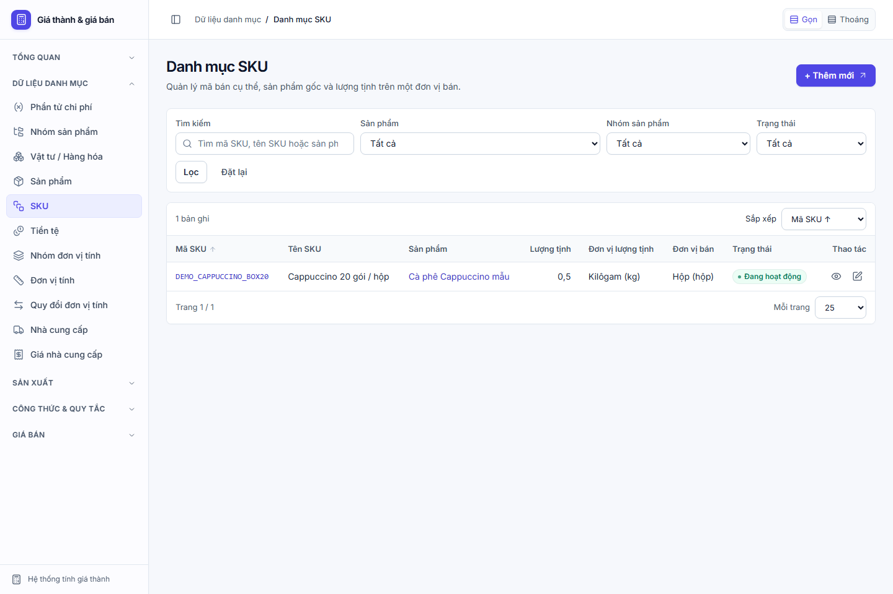

*Hình 11. Tên SKU không tự tạo quy đổi. Muốn dùng cả Gói và Túi cần khai báo đúng quan hệ 1 túi = 50 gói.*

**Kiểm tra:** 50 gói × 18 g = 900 g, không phải 50 g. Thay lượng tịnh có thể đổi cách tính nguyên liệu của Run mới; kết quả cũ vẫn giữ số đã lưu.

## 5. Nhà cung cấp và giá mua

### 5.1. Nhà cung cấp

**Dữ liệu danh mục → Nhà cung cấp.** Thêm mã, tên, mã số thuế nếu có; chọn tiền tệ mặc định, nhập điều khoản thanh toán rồi lưu. Form hiện không có địa chỉ/email/điện thoại; không điền các thông tin đó vào trường không đúng nghĩa.

Tìm bằng mã/tên/mã số thuế; lọc hoạt động hoặc tiền tệ. Mở chi tiết → **Chỉnh sửa** khi cần; ngừng hoạt động nếu không giao dịch nữa. **Nhà cung cấp còn giá mua không được xóa**. Tiền tệ mặc định không tự điền thay tiền tệ trên mọi báo giá; kiểm tra lại form giá.

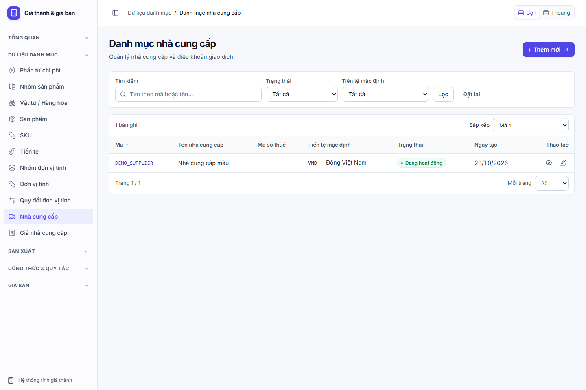

*Hình 12. Tạo nhà cung cấp trước khi lập giá mua vật tư.*

### 5.2. Tạo, xem và sửa giá mua

**Dữ liệu danh mục → Giá nhà cung cấp.** Cần nhà cung cấp, Item, tiền tệ và đơn vị đang hoạt động.

1. Thêm mới; chọn nhà cung cấp và vật tư. Nhập **Đơn giá ≥ 0**, tiền tệ, đơn vị báo giá và **Số lượng tối thiểu ≥ 0**. Ví dụ đường 19.200 VND/kg nhập `19200`, tối thiểu `0`.
2. Khai báo thông tin thuế mua theo báo giá. **Tỷ lệ thuế** dùng phần số `0.1` cho 10%; **Tỷ lệ thuế được khấu trừ** `1` nghĩa là toàn bộ. Bộ tính hiện chưa xử lý giá đã gồm thuế hoặc tỷ lệ thuế mua khác 0; không sửa sai thông tin thật để vượt lỗi.
3. Nhập ngày bắt đầu; ngày kết thúc nếu có phải sau ngày đầu. Ghi nguồn và số báo giá/tài liệu tham chiếu rồi **Lưu giá nhà cung cấp**. Bản mới là **Nháp**.
4. Tìm theo nhà cung cấp/vật tư; lọc nhà cung cấp, vật tư, tiền tệ, đơn vị, trạng thái và hiệu lực theo ngày. **Chỉnh sửa** cập nhật bản đang mở, không tạo giá kỳ mới. Bản Nháp chưa được dùng/tham chiếu mới đủ điều kiện xóa.

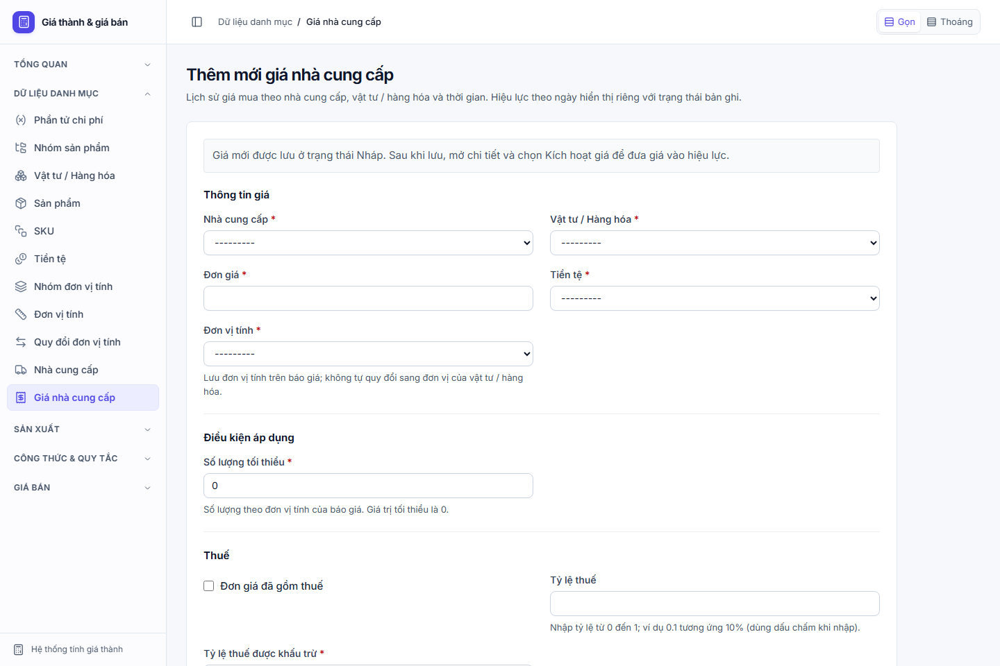

*Hình 13. Đơn vị báo giá phải đúng với đơn giá; không lấy giá mỗi kg gắn vào đơn vị gam.*

### 5.3. Kích hoạt giá để tính

1. Mở **Xem chi tiết** đúng giá. Kiểm tra vật tư, tiền, đơn vị, lượng tối thiểu và khoảng ngày.
2. Chọn **Kích hoạt giá → Xác nhận kích hoạt**. Nếu có lỗi, sửa đúng dữ liệu/danh mục theo thông báo rồi thử lại.
3. Kiểm tra **Trạng thái bản ghi = Đang hiệu lực**. Giá tương lai vẫn có thể có nhãn theo ngày **Sắp hiệu lực**, chỉ được dùng khi Run nằm trong kỳ đó.

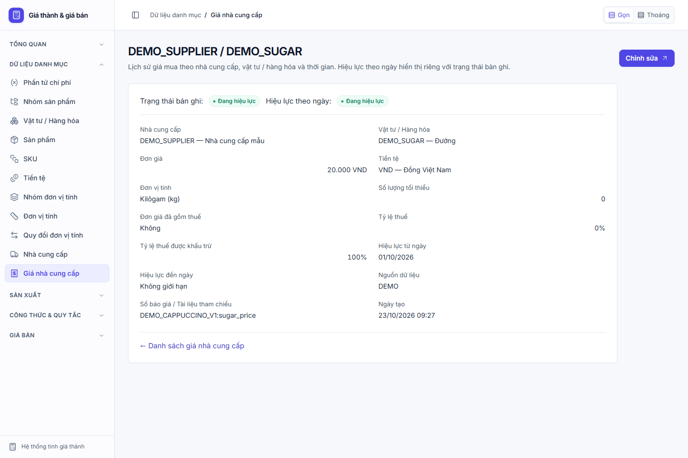

*Hình 14. Đọc riêng trạng thái bản ghi và hiệu lực theo ngày. Ảnh chụp desktop thay cho ảnh điện thoại của bản cũ.*

Kích hoạt không tự chọn giá rẻ nhất/nhà cung cấp ưu tiên. Bộ tính cần **đúng một giá phù hợp** sau xét vật tư, ngày, tiền tệ, đơn vị và lượng tối thiểu. Hai giá cùng phù hợp sẽ báo lỗi; có đủ báo giá không đồng nghĩa không bị trùng nguồn.

### 5.4. Giá thay đổi theo tháng

Giữ giá cũ, **thêm giá mới** từ đầu tháng mới. Ví dụ kỳ cũ đến 31/10, kỳ mới từ 01/11. Nếu kỳ cũ chưa có ngày kết thúc, thống nhất ngày áp dụng và cập nhật ngày theo quy trình quản lý dữ liệu trước khi kích hoạt giá mới. Không sửa đè số tiền cũ chỉ để thay giá tháng sau. Sau khi cập nhật, **tạo Run mới**; Run đã khóa không tự lấy giá mới.

**Kiểm tra trước khi dùng:** giá mua và Run cùng tiền tệ (Costing chưa đổi ngoại tệ); các đơn vị đổi được; vật tư/nhà cung cấp hoạt động; trạng thái đã hiệu lực; không thiếu/trùng nguồn. Tỷ giá ở mục Giá bán không tự đổi tiền giá mua cho Costing.

## 6. Định mức nguyên vật liệu / BOM

### 6.1. Tạo định mức và phiên bản đầu

**Sản xuất → BOM / Công thức sản xuất.** Chuẩn bị sản phẩm, vật tư, đơn vị và quy đổi. BOM thuộc **Sản phẩm**, không gán riêng SKU; bộ lọc SKU giúp tìm BOM của sản phẩm chứa SKU đó.

1. Chọn **+ Thêm định mức**, nhập sản phẩm, mã, tên, mô tả và trạng thái hoạt động.
2. Trong phiên bản đầu, nhập **Sản lượng chuẩn > 0**, **Đơn vị tính đầu ra** và **Tỷ lệ thu hồi (%)**. Ví dụ cho 1 kg thành phẩm: sản lượng `1`, đơn vị kg, thu hồi `100`.
3. Nhập ngày/lý do thay đổi khi đã rõ. Ngày kết thúc nếu có phải sau ngày bắt đầu. Chọn **Lưu định mức nguyên vật liệu**; kiểm tra phiên bản đầu **Nháp**.

### 6.2. Thêm, sửa và xóa thành phần

1. Mở đúng phiên bản Nháp → **+ Thêm thành phần**.
2. Chọn vật tư, nhập **Số lượng > 0**, đơn vị, hao hụt từ 0 đến dưới 100%; nhập thứ tự và ghi chú nếu cần. Số lượng là nhu cầu của **sản lượng chuẩn của BOM**, không tự là một gói.
3. **Lưu thành phần**, lặp lại từng vật tư; kiểm tra bảng. Dùng biểu tượng sửa để đổi dòng, **Xóa → Xác nhận xóa** để bỏ dòng nhập nhầm khi phiên bản còn được sửa.
4. Nếu dùng đơn vị khác đơn vị cơ sở của vật tư, cần quy đổi hợp lệ. Cùng vật tư được phép có nhiều dòng; đừng nhập lặp ngoài ý muốn vì bộ tính cộng từng dòng.

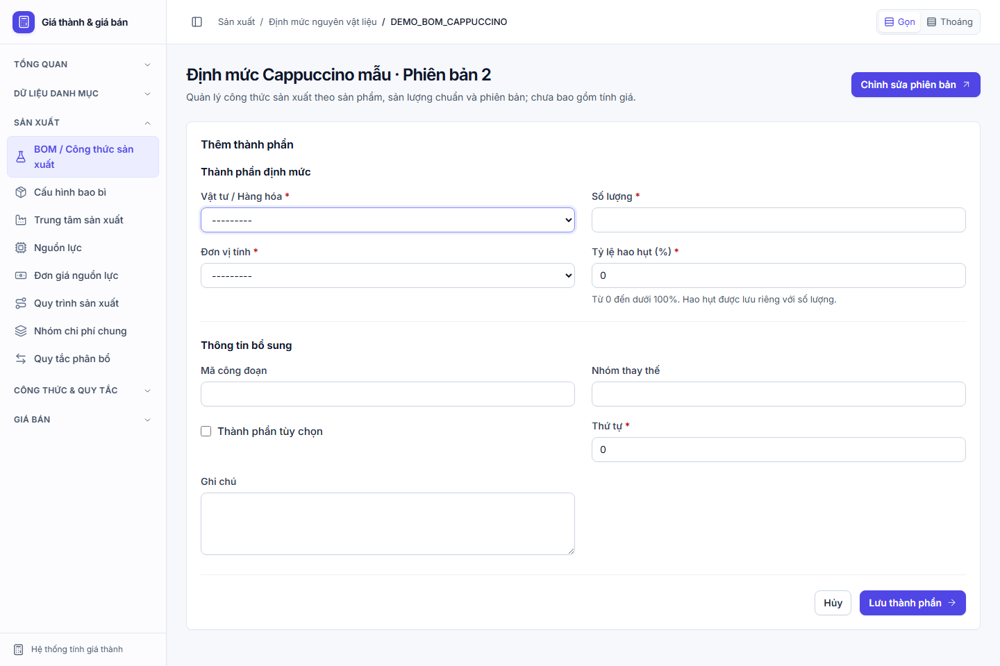

*Hình 15. Thành phần BOM tham chiếu vật tư và đơn vị; số lượng và hao hụt được lưu riêng.*

Đối với bộ tính hiện tại, dùng thành phần bắt buộc đã xác định. **Thành phần tùy chọn / Nhóm thay thế** có thể lưu nhưng chưa có quy tắc chọn khi chạy, sẽ bị chặn. Mã công đoạn ở dòng là tham chiếu văn bản, không tự nối với Routing.

### 6.3. Kích hoạt phiên bản

1. Mở phiên bản; kiểm tra sản phẩm, đầu ra, thu hồi, thành phần và **Hiệu lực từ ngày**. Nếu thiếu ngày, chọn **Chỉnh sửa phiên bản** để bổ sung.
2. Bấm **Kích hoạt phiên bản → Xác nhận kích hoạt**. Nếu lỗi, đọc thông báo và sửa đúng nguyên nhân.
3. Kiểm tra trạng thái **Đang hiệu lực**. Cần đủ giá mua riêng; kích hoạt BOM không kích hoạt giá mua.

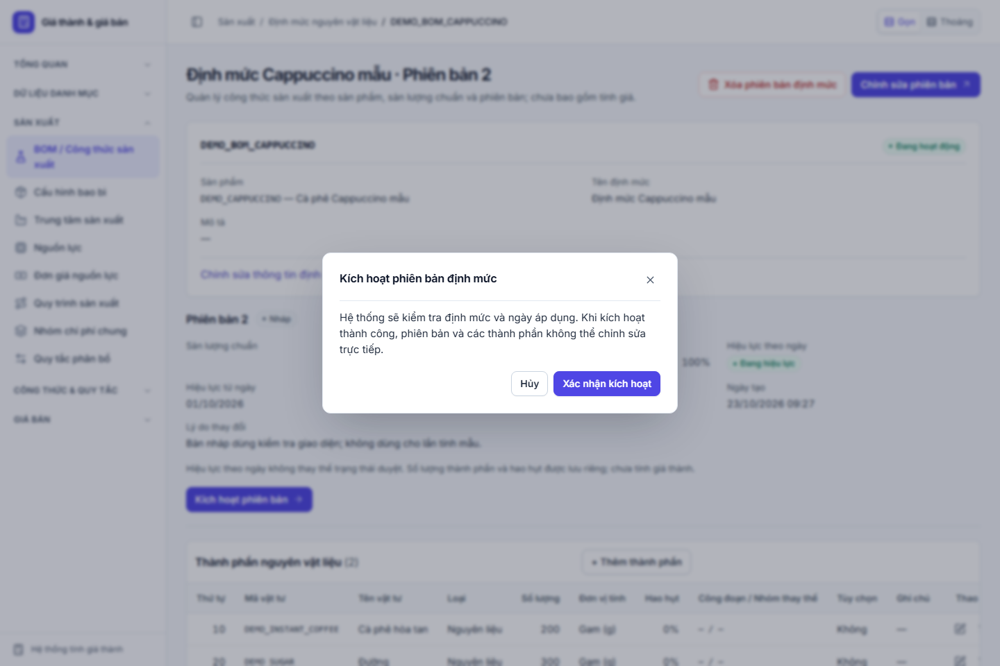

*Hình 16. Xác nhận đưa phiên bản vào sử dụng; sau khi chốt, không sửa trực tiếp thành phần.*

Không được chồng ngày với BOM hiệu lực của cùng sản phẩm. Ngày cuối vẫn được dùng: bản cũ hết 31/10, bản mới từ 01/11. Bản cũ đang mở không giới hạn cần thống nhất lịch áp dụng với người phụ trách, không thử tạo thêm nguồn cùng kỳ.

### 6.4. Lịch sử, sao chép và xóa phiên bản

Mở **Lịch sử phiên bản** để chọn bản cụ thể; trang hồ sơ mặc định có thể mở bản mới nhất còn Nháp. Muốn đổi định mức đã chốt, mở bản nguồn → **Tạo phiên bản mới từ phiên bản N**, sửa ngày, lý do và thông số, lưu. Tất cả dòng được sao chép; bản nguồn giữ nguyên. Tạo bản mới không chọn nguồn sẽ chưa có thành phần, cần nhập lại.

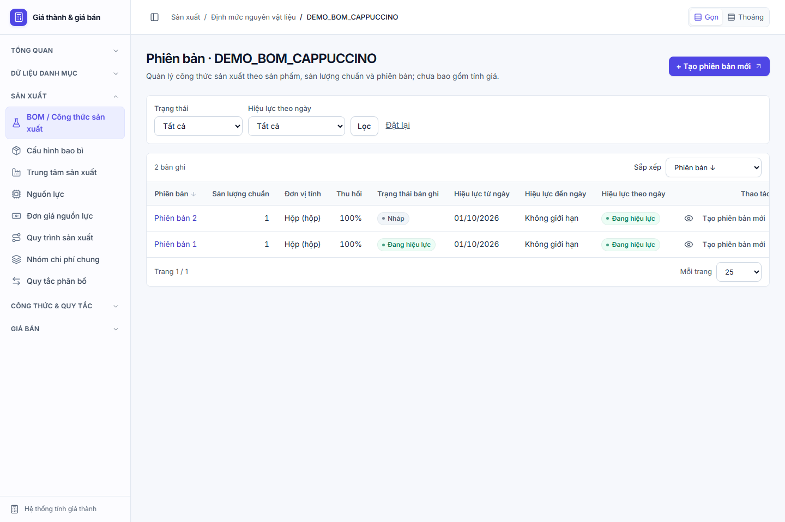

*Hình 17. Chọn đúng phiên bản để xem lịch sử, sao chép hoặc chỉnh sửa bản còn Nháp.*

**Chỉnh sửa thông tin định mức** sửa hồ sơ; **Chỉnh sửa phiên bản** sửa đầu ra/ngày/thu hồi. Chỉ xóa phiên bản còn sửa được, chưa bị tham chiếu; hộp thoại nêu các dòng sẽ xóa cùng. Hồ sơ cha còn phiên bản không xóa được. Bản đã chốt cần giữ lại.

**Cách đối chiếu lượng:** nhu cầu = lượng dòng × hệ số sản lượng ÷ thu hồi ÷ (1 − hao hụt). Thu hồi 100%, hao hụt 0% thì chỉ nhân hệ số. Không tự tăng số lượng lần nữa vì đã nhập hao hụt.

## 7. Cấu hình bao bì và liên kết SKU

### 7.1. Tạo cấu hình và thành phần

**Sản xuất → Cấu hình bao bì.** Chuẩn bị sản phẩm, SKU, vật tư bao bì, đơn vị và báo giá.

1. Chọn **+ Thêm cấu hình bao bì**, nhập sản phẩm, mã, tên, mô tả; bổ sung trọng lượng/kích thước nếu biết. Có số đo thì chọn đúng đơn vị; có thể để trống quy cách chưa dùng.
2. Lưu để có phiên bản đầu Nháp. Chọn **+ Thêm thành phần**; nhập vật tư, **Số lượng > 0** (cho phép số lẻ), đơn vị và cấp đóng gói. Lưu từng dòng.
3. Dùng **Chỉnh sửa / Xóa** trên dòng để sửa sai khi còn Nháp. Kiểm tra không tính lại cùng vật tư bao bì đã có trong BOM.

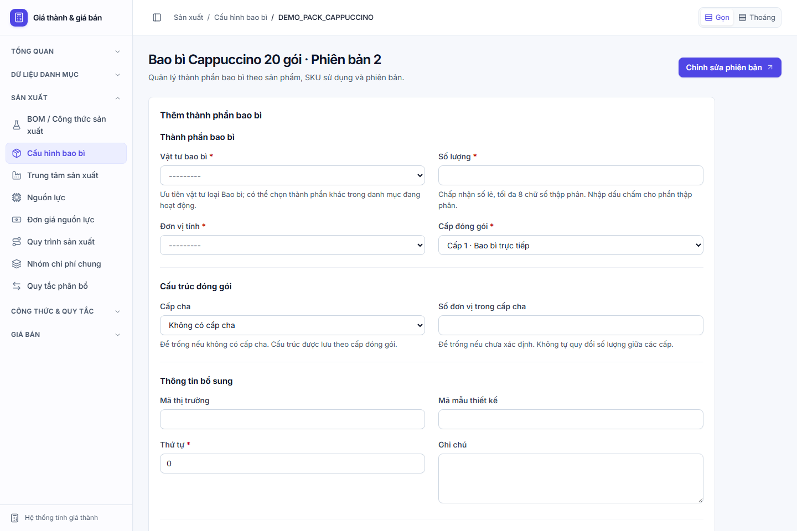

*Hình 18. Ví dụ 1/12 carton có thể nhập số thập phân theo độ chính xác; không bắt buộc số nguyên.*

Các cấp có thể gồm bao bì trực tiếp, bao bì nhóm, bao bì vận chuyển, pallet, container. **Cấp cha / Số đơn vị trong cấp cha** mô tả cấu trúc; bộ tính hiện dùng số lượng dòng trên cơ sở đã nhập, không tự đi qua cây để nhân tiếp. Điều kiện thị trường/mẫu thiết kế có thể lưu nhưng nguồn tính hiện chưa xử lý; có dữ liệu điều kiện này có thể chặn tính.

### 7.2. Gán, sửa và bỏ liên kết SKU

1. Tại **SKU sử dụng cấu hình**, chọn **+ Gán SKU**.
2. Chọn SKU **cùng sản phẩm**, đánh dấu **Cấu hình chính**, nhập ngày liên kết rồi **Lưu liên kết SKU**.
3. Mở **Xem tất cả liên kết SKU** để tìm/lọc/sắp xếp/phân trang. Dùng bút để sửa ngày/cấu hình chính; dùng thùng rác để xóa liên kết đủ điều kiện. Xóa liên kết không xóa SKU hay bao bì.
4. Chỉ có **một liên kết chính phù hợp ngày chạy**. Đổi sang cấu hình khác cần kiểm tra kết thúc kỳ cũ và ngày đầu kỳ mới, tránh hai liên kết cùng được chọn.

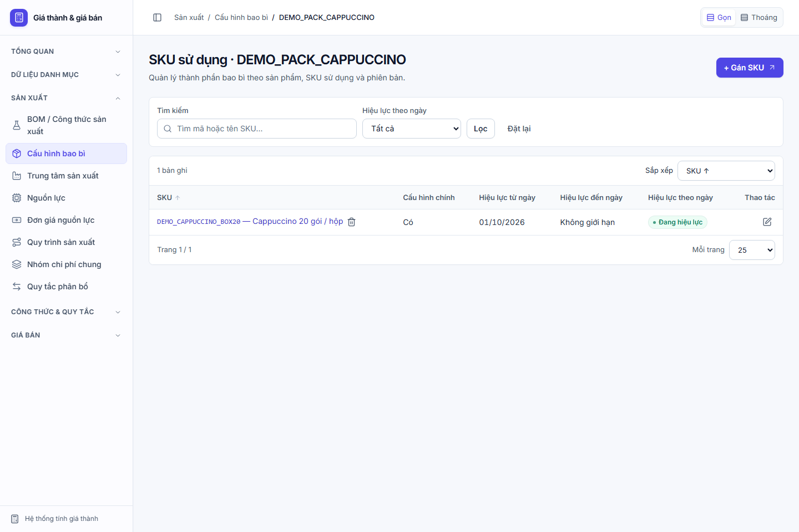

*Hình 19. Liên kết thuộc cấu hình chung, không phải một phiên bản; ngày liên kết và ngày phiên bản cần được kiểm tra riêng.*

### 7.3. Kích hoạt và thay phiên bản

Mở đúng phiên bản, kiểm tra ngày/thành phần/quy đổi; chọn **Kích hoạt phiên bản → Xác nhận kích hoạt**, kiểm tra **Đang hiệu lực**. Gán SKU hoặc bật hoạt động không tự làm việc này. Hệ thống chặn chồng kỳ hiệu lực trong cùng cấu hình. Muốn sửa bản đã chốt, **Tạo phiên bản mới từ phiên bản N** để sao chép các dòng, sửa bản Nháp, kiểm tra rồi kích hoạt. Liên kết SKU của cấu hình vẫn giữ, không tạo lại theo từng phiên bản.

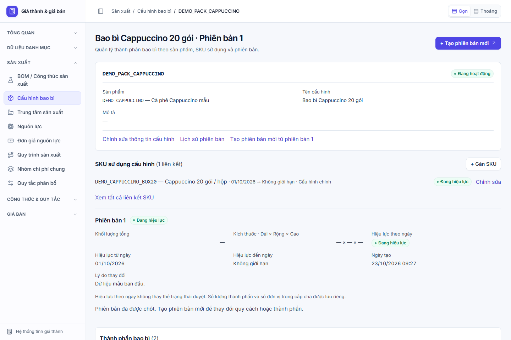

*Hình 20. Kiểm tra phiên bản, ngày, vật tư và liên kết SKU trước lần tính.*

**Quan trọng khi chạy:** phiên bản bao bì chưa có ô sản lượng đầu ra. Hãy thống nhất bảng đang dành cho **1 túi**, **12 hộp** hay lượng nào. Ví dụ bảng cho 1 túi 50 gói gồm 50 vỏ gói + 1 túi ngoài; khi chạy nhập **Số thành phẩm theo định mức bao bì = 1**, **Đơn vị thành phẩm đóng gói = Túi 50 gói × 18 g**. Tính 1 gói dùng 1/50 bảng; không đổi cơ sở thành 1 gói nếu chưa đổi cả lượng các dòng.

Xóa phiên bản Nháp sẽ xóa các dòng sở hữu đã công bố, không xóa vật tư. Hồ sơ còn phiên bản/liên kết hoặc nguồn đã chốt có thể bị chặn xóa. Ngừng cấu hình có thể làm Run mới thiếu bao bì.

## 8. Trung tâm sản xuất, nguồn lực và đơn giá

### 8.1. Trung tâm sản xuất

**Sản xuất → Trung tâm sản xuất.** Đây là nơi/nhóm thực hiện công đoạn.

1. Thêm mới; nhập mã, tên, mã địa điểm nếu có.
2. Nhập công suất/công suất bình thường nếu đã xác định và chọn đơn vị công suất. Hai số có thể trống; nếu có thì không âm và cần đơn vị.
3. Giữ hoạt động, **Lưu trung tâm sản xuất**, xem chi tiết và các nguồn lực thuộc trung tâm.
4. Tìm/lọc trạng thái/sắp xếp; sửa qua Chỉnh sửa. Trung tâm còn nguồn lực hoặc công đoạn không xóa được. Ngừng hoạt động nếu không dùng cho cấu hình mới.

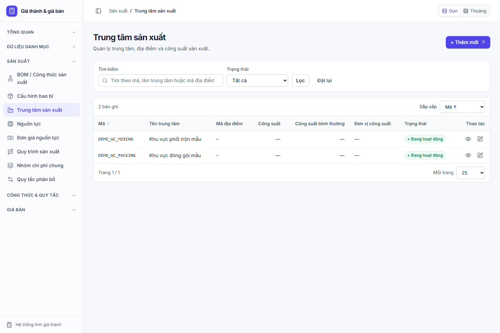

*Hình 21. Công suất khai báo chưa tự sinh lịch công suất hoặc số liệu kỳ phân bổ.*

### 8.2. Nguồn lực

**Sản xuất → Nguồn lực.** Chuẩn bị trung tâm và đơn vị công suất khi cần.

1. Thêm mới; nhập mã, tên, chọn **Loại nguồn lực**, trung tâm nếu có và các thông tin năng lực thực sự dùng trên form.
2. Khi nhập công suất, chọn đơn vị phù hợp; giữ hoạt động rồi lưu. Máy và nhân công là các nguồn lực khác nhau.
3. Xem chi tiết để xem thông tin và **Lịch sử đơn giá**. **Thêm đơn giá** từ đây giúp chọn sẵn nguồn lực.
4. Tìm mã/tên, lọc loại/trung tâm/trạng thái. Sửa qua Chỉnh sửa. Nguồn lực còn đơn giá hoặc được công đoạn dùng không xóa được.

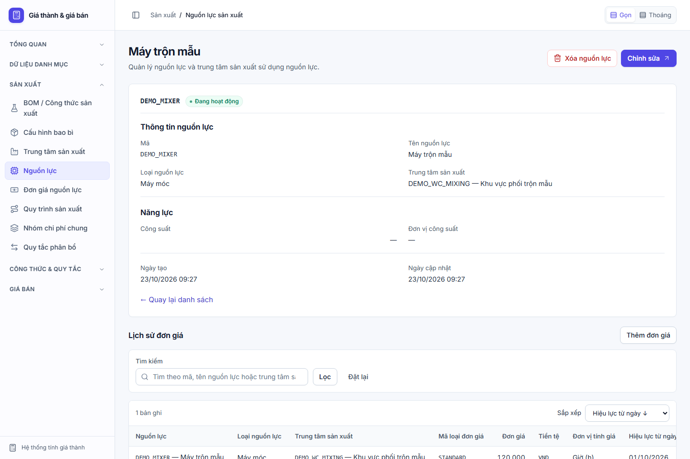

*Hình 22. Lịch sử đơn giá giúp kiểm tra mức tiền tại các thời kỳ.*

### 8.3. Đơn giá nguồn lực theo kỳ

**Sản xuất → Đơn giá nguồn lực.** Tạo một bản cho một mức giá trong một kỳ, ví dụ 120.000 VND/giờ.

1. Thêm mới; chọn nguồn lực, nhập **Mã loại đơn giá** theo quy ước công ty.
2. Nhập đơn giá không âm, tiền tệ, **Đơn vị tính giá**. Không mặc định mọi nguồn lực tính theo giờ; chọn đúng đơn vị báo giá.
3. Nhập ngày đầu/cuối và tài liệu tham chiếu; **Lưu đơn giá nguồn lực**. Bản mới là Nháp.
4. Tìm/lọc nguồn lực, loại, trung tâm, tiền tệ, đơn vị, hiệu lực và trạng thái. Sửa cập nhật bản đang mở; muốn thay mức tiền từ kỳ mới thì **thêm bản mới**, giữ giá cũ.

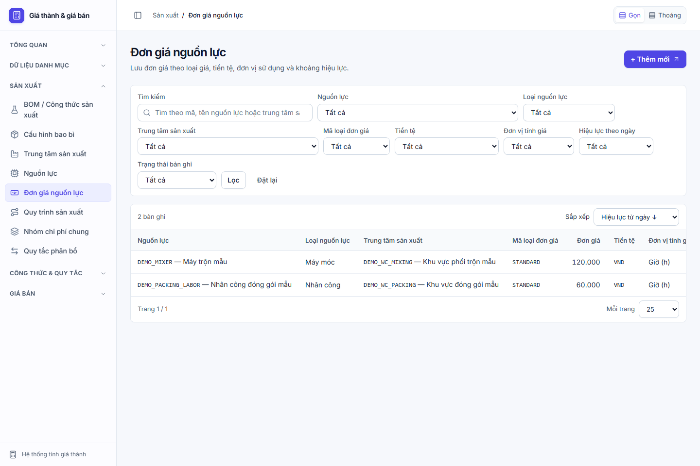

*Hình 23. Không sửa đè đơn giá cũ thành giá mới nếu cần giữ lịch sử.*

**Giới hạn thao tác:** chưa có nút đưa đơn giá nguồn lực mới vào hiệu lực. Muốn dùng nguồn này, người phụ trách phải chuẩn bị dữ liệu hiệu lực phù hợp; nhập ngày không thay trạng thái Nháp. Bộ tính hiện cần duy nhất một đơn giá hiệu lực của nguồn lực tại ngày chạy, chưa tự chọn theo mã loại giá. Tiền tệ phải khớp Run; đơn vị giá cần quy đổi được với thời gian công đoạn. Chỉ bản Nháp chưa tham chiếu mới được xóa.

## 9. Quy trình sản xuất và công đoạn

### 9.1. Tạo quy trình

**Sản xuất → Quy trình sản xuất.** Chuẩn bị sản phẩm, trung tâm/nguồn lực và đơn vị thời gian.

1. Chọn **+ Thêm quy trình**, nhập sản phẩm, mã, tên và trạng thái hoạt động.
2. Nhập **Sản lượng lô chuẩn > 0** và đơn vị nếu dùng cơ sở chung; có thể để trống cả cặp. Nhập ngày/lý do thay đổi rồi **Lưu quy trình sản xuất**.
3. Mở phiên bản Nháp để thêm công đoạn. Quy trình thuộc sản phẩm; bộ lọc SKU không tạo quan hệ riêng với SKU.

### 9.2. Thêm, sửa và xóa công đoạn

1. Chọn **+ Thêm công đoạn**. Nhập thứ tự nguyên dương, không trùng trong phiên bản; thường tăng 10 để chèn thêm sau này. Nhập mã và tên công đoạn.
2. Chọn trung tâm; danh sách **Nguồn lực chính** tải theo trung tâm hoặc nguồn lực chung. Mỗi công đoạn hiện có **một nguồn lực chính**, chưa có bảng gán nhiều nguồn lực.
3. Nhập **Thời gian chuẩn bị**, **Thời gian chạy** không âm, chọn đơn vị thời gian khi có thời gian phát sinh.
4. Nếu dùng cơ sở riêng, nhập **Sản lượng cơ sở > 0** và đơn vị. Nếu bỏ trống, thời gian chạy dùng cơ sở lô của phiên bản. Điền ghi chú, **Lưu công đoạn**.
5. Sửa bằng bút trên dòng; xóa dòng và xác nhận khi còn được sửa. Kiểm tra thứ tự sau mỗi lần bổ sung.

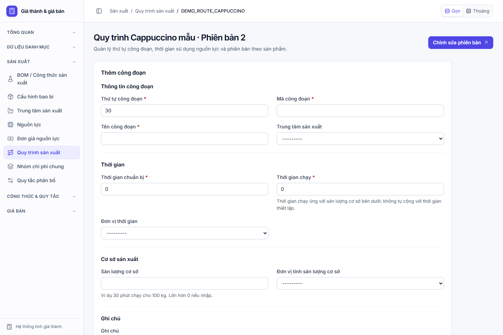

*Hình 24. Giữ riêng thời gian chuẩn bị, thời gian chạy và cơ sở sản lượng.*

Ví dụ chuẩn bị 15 phút, chạy 30 phút/100 kg; tính 200 kg dùng **15 + 30 × 2 = 75 phút**. Không nhân thời gian chuẩn bị lên 2. Công đoạn có thời gian cần nguồn lực chính phù hợp trung tâm, đơn giá hiệu lực và quy đổi thời gian. Có thể lưu công đoạn chưa đủ các điều kiện chạy; vì vậy cần tự kiểm tra trước khi dùng phương án có nguồn lực.

### 9.3. Xem, đổi phiên bản và quản lý lịch sử

Trang chi tiết hiển thị công đoạn theo thứ tự. **Lịch sử phiên bản** mở bản cũ; **Chỉnh sửa thông tin quy trình** sửa hồ sơ, **Chỉnh sửa phiên bản** sửa cơ sở lô/ngày. **Tạo phiên bản mới từ phiên bản N** sao chép công đoạn và tham chiếu nguồn lực sang Nháp; bản cũ giữ nguyên. Tạo không chọn nguồn thì chưa có công đoạn.

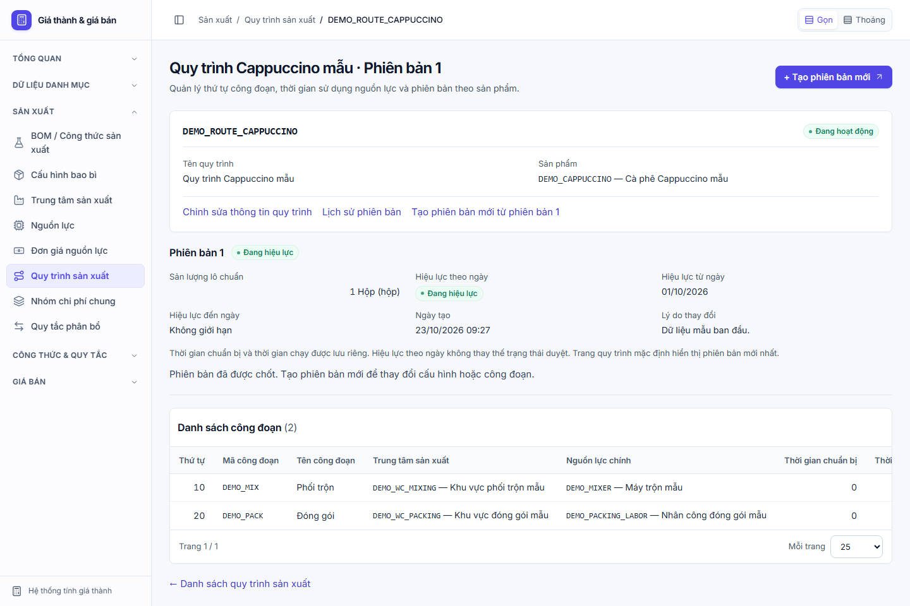

*Hình 25. Quy trình chỉ mô tả cách sử dụng nguồn lực, không chép đơn giá hiện tại vào công đoạn.*

Chưa có nút kích hoạt quy trình mới trên giao diện. Dùng nguồn đã được chuẩn bị hiệu lực trước khi chạy; bản đã chốt không sửa/xóa trực tiếp. Xóa phiên bản còn sửa được chỉ xóa công đoạn sở hữu, không xóa nguồn lực hay trung tâm. Hồ sơ còn phiên bản không xóa được.

## 10. Nhóm chi phí chung và quy tắc phân bổ

### 10.1. Nhóm chi phí chung

**Sản xuất → Nhóm chi phí chung.** Thêm mã, tên, **Loại nhóm chi phí** (cố định nhà máy, biến đổi nhà máy, đảm bảo chất lượng, kho vận, xuất khẩu, khác), mô tả và hoạt động rồi **Lưu nhóm chi phí chung**.

Xem chi tiết để xem các quy tắc liên quan; tìm/lọc/sắp xếp khi cần. Sửa tên/loại/mô tả theo thực tế. Nhóm còn quy tắc hoặc số liệu kỳ bị chặn xóa. **Hiện chưa có màn hình thêm/xóa “thành viên là phần tử chi phí” trong nhóm**; không nhầm nhóm này với nhóm của Phần tử chi phí và không coi tạo nhóm là đã có số tiền phân bổ.

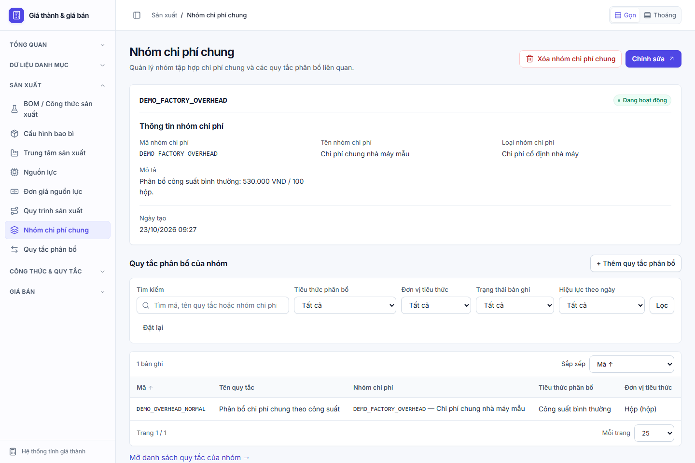

*Hình 26. Chi tiết nhóm và các quy tắc liên quan; không có chức năng tự gom tiền từ danh mục phần tử.*

### 10.2. Tạo và sửa quy tắc phân bổ

1. Vào **Sản xuất → Quy tắc phân bổ → + Thêm quy tắc phân bổ**, hoặc thêm từ chi tiết nhóm để chọn sẵn nhóm.
2. Nhập mã, tên, chọn nhóm chi phí và **Tiêu thức phân bổ**; chọn đơn vị tiêu thức nếu cần. Mức ưu tiên được lưu để cấu hình; không tự có thuật toán chạy cho mọi tiêu thức.
3. Nhập ngày, mã công thức tham chiếu nếu thật sự có nhu cầu cấu hình, rồi lưu. Bản mới là Nháp.
4. Tìm/lọc nhóm, tiêu thức, đơn vị, trạng thái và ngày; mở chi tiết, sửa bản cho phép. Chỉ Nháp không tham chiếu được xóa; nhóm liên quan không bị xóa theo.

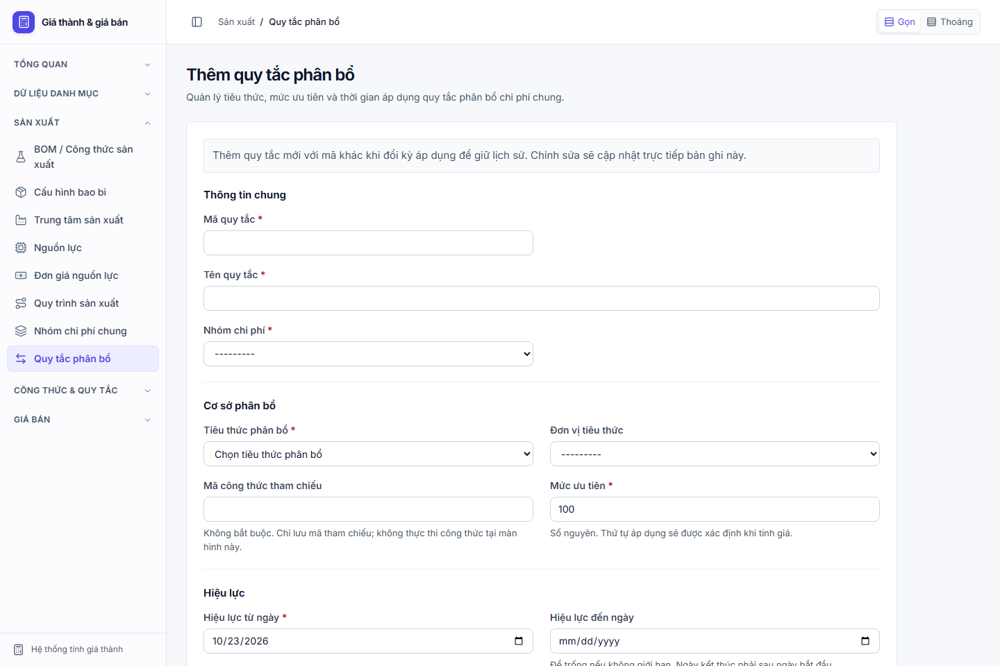

*Hình 27. Chọn tiêu thức cấu hình không đồng nghĩa bộ tính đã thực thi được mọi lựa chọn.*

**Khả năng tính hiện tại:** chỉ **Công suất bình thường**, với quy tắc hiệu lực và đúng một số liệu kỳ hiệu lực có số tiền, tiền tệ, công suất bình thường dương và đơn vị phù hợp; sản lượng không vượt công suất. Ví dụ kỳ có 530.000 VND/100 hộp, lần tính 10 hộp được phân bổ 53.000 VND. Các tiêu thức khác và mã công thức tham chiếu mới là cấu hình lưu được, chưa phải nguồn chạy.

**Điểm dừng:** chưa có UI nhập số liệu kỳ chi phí chung và chưa có nút kích hoạt quy tắc mới. Không có bảng đối tượng phân bổ/chi tiết tỷ lệ riêng để thêm. Phối hợp người phụ trách chuẩn bị nguồn; không hướng dẫn sửa trực tiếp cơ sở dữ liệu để vượt giới hạn.

## 11. Công thức: soạn thảo, kiểm tra, kiểm thử và kích hoạt

### 11.1. Tạo và soạn biểu thức

**Công thức & Quy tắc → Thiết lập công thức.** Cần các Phần tử chi phí đầu vào đã tồn tại, đúng kiểu/tiền tệ/đơn vị.

1. Chọn **+ Thêm công thức**. Nhập mã, tên, mô tả; chọn phần tử chi phí kết quả nếu cần cố định kiểu đầu ra. Mã dùng chữ cái, số và gạch dưới; không có khoảng trắng.
2. Nhập **Biểu thức**. Tìm trong danh sách **Biến dữ liệu**, chọn mục để chèn mã, tránh gõ sai. Ví dụ `$MATERIAL_TOTAL + $PACK_TOTAL` cộng hai phần tử tiền cùng tiền tệ.
3. Nhập ngày đầu/cuối và lý do thay đổi của phiên bản nếu đã rõ. Giữ công thức hoạt động.
4. Bấm **Kiểm tra công thức**; đọc cú pháp, kiểu đầu ra, tiền tệ/đại lượng và phụ thuộc. Nếu lỗi có dòng/cột, quay lại vị trí đó trong biểu thức.
5. **Lưu công thức** để tạo hồ sơ và phiên bản Nháp. Kiểm tra hợp lệ không tự lưu hoặc kích hoạt phiên bản.

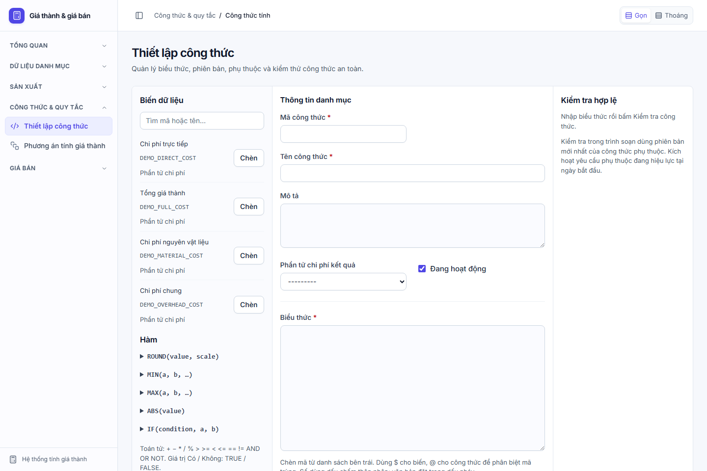

*Hình 28. Trình soạn biểu thức và danh sách biến hỗ trợ chèn đúng mã.*

| Muốn làm gì? | Cách viết | Điều kiện cần nhớ |
|---|---|---|
| Dùng phần tử chi phí | `$MATERIAL_TOTAL` | Mã phần tử tồn tại |
| Dùng công thức khác | `@DIRECT_TOTAL` | Theo đúng phiên bản/phụ thuộc tại ngày dùng |
| Cộng/trừ, nhân/chia | `+ - * /`, dấu ngoặc | Đúng kiểu/đơn vị; không tự đổi kg sang g |
| Làm tròn | `ROUND($TOTAL_COST, 2)` | Số chữ số nguyên từ 0–12 |
| Chọn theo điều kiện | `IF($IS_EXPORT, $EXPORT_COST, $LOCAL_COST)` | Hai nhánh có kiểu/đơn vị tương thích |
| Giá trị nhỏ/lớn nhất, trị tuyệt đối | `MIN(...)`, `MAX(...)`, `ABS(...)` | Các số phải tương thích |

Không cộng tiền trực tiếp với một số thường: `$TOTAL_COST + 1000` không phải cách cộng thêm 1.000 VND; dùng một phần tử Tiền cho khoản thêm. Chia hai lượng cùng đơn vị có thể ra hệ số; chia tạo đại lượng mới chưa hỗ trợ. Không có hàm tự truy vấn báo giá, Excel hay API trong biểu thức. Ký hiệu `%` là phép lấy số dư, không phải viết phần trăm.

### 11.2. Kiểm thử với dữ liệu mẫu

1. Sau kiểm tra hợp lệ, các ô **Tên phần tử · MÃ** xuất hiện theo biến đầu vào cuối cùng.
2. Nhập đủ dữ liệu mẫu đúng kiểu và đơn vị. Tiền/số/lượng nhập số; tỷ lệ dùng phần số `0.1` cho 10%; Có/Không chọn giá trị.
3. Điền **Kết quả mong đợi** nếu muốn đối chiếu; chọn **Kiểm thử**.
4. Xem kết quả, trạng thái đạt/không đạt và diễn giải. Nếu không khớp, kiểm tra quy ước đầu vào/công thức; đừng đổi đáp án chỉ để được “Đạt”.

### 11.3. Lưu, chạy và ngừng bộ kiểm thử

1. Tại **trang phiên bản**, nhập lại dữ liệu mẫu, **Kết quả mong đợi** và **Tên bộ kiểm thử**.
2. Chọn **Lưu bộ kiểm thử**. Đây là thao tác khác việc thử tính trong trình soạn.
3. Chọn **Chạy bộ kiểm thử đã lưu** để chạy các mẫu đang hoạt động và xem kết quả từng mẫu. Ví dụ mẫu tổng trực tiếp có 260.000 + 150.000 + 120.000, mong đợi 530.000 VND.
4. Mẫu không còn phù hợp: chọn **Ngừng sử dụng** trên dòng. Bộ kiểm thử dùng chung theo công thức, không xóa cùng phiên bản và không có thao tác xóa vật lý. Khi cần mẫu mới, lưu một mẫu khác.

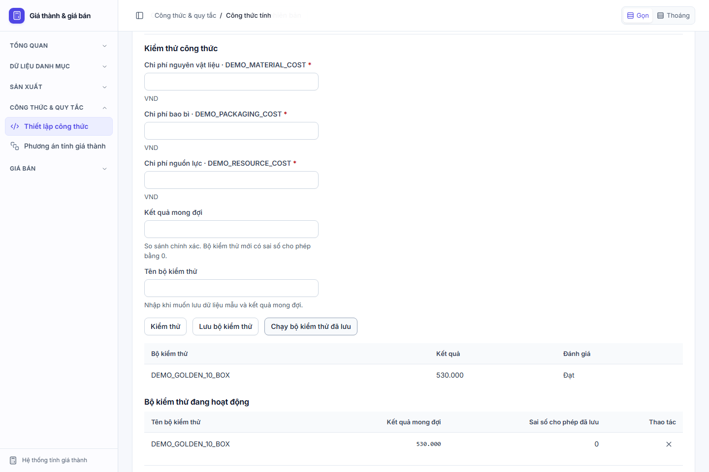

*Hình 29. Phân biệt Kiểm thử, Lưu bộ kiểm thử và Chạy bộ kiểm thử đã lưu.*

### 11.4. Kích hoạt phiên bản công thức

Kiểm tra ngày đầu, công thức hoạt động, phụ thuộc hiệu lực phù hợp và ít nhất một bộ kiểm thử đang dùng. Chọn **Kích hoạt phiên bản → Xác nhận kích hoạt**. Hệ thống kiểm tra lại biểu thức và chạy các bộ kiểm thử hoạt động; cần tất cả đạt. Nếu lỗi, bản vẫn chưa được kích hoạt; sửa nguyên nhân rồi thử lại. Có nhãn **Hợp lệ** không thay bước kích hoạt.

### 11.5. Xem lịch sử, sửa và tạo bản mới

**Lịch sử phiên bản** cho mở biểu thức cụ thể. **Chỉnh sửa** thông tin công thức sửa tên/mô tả/hoạt động; **Chỉnh sửa biểu thức** sửa bản còn Nháp. Muốn đổi bản đã chốt, chọn **Tạo phiên bản mới**, sửa biểu thức/ngày/lý do, kiểm tra, kiểm thử và kích hoạt bản mới. Các bộ kiểm thử chung cần được rà lại cho quy tắc mới; không tự nhân đôi theo phiên bản.

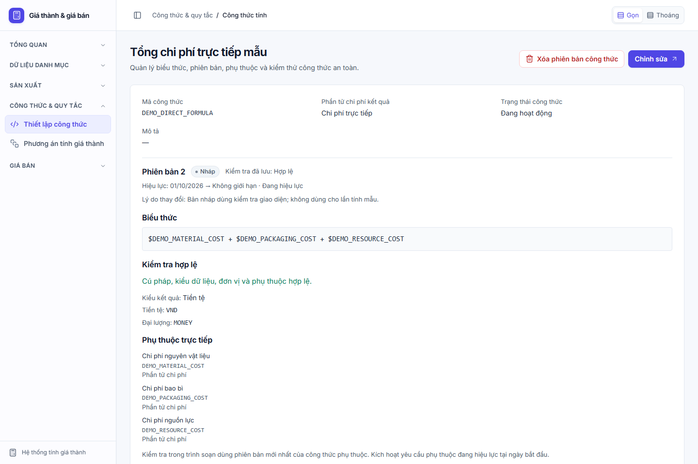

*Hình 30. Nháp nhưng kiểm tra hợp lệ vẫn khác một phiên bản Đang hiệu lực.*

Chỉ xóa phiên bản còn sửa được, chưa bị tham chiếu; công thức cha còn phiên bản, bộ kiểm thử hoặc công thức/phương án tham chiếu sẽ bị chặn. Khi cần giải thích kết quả cũ, mở **Run cũ**, không kiểm thử lại biểu thức rồi coi đó là lịch sử: công thức phụ thuộc hoặc nguồn hiện tại có thể đã đổi.

## 12. Phương án tính giá thành và thành phần

### 12.1. Tạo phương án

**Công thức & Quy tắc → Phương án tính giá thành.** Cần các phần tử chi phí, công thức và nguồn sẽ dùng.

1. Chọn **+ Thêm phương án**. Nhập mã, tên, **Mã mục đích**, **Mã phạm vi áp dụng** theo quy ước, ví dụ `STANDARD_COST`, `SKU`. Những mã này không tự gắn phương án với SKU.
2. Điền mô tả, hoạt động và ngày/lý do của phiên bản đầu rồi **Lưu phương án tính giá thành**.
3. Mở phiên bản Nháp. Phương án không có ô gắn trực tiếp BOM/bao bì/quy trình; các nguồn được chọn theo sản phẩm/SKU/ngày của Run và cấu hình dòng.

### 12.2. Thêm, sửa, xóa dòng thành phần

1. Bấm **+ Thêm thành phần**. Nhập **Mã dòng**, **Tên hiển thị**, **Vai trò của dòng**, thứ tự và **Phần tử chi phí** phù hợp.
2. Chọn **Nguồn dữ liệu**. Ô nguồn thay đổi theo lựa chọn; nhập/chọn đúng nguồn trong bảng dưới.
3. Chọn phạm vi chi phí, nơi hiển thị, số chữ số sau dấu phẩy và các giới hạn nhập nếu cần; **Lưu thành phần**.
4. Lặp lại đủ đầu vào, dòng tính và dòng tổng. Dùng sửa/xóa trên dòng khi phiên bản còn Nháp; xác nhận xóa đúng dòng. Thứ tự hiển thị duy nhất, không tự là thứ tự tính.

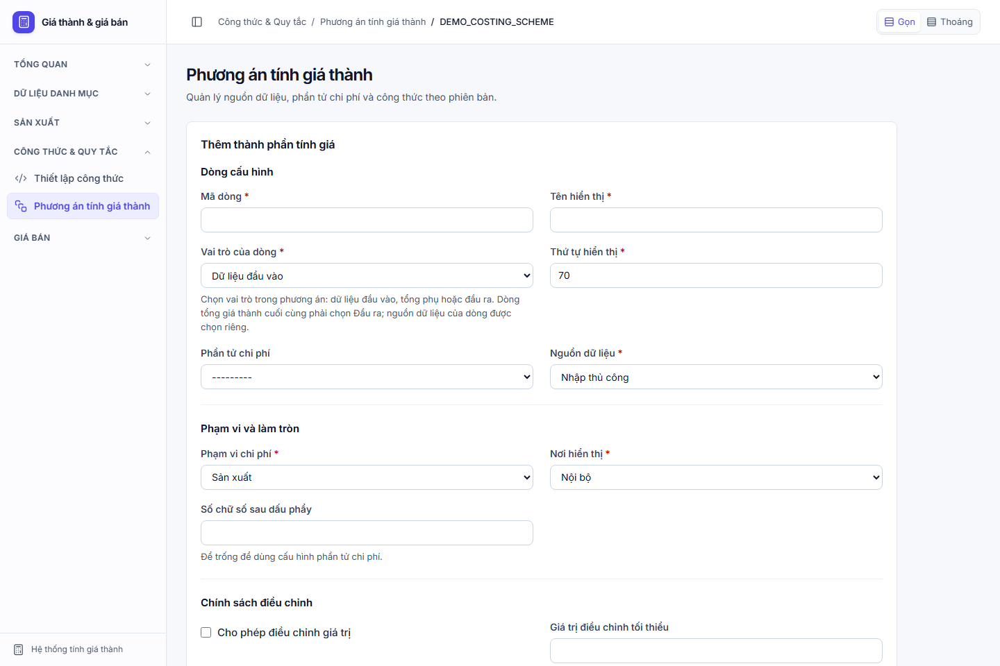

*Hình 31. Vai trò của dòng và Nguồn dữ liệu là hai trường độc lập, cần chọn cả hai.*

| Nguồn | Ô cần thiết | Hành vi |
|---|---|---|
| **Hệ thống** | Mã nguồn tính tự động | Lấy dữ liệu tại ngày Run |
| **Nhập thủ công** | Phần tử, kiểu/giới hạn phù hợp | Sinh ô bắt buộc nhập trên form chạy |
| **Công thức** | Phiên bản công thức đã kích hoạt | Tính từ các đầu vào của phương án |
| **Tra cứu / Nguồn bên ngoài** | Có trường cấu hình để lưu Nháp | Chưa được kích hoạt/chạy trong bộ tính hiện tại |

Các mã nguồn hệ thống thực thi hiện có:

| Mã nhập chính xác | Dữ liệu được lấy |
|---|---|
| `MATERIAL_COST` | Tổng tiền vật tư theo BOM và giá mua |
| `PACKAGING_COST` | Bao bì chính của SKU; cần cơ sở đóng gói trên Run |
| `RESOURCE_COST` | Thời gian công đoạn và đơn giá nguồn lực |
| `RUN_QUANTITY` | Sản lượng Run quy về đơn vị của phần tử |
| `ALLOCATION:<mã quy tắc>` | Phân bổ theo Công suất bình thường với đủ số liệu kỳ |

Dòng phải gán Phần tử chi phí nếu cần cung cấp biến cho công thức. Không có nguồn tự động riêng cho mọi tên như nhân công/vận chuyển. Nếu nhân công đã lấy từ nguồn lực thì không cộng lại khoản nhập tay của cùng công việc. Một công thức dùng biến Nhập thủ công vẫn cần người chạy nhập biến; nó không tự đi tìm số.

### 12.3. Kiểm tra cấu hình và kích hoạt

1. Chọn **Kiểm tra cấu hình**, đọc lỗi/lưu ý, bảng phụ thuộc và thứ tự tính.
2. Mỗi biến cần có đúng một nguồn cung cấp; không thiếu biến, trùng nguồn hoặc vòng phụ thuộc. Phiên bản công thức và các phụ thuộc phải phù hợp kỳ áp dụng.
3. Bảo đảm **đúng một dòng tổng** có **Vai trò của dòng = Đầu ra**, phần tử **Tiền tệ**, không đơn vị, phạm vi **Sản xuất**. Nguồn thường là Công thức. Đây là cấu hình rất dễ bỏ sót.
4. Sau khi xử lý lỗi, chọn **Kích hoạt phiên bản → Xác nhận kích hoạt**, kiểm tra **Đang hiệu lực**.

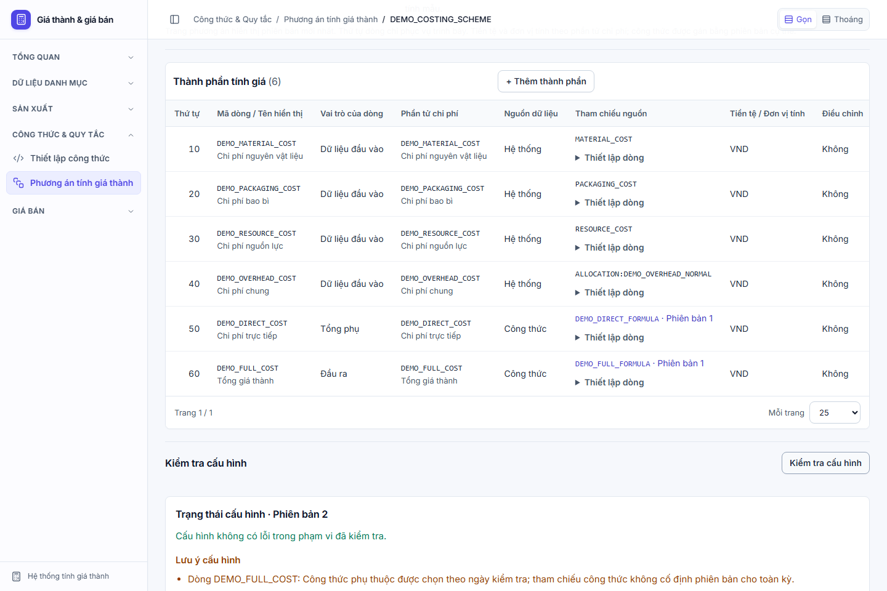

*Hình 32. Đọc cả lỗi và thứ tự phụ thuộc; kiểm tra cấu hình đạt chưa bảo đảm mọi nguồn giá mua/BOM đã sẵn sàng cho Run.*

### 12.4. Lịch sử, sao chép và xóa

Mở **Lịch sử phiên bản** để chọn bản cụ thể. **Tạo phiên bản mới từ phiên bản N** sao chép toàn bộ dòng và giữ tham chiếu phiên bản công thức; sau đó sửa ngày/lý do/dòng ở Nháp, kiểm tra và kích hoạt lại. Bản đã chốt không sửa/xóa dòng. Xóa phiên bản Nháp đủ điều kiện xóa cùng các dòng sở hữu, giữ công thức/phần tử; hồ sơ còn phiên bản không xóa được. Bản có Run sử dụng phải giữ lịch sử.

## 13. Lần tính giá thành và diễn giải

### 13.1. Tạo và chạy lần tính

**Tổng quan → Lần tính giá thành → + Chạy tính giá.** Trước khi chạy, cần phương án hiệu lực; BOM/bao bì/nguồn khác mà phương án dùng cũng phải hiệu lực đúng ngày, không thiếu hoặc mơ hồ.

1. Chọn **Sản phẩm**, **Ngày tính giá**, nhập **Sản lượng cần tính > 0** và **Đơn vị sản lượng**.
2. Chọn **Tiền tệ tính giá**, loại lần tính Chuẩn/Kế hoạch, SKU nếu dùng bao bì hoặc quy cách cụ thể; chọn **Phương án tính giá thành**. Khi đổi sản phẩm/ngày/phương án, kiểm tra lại các lựa chọn phụ thuộc.
3. Nếu có nguồn Bao bì, nhập **Số thành phẩm theo định mức bao bì** và **Đơn vị thành phẩm đóng gói**. Đây là lượng đầu ra tương ứng bảng bao bì, không phải số loại vật tư.
4. Nhập đủ **Dữ liệu đầu vào thủ công**. Kiểm tra tên/mã, đơn vị và giới hạn từng ô; ghi chú căn cứ nếu cần.
5. Bấm **Chạy tính giá**, chờ kết quả. Thành công hiển thị **Đã khóa**; lỗi hiển thị **Thất bại** cùng thông báo/mã tham chiếu.

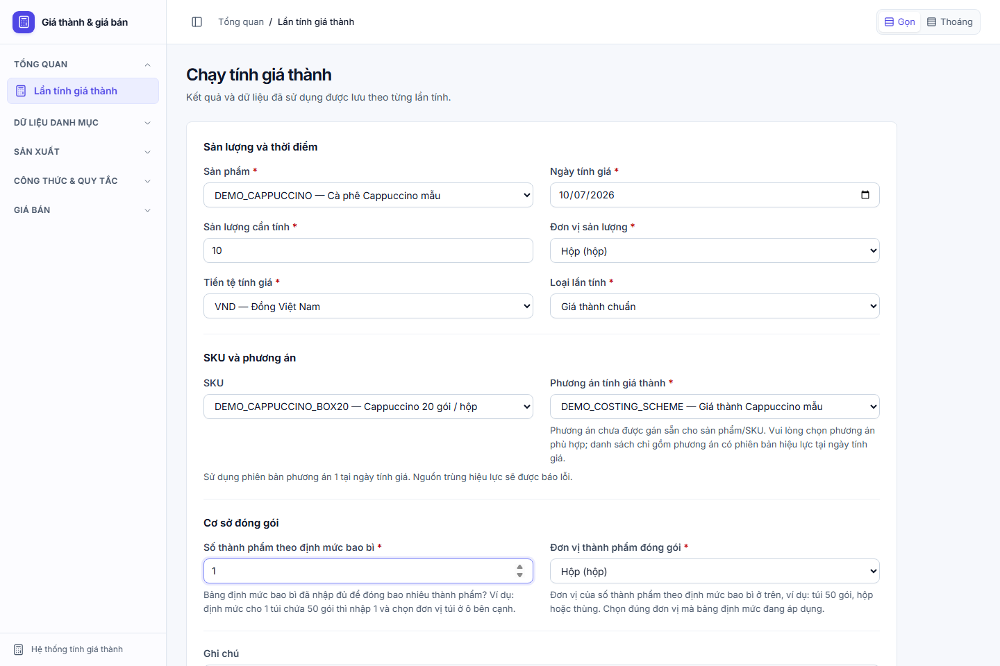

*Hình 33. Chọn ngày, sản lượng và phương án trước; kiểm tra cơ sở bao bì và các ô đầu vào xuất hiện theo phương án.*

### 13.2. Đọc kết quả

Kiểm tra đúng sản phẩm/SKU, ngày, số lượng và đơn vị. **Tổng giá thành** là toàn bộ lượng cần tính; **Giá thành một đơn vị** = tổng / số lượng Run. Run 10 hộp tổng 583.000 VND cho giá một hộp 58.300 VND. Bảng dòng có thể gồm đầu vào, tổng phụ và đầu ra; **không cộng lại mọi dòng**, vì tổng phụ đã chứa các khoản trước.

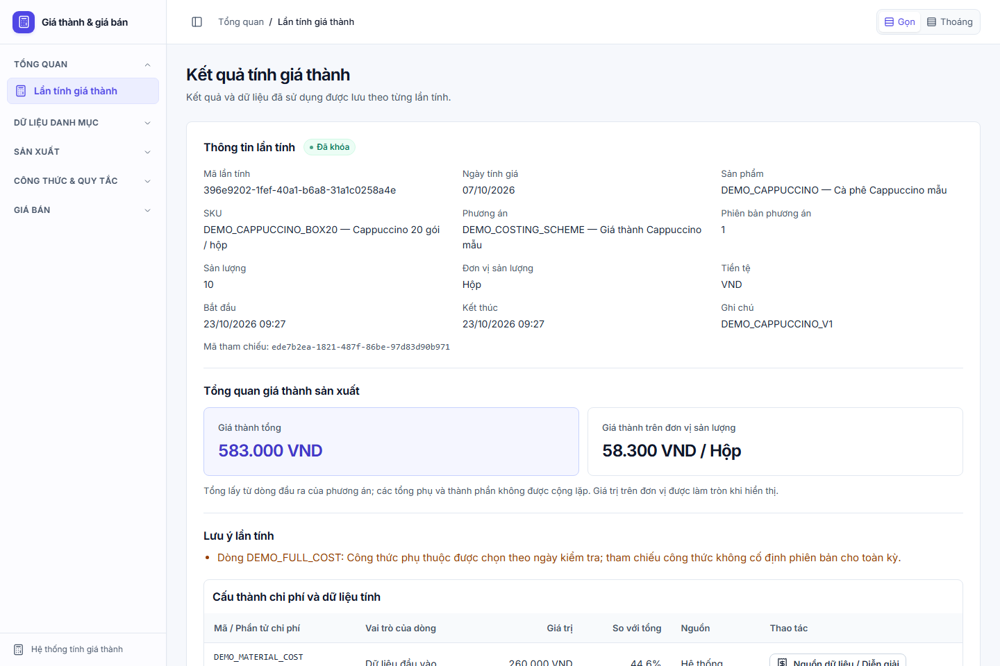

*Hình 34. Kết quả Đã khóa và bảng cấu thành; ảnh minh họa bộ Cappuccino, không phải đáp án bài cà phê 3 trong 1.*

### 13.3. Xem nguồn và diễn giải từng dòng

1. Tại dòng cần kiểm tra, chọn **Nguồn dữ liệu / Diễn giải**.
2. Trong khung bên, đọc khoản đang xem, số tiền và nguồn. Nguyên liệu/bao bì có vật tư, lượng tính tiền, đơn giá, nhà cung cấp và quy đổi; nguồn lực có công đoạn/thời gian/đơn giá; công thức có đầu vào và bước tính.
3. Mở các nhóm thu gọn nếu cần chi tiết. Đối chiếu lượng/đơn vị/ngày trước khi kết luận phép cộng sai. Đóng bằng nút đóng hoặc Escape; thao tác này chỉ đọc dữ liệu đã lưu.

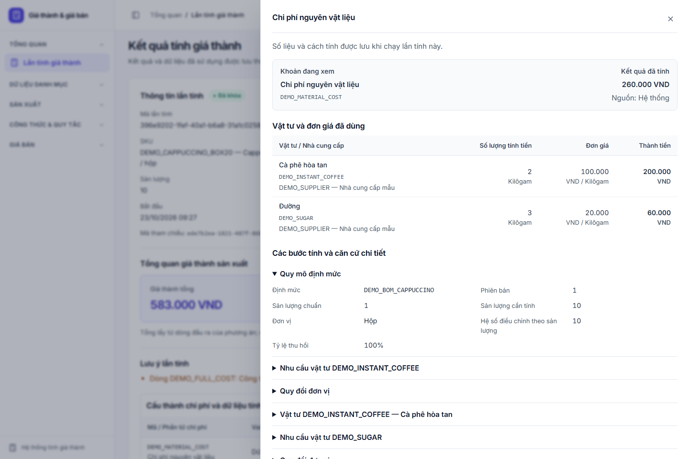

*Hình 35. Tra từng vật tư và mức giá đã dùng, không phải giá mới nhất trong danh mục.*

### 13.4. Dữ liệu và phiên bản đã sử dụng

Chọn **Xem dữ liệu và phiên bản đã sử dụng**. Mở các nhóm định mức, bao bì, quy trình, giá mua, công thức… để xem căn cứ của Run. Dữ liệu này được lưu tại thời điểm chạy; sửa nguồn sau đó không cập nhật Run cũ.

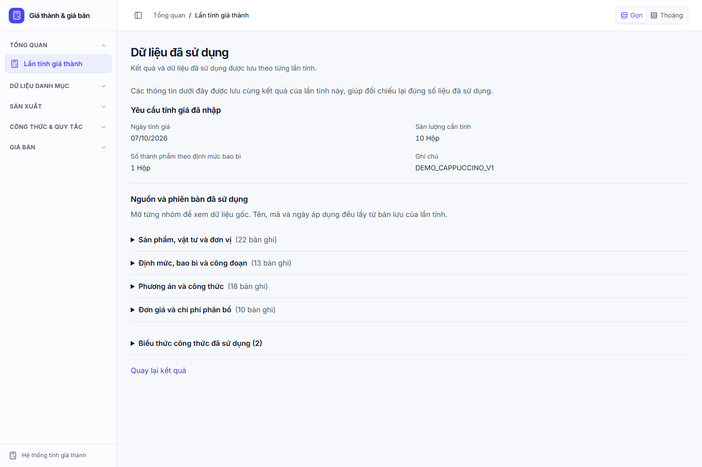

*Hình 36. Lưu lại số lần tính và mã tham chiếu khi đối chiếu hoặc cần hỗ trợ.*

### 13.5. Tạo lần tính mới từ kết quả cũ

Mở Run → **Tạo lần tính mới**. Form **Chạy lại bằng dữ liệu hiện tại** điền lại yêu cầu và các đầu vào thủ công còn khớp mã dòng. Xem lại ngày, sản lượng, đơn vị, SKU, phương án và cơ sở bao bì; bấm chạy. Tạo **Run mới**, giữ Run gốc. Nguồn được chọn lại theo ngày từ dữ liệu hiện có, không phải phát lại bản chụp cũ.

Danh sách Run hỗ trợ tìm/lọc sản phẩm, trạng thái và các điều kiện trên màn hình; mở chi tiết để tra số liệu. Không có sửa/xóa một Run đã lưu hoặc các dòng kết quả, kể cả Run thất bại. Muốn đổi số, sửa đúng nguồn/cấu hình và tạo Run mới. Giá thành đã khóa được dùng ở mục 15; bán theo đơn vị nào phải chọn đúng nguồn có đơn vị đó.

## 14. Kênh bán, phí, thuế và tỷ giá

### 14.1. Kênh bán

**Giá bán → Kênh bán.** Thêm mã, tên, loại kênh, mã nền tảng/thị trường/loại người bán nếu có; chọn tiền tệ mặc định, giữ hoạt động rồi **Lưu kênh bán**. Ví dụ Bán trực tiếp, Shopee. Mã nền tảng chỉ nhận diện kênh; phần mềm không tự tải biểu phí.

Tìm mã/tên/nền tảng/thị trường, lọc loại/tiền tệ/trạng thái. Mở chi tiết để sửa hoặc ngừng hoạt động. Kênh còn quy tắc phí hoặc kịch bản tham chiếu không xóa được. Sau tạo kênh, khai báo phí/thuế thực tế cần áp dụng.

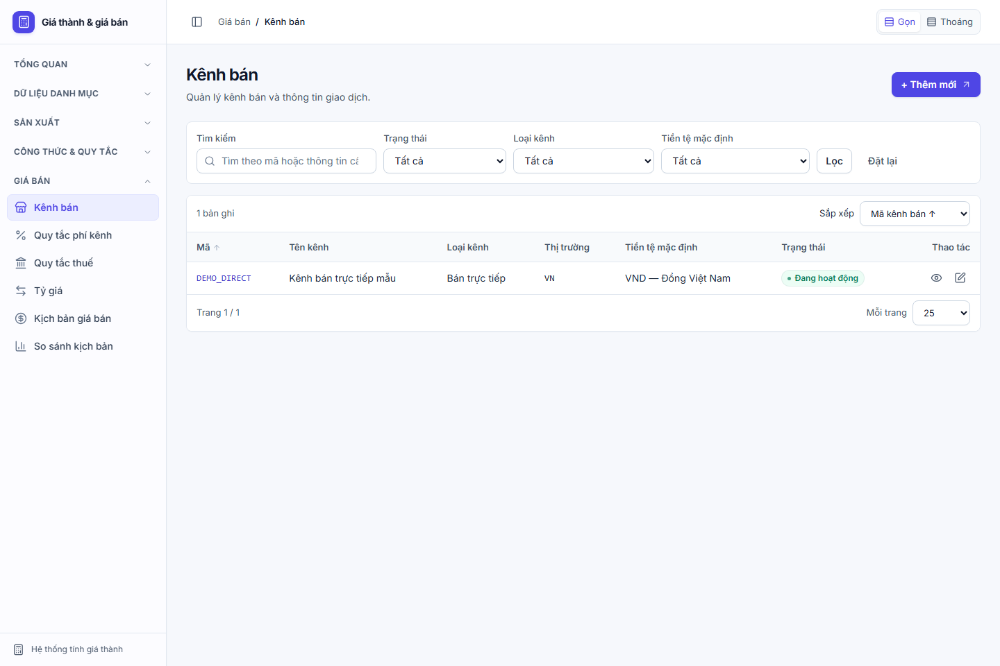

*Hình 37. Một sản phẩm có thể lập kịch bản riêng cho nhiều kênh.*

### 14.2. Quy tắc phí kênh

1. Vào **Giá bán → Quy tắc phí kênh → + Thêm mới**. Chọn kênh, nhập **Loại phí** theo quy ước, ví dụ `COMMISSION`, và **Cơ sở tính phí**.
2. Trong phạm vi tính hiện tại, dùng cơ sở `LIST_PRICE` – giá khách trả đã gồm thuế. Nhập tỷ lệ `%`, tiền cố định hoặc cả hai. Phí 5% nhập `5`; phí 1.000/đơn vị bán nhập `1000` và tiền tệ.
3. Nhập sàn/trần nếu có. Có tiền cố định/sàn/trần thì cần tiền tệ; trần không nhỏ hơn sàn. Tỷ lệ được hoàn dùng `0`, phí được đánh dấu **Giá đã bao gồm thuế** theo khả năng tính hiện có.
4. Chọn nhóm/SKU nếu giới hạn phạm vi, mức ưu tiên và ngày. Để trống nhóm/SKU là chung cho kênh; SKU phải phù hợp nhóm nếu cùng chọn.
5. Lưu Nháp để kiểm tra; khi đã xác nhận chính sách, chọn **Đang hiệu lực** trên form và lưu. Đây là cách đưa phí vào dùng, không có nút kích hoạt giống BOM.

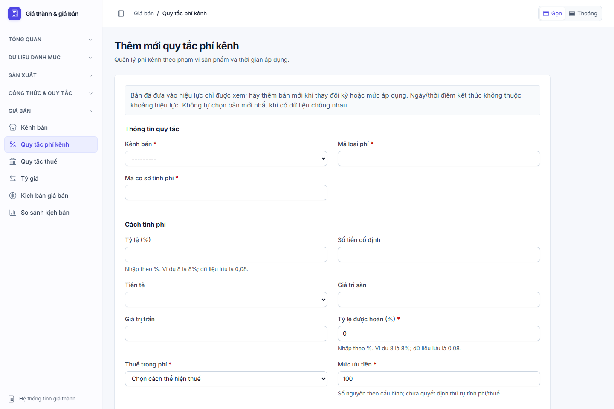

*Hình 38. Phí cố định được hiểu trên một đơn vị đầu ra của nguồn giá thành, không tự là phí cho cả đơn hàng nhiều sản phẩm.*

**Cách chọn phí:** các loại phí khác nhau được cộng; cùng loại chọn SKU → nhóm → chung, rồi ưu tiên lớn nhất. Hòa cả phạm vi/ưu tiên sẽ báo mơ hồ. Sàn/trần áp riêng từng phí đã chọn. Không đổi tên loại phí để tạo cách tính mới. Cơ sở khác, tỷ lệ hoàn khác 0 hoặc thuế riêng trên phí chưa được bộ tính hỗ trợ.

Tìm/lọc kênh, loại, cơ sở, nhóm/SKU, tiền tệ, hiệu lực/trạng thái. Nháp được sửa/xóa đủ điều kiện. Bản đã chốt chỉ xem; đổi kỳ qua mục 14.5, không sửa giá trị lịch sử.

### 14.3. Quy tắc thuế bán hàng

1. Vào **Giá bán → Quy tắc thuế → + Thêm mới**. Nhập **Mã khu vực**, loại thuế, cơ sở và phạm vi nhóm thuế/loại người bán/loại giao dịch nếu áp dụng.
2. Nhập thuế suất `%` hoặc tiền cố định và tiền tệ nếu cần. Chọn cách giá đã/chưa gồm thuế, mức ưu tiên, ngày và tham chiếu.
3. Với khả năng hiện tại, dùng cơ sở `SELLING_PRICE` hoặc `LIST_PRICE`; tỷ lệ được khấu trừ `0` cho phép tính giá bán. Lưu Nháp để kiểm tra, chuyển Đang hiệu lực và lưu khi đã xác nhận.
4. Tìm/lọc khu vực, loại thuế, phạm vi, tiền tệ, trạng thái và hiệu lực. Nháp sửa/xóa theo điều kiện; đã chốt chỉ xem/đóng kỳ tương lai nếu đủ điều kiện.

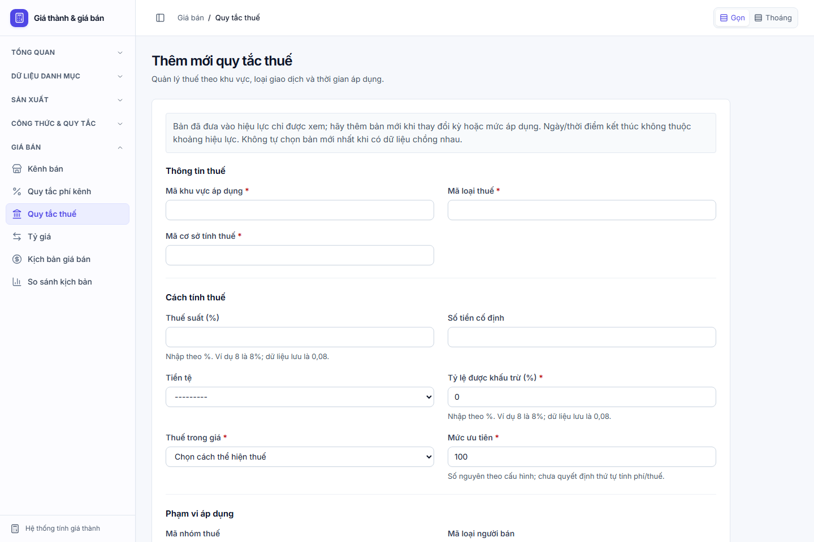

*Hình 39. Thuế bán hàng tách khỏi thuế mua nguyên liệu; mức minh họa không phải mức thuế pháp lý được khẳng định.*

**Cách hiểu:** giá khách trả 110 đã gồm thuế 10% thì giá trước thuế 100 và thuế 10, không lấy 110 × 10%. Nhiều loại thuế được tính độc lập trên cùng giá trước thuế, không thuế chồng thuế. Chưa hỗ trợ trộn hai cách đã/chưa gồm thuế trong cùng kịch bản. Nếu thực sự không áp dụng thuế, chọn rõ **Không áp dụng thuế** ở kịch bản; thiếu quy tắc không tự được coi thuế bằng 0.

### 14.4. Tỷ giá

**Giá bán → Tỷ giá.** Cần khi giá vốn, phí tiền cố định hoặc thuế khác tiền tệ bán.

1. Thêm mới; chọn tiền nguồn, tiền đích, nhập tỷ giá dương, mã loại tỷ giá và nguồn dữ liệu.
2. Nhập thời điểm bắt đầu/kết thúc với giờ rõ ràng; lưu Nháp hoặc chọn Đang hiệu lực để dùng khi đã xác nhận.
3. Tìm/lọc cặp tiền, loại, trạng thái, thời điểm. Nháp được sửa/xóa đủ điều kiện; bản đã chốt giữ lịch sử và đóng kỳ tương lai nếu cần.

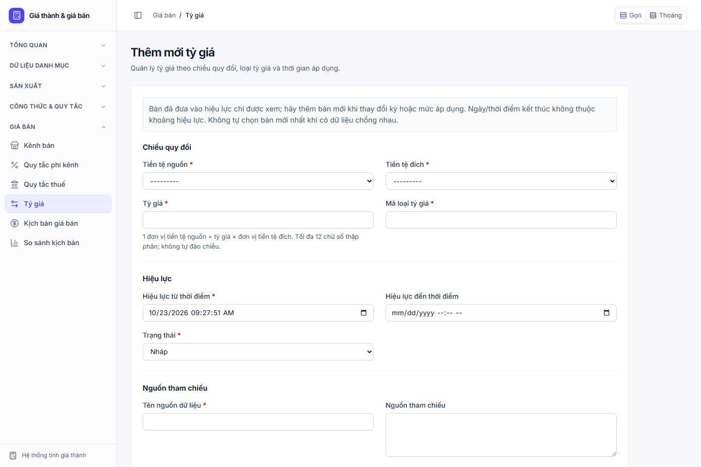

*Hình 40. Một tỷ giá có chiều và thời điểm; không tự suy ra chiều ngược.*

Bộ tính giá bán tra tại **00:00 ngày định giá, giờ Việt Nam**. Tỷ giá bắt đầu 09:00 ngày đó chưa áp dụng ở mốc 00:00. Chỉ dùng đúng chiều/loại và một nguồn duy nhất, không tự đảo hoặc ghép nhiều bước. Nếu tất cả cùng VND thì không cần tạo tỷ giá chỉ để điền cho đủ. Tỷ giá này không mở chức năng đổi ngoại tệ giá mua ở Costing.

### 14.5. Kết thúc hiệu lực và thay chính sách

Phí/thuế/tỷ giá dùng khoảng **từ lúc bắt đầu đến trước mốc kết thúc**. Bản cũ hết 01/11 và bản mới bắt đầu 01/11 thì ngày 01/11 chỉ dùng bản mới. Quy ước này khác nguồn giá thành vốn có tính ngày cuối.

1. Mở chi tiết bản **Đang hiệu lực**, chưa có ngày kết thúc. Chọn **Kết thúc hiệu lực** nếu nút xuất hiện.
2. Nhập mốc **tương lai**, sau ngày/thời điểm bắt đầu. Xác nhận theo form; thao tác giữ tỷ lệ/số tiền/phạm vi cũ.
3. Tạo quy tắc mới từ đúng mốc đó, kiểm tra và đưa vào hiệu lực. Đóng bản cũ không tự tạo bản mới. Không dùng thao tác này để sửa kỳ đã qua hoặc thay lại mốc đã đặt.

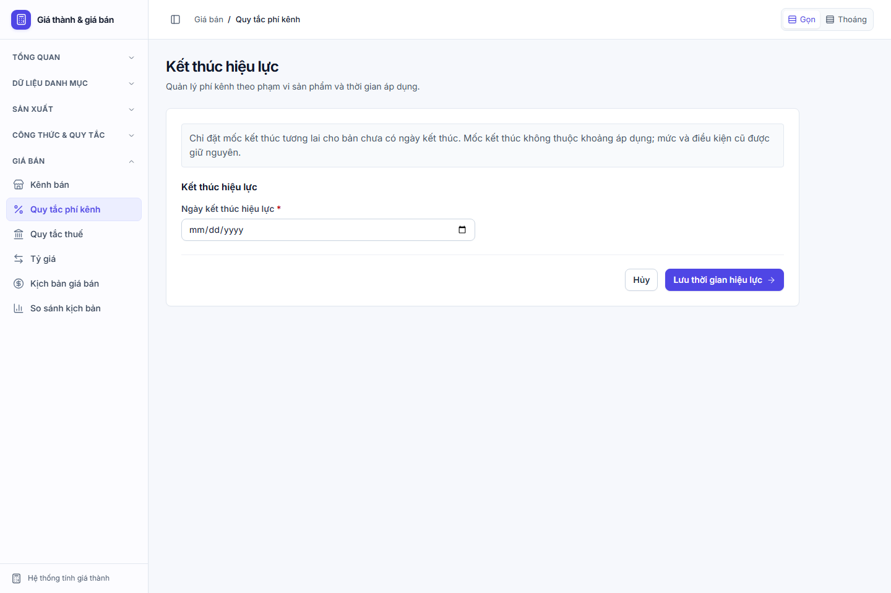

*Hình 41. Kết thúc hiệu lực là thao tác riêng; không sửa tỷ lệ của bản đã chốt.*

## 15. Kịch bản giá bán và so sánh

### 15.1. Tạo kịch bản Nháp

**Giá bán → Kịch bản giá bán → + Thêm kịch bản.** Cần Run Đã khóa đúng sản phẩm/SKU và **đúng đơn vị bán muốn định giá**; kênh/tiền tệ hoạt động, nguồn phí/thuế/tỷ giá cần thiết đã sẵn sàng.

1. Nhập mã, tên; chọn **Sản phẩm → SKU → Nguồn giá thành** theo thứ tự. Nhãn nguồn có ngày, giá vốn/đơn vị, phương án và số Run. Đổi sản phẩm/SKU thì chọn lại nguồn.
2. Chọn kênh, **Ngày định giá** và tiền tệ. Kiểm tra lại mã khu vực được gợi ý từ kênh.
3. Chọn áp dụng thuế theo quy tắc hoặc không áp dụng. Nếu áp dụng, nhập khu vực và các mã phạm vi cần thiết; nhập mã loại tỷ giá khi cần đổi tiền.
4. Chọn phương pháp, nhập **đúng một mục tiêu** trong bảng dưới. Giá bán tối thiểu tùy chọn là mức sàn; không phải ô nhập một giá bán tùy ý để ép xuống.
5. Nhập hiệu lực áp dụng của kịch bản nếu cần; ngày này không thay Ngày định giá dùng tra nguồn. Bấm **Lưu Nháp**; lúc này chưa có kết quả bán.

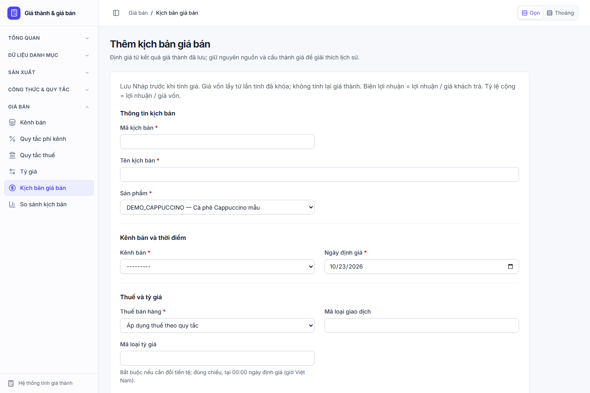

*Hình 42. Nguồn giá thành phải khớp sản phẩm/SKU và đơn vị hàng muốn bán.*

| Mục tiêu | Cách hiểu | Ví dụ nhập |
|---|---|---|
| **Biên lợi nhuận mục tiêu** | Lợi nhuận sau phí, thuế / **giá khách trả** | `20` cho 20%, hai mục tiêu khác để trống |
| **Tỷ lệ cộng trên giá vốn** | Lợi nhuận sau phí, thuế / giá vốn | `20` cho 20%, không đồng nghĩa giá vốn × 1,2 khi còn phí/thuế |
| **Lợi nhuận trên một đơn vị** | Số tiền lãi mong muốn cho một đơn vị đầu ra | Ví dụ `2700` VND/túi |

Nếu nguồn Run tính 50 gói, giá vốn đơn vị vẫn là **mỗi gói**, không phải túi. Muốn bán túi 50 gói thì chọn Run có đơn vị đầu ra Túi. Phí cố định cũng theo đơn vị đầu ra này.

### 15.2. Tính và đọc kết quả

1. Mở chi tiết Nháp → **Tính giá bán**.
2. Thành công chuyển **Đã tính**; kiểm tra **Giá khách trả**, giá niêm yết, tổng phí, thuế, giá vốn, doanh thu sau phí/thuế và lợi nhuận. Số tiền được hiển thị gọn nhưng giá trị lưu có độ chính xác đầy đủ.
3. Mở **Nguồn và diễn giải đã lưu** để xem quy tắc phí được chọn/bị loại, cách áp sàn/trần, thuế và tỷ giá. Đối chiếu: **Giá khách trả − Phí − Thuế − Giá vốn = Lợi nhuận**.
4. Nếu lỗi, trạng thái vẫn Nháp; đọc thông báo/mã tham chiếu, sửa nguồn hoặc form rồi tính lại. Không tự đổi loại nguồn/thuế để che lỗi thiếu cấu hình.

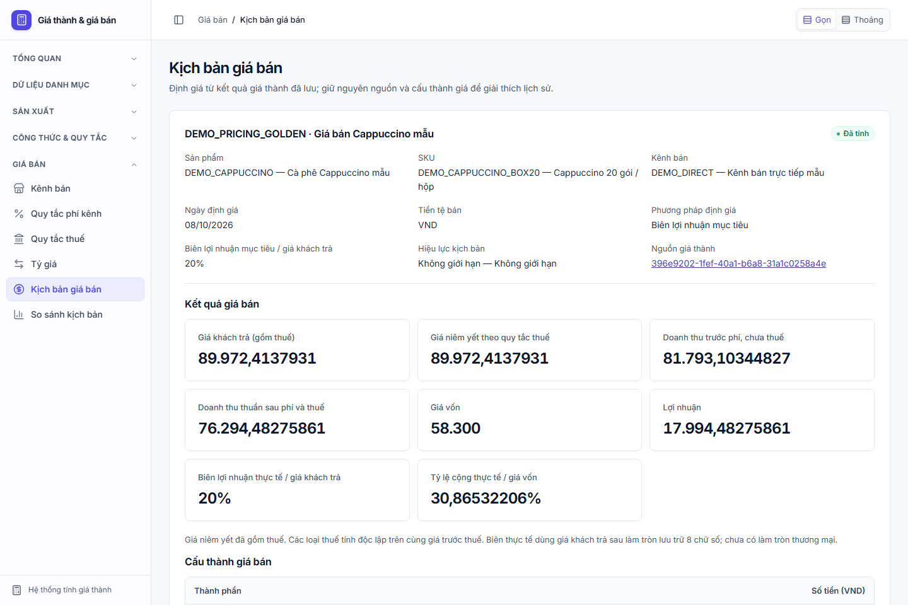

*Hình 43. Kết quả lưu theo nguồn đã dùng, không cập nhật tự động theo biểu phí mới.*

### 15.3. Sửa, nhân bản và xóa kịch bản

Nháp có thể **Chỉnh sửa** rồi lưu/tính lại; Nháp chưa có kết quả thành công được xóa khi đủ điều kiện. Bản **Đã tính** chỉ xem, không xóa hoặc ghi đè kết quả. Muốn thử mục tiêu/kênh/ngày khác, dùng **Nhân bản thành kịch bản mới**, nhập mã mới, xem lại nguồn và các đầu vào rồi lưu/tính. Gọi tính lại bản Đã tính vẫn trả kết quả đã lưu, không cập nhật theo phí hôm nay.

Danh sách hỗ trợ tìm mã/tên/sản phẩm/SKU; lọc sản phẩm, SKU, kênh, tiền tệ, trạng thái, ngày định giá; sắp xếp và phân trang. Nếu không thấy nguồn giá thành cũ trong lựa chọn mới, kiểm tra bộ lọc/phạm vi và liên hệ người phụ trách: danh sách mặc định giới hạn các nguồn gần nhất.

### 15.4. So sánh kịch bản

1. Vào **Giá bán → So sánh kịch bản**. Chọn sản phẩm, SKU nếu có; lọc kênh/tiền tệ/ngày hoặc tìm mã.
2. Đánh dấu **2–5 kịch bản Đã tính** tương thích: cùng sản phẩm/SKU, cùng cơ sở/đơn vị giá vốn. Có thể chuyển trang mà giữ lựa chọn.
3. Chọn **Kịch bản mốc** hoặc dùng kịch bản đầu tiên, bấm **So sánh kịch bản**.
4. Đọc bảng giá, phí, thuế, lãi và chênh lệch theo mốc. Bỏ chọn hoặc đổi mốc để thử góc nhìn khác. Với khác tiền tệ, không tự trừ/quy đổi chênh lệch.

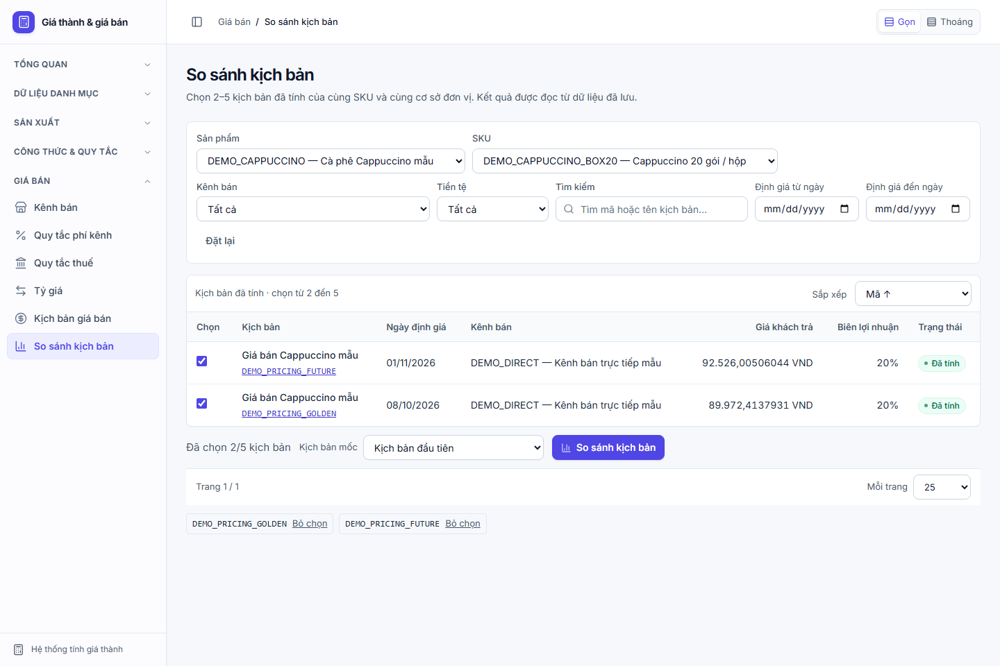

*Hình 44. So sánh chỉ đọc các kết quả đã lưu; không chạy lại Costing hoặc tra phí mới.*

So sánh không có bản ghi riêng để thêm/sửa/xóa, không tự kết luận kênh nào tốt nhất. Cân nhắc cả giá khách có thể chấp nhận, lãi, chi phí chưa đưa vào và thực tế bán hàng.

## 16. Thực hành và xử lý tình huống

### 16.1. Bài cà phê 3 trong 1: từ một gói đến hai kênh bán

Bài dùng **giá gốc của Excel, chưa tăng 40%**, một gói 18 g; một túi chứa 50 gói = 900 g. Ảnh các chương dùng bộ mẫu Cappuccino để minh họa màn hình; không đối chiếu con số trong ảnh với đáp án cà phê 3 trong 1. Từng mã và biểu thức đầy đủ xem [Bài thực hành 15](15_THUC_HANH_CAFE_3IN1_SHOPEE_VA_TRUC_TIEP.md).

| Bước thực hành | Dữ liệu/thao tác cần kiểm tra |
|---|---|
| 1. Đơn vị và quy cách | Gói 18 g và Túi 50 gói cùng nhóm số lượng; quy đổi **1 túi = 50 gói**; SKU lượng tịnh **0,9 kg/túi** |
| 2. Giá mua | Tạo vật tư và giá đúng đơn vị; kích hoạt từng giá |
| 3. BOM | Chuẩn **1 kg**, thu hồi 100%, hao hụt 0%; đường 0,58 kg; bột kem 0,322 kg; cà phê hòa tan 0,087 kg; hương cà phê 0,001 kg; Nestle đỏ 0,01 kg |
| 4. Bao bì | Chuẩn **1 túi**: 50 vỏ gói, 1 túi ngoài, 0,15 carton; gán SKU chính và kích hoạt phiên bản |
| 5. Công thức/phương án | Nguyên liệu/bao bì lấy Hệ thống; các suất máy/xưởng/mực/vận chuyển/nhân công nhập tay theo 1 kg, công thức đổi về sản lượng; kiểm thử và kích hoạt |
| 6. Một gói | Run sản lượng **1 Gói 18 g**; cơ sở bao bì vẫn **1 Túi 50 gói**; kiểm tra lượng thành phẩm ra **0,018 kg** |
| 7. Một túi | Tạo Run mới, đổi thành **1 Túi 50 gói**; giữ các suất 1 kg, không nhân tay với 50; kiểm tra lượng **0,9 kg** |
| 8. Hai kênh | Dùng Run **một túi Đã khóa** cho cả kịch bản trực tiếp và Shopee; tính rồi so sánh |

Giá mẫu: đường 19.200; bột kem 59.500; cà phê 340.000; hương 1.510.000; Nestle đỏ 1.820.000 VND/kg. Vỏ gói 239,2 VND/cái; túi ngoài 1.067,2 VND/cái; carton 19.000 VND/thùng. Tên/đơn giá Nestle đỏ giữ theo dữ liệu đã xác nhận.

| Ô thủ công trên phương án bài thực hành | Số nhập | Ý nghĩa |
|---|---:|---|
| `C3_BASIS_KG` | `1` | Cơ sở một kg thành phẩm |
| `C3_MACHINE_KG` | `908.11965812` | Chi phí máy cho cơ sở 1 kg |
| `C3_FACTORY_KG` | `1199.39393939` | Chi phí nhà xưởng/1 kg |
| `C3_INK_KG` | `303.03030303` | Chi phí mực/1 kg |
| `C3_SHIP_TEST_KG` | `150` | Cước thử mẫu/1 kg |
| `C3_SHIP_HCM_HN_KG` | `1280` | Cước TP.HCM–Hà Nội/1 kg |
| `C3_SHIP_HN_FACTORY_KG` | `180` | Cước Hà Nội–nhà máy/1 kg |
| `C3_LABOR_KG` | `4719.20717319` | Chi phí nhân công/1 kg |

Đây là cách tái hiện bộ Excel, không đồng thời tính lại cùng máy/nhân công qua nguồn lực tự động. Nhập nguyên liệu/bao bì bằng tiền thủ công sẽ làm sai cách nối nguồn của bài.

**Đáp án đối chiếu:** một gói khoảng **1.907,38951933 VND**, một túi khoảng **95.369,47596636 VND**. Nguyên liệu một gói 1.432,53; bao bì 317,544; máy/xưởng/mực 43,38979021; vận chuyển 28,98; nhân công 84,94572912 VND. Không cộng thêm các dòng suất 1 kg vào tổng lần nữa.

**Giá bán minh họa:** cùng giá vốn một túi, biên lợi nhuận 20% trên giá khách trả, thuế giả định 10% đã gồm trong giá. Trực tiếp không phí; Shopee dùng ba phí khác loại 10%, 2% và 1.000 VND/túi. Kết quả mẫu khoảng **134.495,41 VND/túi trực tiếp**, **163.590,16 VND/túi Shopee**. Đây là giả định đào tạo, không phải biểu phí/thuế hiện hành. Thay bằng số do kế toán/kinh doanh xác nhận; phí mỗi đơn nhiều túi phải được xác định cách phân bổ, không mặc định phí mỗi túi.

### 16.2. Khi dữ liệu thay đổi

| Tình huống | Cách làm phù hợp |
|---|---|
| Giá nguyên liệu/nguồn lực đổi kỳ mới | Lập bản giá mới, kiểm tra ranh giới kỳ và nguồn duy nhất; giữ giá cũ |
| Thay định mức, bao bì, quy trình | Sao chép phiên bản nguồn sang Nháp, chỉnh và kiểm tra; kích hoạt ở module có nút hỗ trợ |
| Đổi biểu thức/phương án | Tạo phiên bản mới, kiểm thử/kiểm tra cấu hình, kích hoạt |
| Muốn tính lại giá thành | Tạo Run mới, kiểm tra lại nguồn hiện tại theo ngày |
| Phí/thuế/tỷ giá đổi | Đóng kỳ tương lai đủ điều kiện, thêm quy tắc mới không mơ hồ |
| Muốn thử biên lợi nhuận/kênh khác | Nhân bản kịch bản Đã tính thành Nháp mới rồi tính |
| Dọn dữ liệu nhập nhầm | Xóa khi không bị ràng buộc; dữ liệu đã dùng ưu tiên ngừng hoạt động/giữ lịch sử |

### 16.3. Lỗi thường gặp và nơi cần sửa

| Biểu hiện | Kiểm tra và xử lý |
|---|---|
| Không lưu được form | Đọc lỗi đầu form/dưới ô; kiểm tra trường bắt buộc, mã trùng, định dạng số, đơn vị và ngày. Không gõ dấu phân cách hàng nghìn trong ô số |
| Dropdown không có dữ liệu | Kiểm tra danh mục đã tạo, đang hoạt động, đúng nhóm/sản phẩm/trung tâm; xóa bộ lọc trước khi tạo trùng |
| Ngày hợp lệ nhưng nguồn Nháp | Thực hiện kích hoạt tại BOM/bao bì/giá mua/công thức/phương án; nguồn chưa có action cần người phụ trách chuẩn bị |
| Không tìm thấy BOM/bao bì/giá | Đúng sản phẩm/SKU, trạng thái, kỳ ngày, liên kết chính, lượng tối thiểu và tiền tệ; không chỉ nhìn nhãn hiệu lực theo hôm nay |
| Nhiều nguồn phù hợp | Kiểm tra bản chồng kỳ/giá trùng/quy đổi hai chiều; không tự mặc định giá rẻ nhất hay mới nhất |
| Thiếu quy đổi | Kiểm tra đơn vị nguồn–đích, đại lượng, vật tư riêng và ngày; thêm cặp trực tiếp đúng quy cách |
| Công thức báo lỗi kiểu/đại lượng | Kiểm tra loại phần tử, tiền tệ/đơn vị; không cộng tiền với số thường, không tạo phép chia có đại lượng mới |
| Kiểm thử đạt nhưng Run thất bại | Kiểm tra đúng một dòng **Đầu ra Tiền/Sản xuất**, nguồn thực sự có dữ liệu hiệu lực, đủ ô thủ công và quy đổi |
| Giá một gói/một túi sai tỷ lệ | Lượng tịnh SKU, quy đổi 50 gói/túi, lượng chuẩn BOM, đơn vị Run và cơ sở bao bì |
| Phân bổ không chạy | Chỉ Công suất bình thường hiện thực thi; cần quy tắc hiệu lực và số liệu kỳ/công suất/đơn vị đầy đủ |
| Giá bán thiếu phí/thuế/tỷ giá | Kiểm tra phạm vi, ưu tiên, ngày định giá, khu vực, kiểu thuế, cơ sở phí và FX đúng chiều/loại tại 00:00 |
| Không sửa/xóa được | Bản đã chốt hoặc còn tham chiếu; đọc ràng buộc, tạo bản mới hoặc ngừng dùng, giữ lịch sử |

### 16.4. Checklist bàn giao kết quả

- [ ] Đúng sản phẩm/SKU, sản lượng và đơn vị, không nhầm gói với túi.
- [ ] BOM, bao bì, giá mua và nguồn phương án dùng đã hiệu lực đúng ngày, không thiếu/trùng.
- [ ] Các khoản thủ công có căn cứ, đúng cơ sở và không tính trùng nguồn tự động.
- [ ] Công thức có bộ kiểm thử đạt; phương án có đúng một dòng Đầu ra.
- [ ] Run thành công **Đã khóa**; đã mở diễn giải đối chiếu một vài dòng quan trọng.
- [ ] Kịch bản dùng đúng Run/đơn vị; phí/thuế/tỷ giá phù hợp thực tế; trạng thái **Đã tính**.
- [ ] Ghi số Run/kịch bản và mã tham chiếu khi gửi người phụ trách; không chỉ chụp mỗi con số tổng.

**Tra cứu tiếp:** [Từng trường nhập](12_FIELD_REFERENCE.md), [Thứ tự khởi tạo](03_THU_TU_KHOI_TAO_DU_LIEU.md), [Lỗi chi tiết](10_LOI_THUONG_GAP_VA_CACH_XU_LY.md), [Giới hạn hiện tại](GAP_REGISTER.md), [Bài thực hành đầy đủ](15_THUC_HANH_CAFE_3IN1_SHOPEE_VA_TRUC_TIEP.md). Các chương cũ mô tả “chưa có Xóa” hoặc “BOM/bao bì/giá mua chưa kích hoạt được” được thay thế trong phạm vi thao tác nêu ở bản 23/10/2026 này.